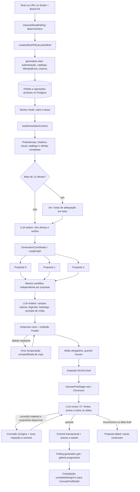

# Mapa do pipeline de textos do PostSpark

Investigação de 15/10/2026. Estado: **CAUSA_CONFIRMADA para as perdas de handoff reproduzidas; qualidade geral do produto não homologada por esta investigação**. Nenhuma correção implementada.

## 1. Recorte e estado observado

- Raiz: `/home/many/Documentos/Projetos linux/PostSpark 3`; branch `main`; HEAD `40c08323d9f4f3d0fd097a04844f81f9dc9d4b61`.
- Checkout preexistente com 208 entradas no status: 94 arquivos versionados alterados/removidos e 114 não rastreados; sem alterações staged. Inclui os módulos atuais de geração e o documento-mestre. As conclusões descrevem **o conteúdo local**, não apenas o commit e não um deploy confirmado.
- Fonte primária consultada: `DOCUMENTO_MESTRE.md`, especialmente §3.2, §13.86, §13.115–119 e §13.121–125. A seção §4 ainda contém descrições históricas de `post.generate`; seu fluxo não deve ser projetado sobre a implementação atual.
- Skills: `investigador`, `compass-context` e leitura das orientações Supabase para a fronteira de persistência. Compass não está exposto entre as ferramentas desta sessão; foi necessário usar `rg` e leitura dirigida. Nenhuma consulta remota ao Supabase ou chamada nova de IA.
- Os três arquivos pedidos são as entregas permanentes desta investigação. A suíte também acrescentou registros ao log operacional preexistente; esse efeito colateral foi registrado no diagnóstico e preservado, sem limpeza. Reprodução temporária com dados sintéticos em `/tmp/postspark-pipeline-investigation-20261015/`, com `fetch` bloqueado. Evidências transferíveis e comandos constam no diagnóstico.

Arquivos relacionados: [diagnóstico](</home/many/Documentos/Projetos linux/PostSpark 3/DIAGNOSTICO-QUALIDADE.md>) e [plano de avaliação](</home/many/Documentos/Projetos linux/PostSpark 3/PLANO-AVALIACAO.md>).

## 2. Arquitetura efetivamente conectada

O desenho representa responsabilidades, não agentes autônomos conversando entre si. O único fanout explícito usa três nós LangGraph no coordenador; `executeProposalWorkflow` é uma sequência procedural. Não há negociação entre redatores, memória conversacional entre propostas ou ferramenta de pesquisa factual chamada por eles. A revisão é uma chamada separada com entrada construída pelo servidor.

### Fronteiras e donos

| Etapa | Dono e entrada | Saída / handoff | Observação |
| --- | --- | --- | --- |
| Criação | `StudioAppV2BPage.prepareBriefAndContinue`, texto + Brand Kit | `CreationBrief` local | Parsing por regex/schema; não é LLM de interpretação. |
| Adaptação | `creationBriefToExecutionBrief` | `executionBrief` | Fixa Instagram, objetivo `engage` e `optimize_structure`; transmite apenas parte do Brand Kit. |
| Transporte | `startGeneration` | `OrchestratedGenerationInput` | Primeira criação distingue URL por prefixo; não constrói `inputType=image` nesse caminho. `Gerar mais` reutiliza controles e acrescenta pedido de novos ganchos. |
| Admissão | `generationRouter.start` | Pedido durável e snapshot inicial | Confere proprietário autenticado, idempotência, formato, mídia, worker e elegibilidade. Reserva de Sparks; não redige copy na requisição HTTP. |
| Execução | `generationWorker` + `generationRuntime` | Preparação e coordenador | Worker separado do HTTP; polling do banco, leases e journal. É um mecanismo durável existente; não uma fila externa ou cron. |
| Contexto | `loadGenerationContext` | Uma string `contextContent` | Escolhe snapshot salvo, URL ou texto. Não retorna um objeto tipado de DNA. |
| Catálogo | `generationPreparation` + catálogo/ofertas | Ofertas completas elegíveis e perfis | Sequências de páginas autoradas, com IDs/hashes, sem montar novo layout. Perfil compacto v2 nas preparações novas. |
| Pré-seleção | `shortlistCompleteDesigns` | Até 12 ofertas e notas/confianças | Acima de 12, Jev pontua cada oferta em lotes; recência e semelhança ajustam a seleção. Até 12, não há chamada Jev. |
| Seleção final | `prepareOrchestratedGeneration`, chamada `selection` | Exatamente três `offerId` e `reason` | Schema permite repetir oferta. Diversificação local pode substituir família repetida com adequação/capacidade/mídia preservadas. Não é escolha visual por pixels. |
| Fanout | `GenerationCoordinator` | Três `ProposalDelivery` independentes | Cada slot recebe definições pinadas e sua razão. A falha de um não invalida os outros. |
| Redação | `executeProposalWorkflow`, operação `copy` | `caption`, `hashtags`, `slides[].values`, `mediaPrompts` | Mesma chamada escreve texto da arte, legenda e prompts de mídia; não há sintetizador de legenda adicional neste caminho. |
| Adequação | Instanciação + `inspectScenes` | Cenas e achados técnicos | Texto canônico pode ser repartido por palavras entre caixas. Fonte, geometria e bindings são autorados; orçamento de caracteres é advisory. |
| Recuperação | `copy_recovery` OU `review_correction:*` | Somente alvos autorizados alterados | Um orçamento compartilhado por proposta, não um reparo ilimitado por etapa. |
| Revisão | `reviewProposal` → `reviewProposalV7` | `passed`, `correction_required` ou `inconclusive` | Obrigatória mesmo com `AI_LLM_JUDGE_ENABLED=false`; confere publicação completa e evidências, não certifica beleza. |
| Entrega | Store/RPC + `generation.get` | Bundle `complete-design-v1` | Commit e concessão de acesso precedem `ready`; resultado geral pode ser `partial`. |
| Editor | `materializeCatalogVariationsDetailed` → compilador | `CanvasPostModel` | O cliente compila a cena entregue. Não há nova redação no compilador ativo. Histórico e salvamento preservam o documento do editor. |

Referências: [Studio:300](</home/many/Documentos/Projetos linux/PostSpark 3/client/src/pages/StudioApp/StudioAppV2BPage.tsx:300>), [brief:86](</home/many/Documentos/Projetos linux/PostSpark 3/shared/creationBrief.ts:86>), [admissão:65](</home/many/Documentos/Projetos linux/PostSpark 3/server/routers/generation.ts:65>), [contexto:174](</home/many/Documentos/Projetos linux/PostSpark 3/server/ai/workflows/generationRuntime.ts:174>), [preparação:636](</home/many/Documentos/Projetos linux/PostSpark 3/server/ai/workflows/generationPreparation.ts:636>), [fanout:232](</home/many/Documentos/Projetos linux/PostSpark 3/server/ai/workflows/generationCoordinator.ts:232>), [workflow:565](</home/many/Documentos/Projetos linux/PostSpark 3/server/ai/workflows/proposalGraph.ts:565>), [cliente:431](</home/many/Documentos/Projetos linux/PostSpark 3/client/src/pages/StudioApp/StudioAppV2BPage.tsx:431>).

## 3. Entradas, contratos e limites

| Fronteira | Dados aceitos | Limite/transformação relevante |
| --- | --- | --- |
| Pedido | `ownerId`, `inputType`, `content`, plataforma, formato, proporção, slides, `tone`, `executionBrief`, imagem, `siteIntelligenceId`, idempotência | `content` de 1 a 24.000 caracteres; carrossel de 2–10 páginas. Modelo público é enum `gemini/llama`, não ID arbitrário de provedor. |
| Brief de execução | objetivo, tom, CTA, intervenção, fonte, slides, requisitos, notas e `brandInput` | `rawInput` até 24.000; notas até 8.000; soma textual validada até 96.000. Defaults de arrays aplicados por normalização. |
| Identidade aceita | website, logo, referência, cores, fonte, adaptação | O contrato não possui campos próprios para `audience` e `brandEssence` do `CreationBrief`. |
| Contexto runtime | texto; página completa extraída; ou projeção de snapshot salvo + evidências salvas | Acima de 24.000 caracteres no contexto combinado, falha explícita `SourceContextLimitError`; não corta silenciosamente esse contexto. |
| Jev | briefing textual, requisitos de mídia/preferências, fonte adicional e perfis | Lotes até 28.000 **bytes** do envelope; não é limite de tokens. Um candidato com envelope maior falha, não é truncado. Concorrência de dois lotes. |
| Seleção | JSON com briefing, perfis das ofertas, preferências, mídia e histórico visual | `options` de tamanho 3; razões até 600 caracteres; enum finito de ofertas. A fonte adicional presente no Jev não aparece como campo no seletor. |
| Copy V7 | Texto bruto, contexto, controles, razão selecionada, definições/capacidade | `proposal_copy_v3`; cada campo nativo exatamente uma vez; listas como arrays; slots conhecidos. Sem `editorialPlan`. |
| Revisão V7 | Fontes com IDs/hashes, requisitos tipados, copy, unidades/aliases, constraints nativas e pixels de todos os slides | Exige cobertura de unidades/slides/requisitos e evidência consistente. Revisor não recebe o `executionBrief` integral. |
| Resultado | Bundle com legenda, hashtags e cenas resolvidas, mais diagnóstico/revisões no delivery | `completeDesignVariationV1Schema`, 1–10 slides; cliente não precisa reconsultar o catálogo para redigir ou reconstruir escolhas. |

Fontes: [pedido e brief](</home/many/Documentos/Projetos linux/PostSpark 3/shared/generationRequest.ts:5>), [limite de contexto](</home/many/Documentos/Projetos linux/PostSpark 3/shared/sourceContext.ts:1>), [Jev](</home/many/Documentos/Projetos linux/PostSpark 3/server/designCatalog/designShortlist.ts:176>), [schema de copy](</home/many/Documentos/Projetos linux/PostSpark 3/server/ai/workflows/proposalGraph.ts:190>), [payload do revisor](</home/many/Documentos/Projetos linux/PostSpark 3/server/ai/workflows/proposalReviewV7.ts:148>), [bundle](</home/many/Documentos/Projetos linux/PostSpark 3/shared/completeDesignGeneration.ts:17>).

## 4. Como o DNA da marca realmente circula

Há três representações distintas. Nenhum `BrandDNA` completo é passado de agente a agente no caminho habitual do Studio.

### 4.1 Brand Kit → briefing do Studio

| Informação | Extração local | Backend/redator | Revisor V7 |
| --- | --- | --- | --- |
| Tom | `tone` | Sim, em `executionBrief.tone` e prompt da copy | Não como instrução estruturada; só se o usuário o tiver escrito também no texto/notas. |
| Público | `audience` | **Perdido** no adaptador | Ausente pelo mesmo caminho. |
| Essência | `brandEssence` | **Perdida** no adaptador | Ausente pelo mesmo caminho. |
| Nome | Fallback de `brandEssence` quando essência ausente | Sem campo próprio; depende de texto bruto/termos obrigatórios | Só se presente nas fontes/copy/requisitos recebidos. |
| Termos obrigatórios | `requiredTerms` | `mustInclude` → requisitos literais | Sim; padrão `either`, sensível a caixa. |
| Termos proibidos | `forbiddenTerms` | Preservados | Sim; palavra/frase, sem confundir parte interna de outra palavra. |
| Paleta/fonte do Kit | Existem no input `BrandKitSummaryInput` | Não são copiados para o `CreationBrief` nem para `brandInput` por esse adaptador | Não chegam desse Kit. |
| Website | Extraído do texto, primeiro URL | `brandInput.websiteUrl` | Conteúdo extraído vai para fontes, não um DNA estruturado. |

O modal permite editar `brief.audience`, mas esse valor também é descartado na conversão. A UI mostra a fonte do Brand Kit; isso não comprova que ela seja transmitida. Evidências: [conversão:135](</home/many/Documentos/Projetos linux/PostSpark 3/shared/creationBrief.ts:135>), [modal:166](</home/many/Documentos/Projetos linux/PostSpark 3/client/src/pages/StudioApp/components/v2/BriefReviewModal.tsx:166>), [contexto editorial:14](</home/many/Documentos/Projetos linux/PostSpark 3/server/ai/workflows/editorialContextV7.ts:14>).

### 4.2 URL na criação habitual

`loadGenerationContext` faz `scrapeUrl(..., {requireComplete:true})`. Obtém título, descrição e conteúdo legível; **não chama** `analyzeSiteIntelligence` nem `extractBrandDNA`. O primeiro `startGeneration` do Studio só recebe `siteIntelligenceId` por reutilização de um pedido anterior, quando houver; não o cria nessa etapa. Portanto, uma URL comum não implica análise semântica/visual completa da marca.

URLs adicionais de `brief.sourceUrls` não viram uma lista de fontes buscadas pelo runtime: o adaptador escolhe a primeira; outras podem continuar no texto, mas não são automaticamente lidas. CSS, screenshots, personalidade visual e tom sintetizado não entram por esse caminho de scrape simples.

### 4.3 Snapshot Site Intelligence, quando explicitamente fornecido

O endpoint separado de análise combina coleta de páginas, `extractBrandDNA` e síntese LLM de negócio/editorial; pode persistir snapshot e servir cache por fingerprint/proprietário. Geração com `siteIntelligenceId` usa `loadSiteIntelligence` e converte o snapshot em string com `siteIntelligenceToPrompt`.

Essa projeção inclui marca, setor, proposta de valor, públicos, produtos, diferenciais, tom, paleta e âncoras. Não leva o objeto inteiro de personalidade, tipografia, evidências e qualidade. O runtime acrescenta somente `[kind] text` de cada evidência: perde IDs/URLs individuais nesse handoff. `sourceReferences` existe no workflow, mas não é preenchido pelo runtime atual.

Há redução **anterior** ao limite de 24.000 do runtime: análise de site usa até cinco páginas; o scrape normal conserva até 12.000 caracteres por página; `buildEvidence` conserva até 2.500 de corpo, 300 de título e 500 de descrição por página, até 15 evidências. A síntese usa um corte de 28.000 no conjunto formatado. Assim, “fonte integral” na revisão significa a representação recebida pela geração, não todo o website original. Warnings/fallback de síntese não são explicitados em `siteIntelligenceToPrompt`.

Referências: [coleta:99](</home/many/Documentos/Projetos linux/PostSpark 3/server/siteContent.ts:99>), [síntese:117](</home/many/Documentos/Projetos linux/PostSpark 3/server/siteIntelligence.ts:117>), [análise:326](</home/many/Documentos/Projetos linux/PostSpark 3/server/siteIntelligence.ts:326>), [projeção:429](</home/many/Documentos/Projetos linux/PostSpark 3/server/siteIntelligence.ts:429>), [runtime:174](</home/many/Documentos/Projetos linux/PostSpark 3/server/ai/workflows/generationRuntime.ts:174>).

### 4.4 Preservação visual versus instrução textual

Se `brandInput.brandColors/fontHint` forem enviados por outro cliente, o catálogo exige compatibilidade das cores/fontes existentes. Isso é filtragem de designs autorados; não comprova recoloração ou troca automática de fontes. Na redação V7, `executionInstructions` não inclui o bloco completo de `brandInput`; mídia recebe parte dele em `mediaPostContext`/referências. A promessa histórica de um `BrandVisualGuardian` recolorindo toda geração não descreve esse workflow.

Referências: [filtro:86](</home/many/Documentos/Projetos linux/PostSpark 3/server/designCatalog/completeDesignStore.ts:86>), [instruções:310](</home/many/Documentos/Projetos linux/PostSpark 3/server/ai/workflows/proposalGraph.ts:310>), [mídia:429](</home/many/Documentos/Projetos linux/PostSpark 3/server/ai/workflows/proposalGraph.ts:429>).

## 5. Modelos e prompts efetivos

Os nomes abaixo são strings configuradas no código/`.env` local, não confirmação de disponibilidade, especificações comerciais ou implantação nos provedores em 15/10/2026. Foi lida somente uma allowlist de configurações sem segredos.

| Responsabilidade ativa | Modelo/configuração local | Política |
| --- | --- | --- |
| Jev, quando >12 ofertas | default `typesafe/jev-1.13`, `OPENROUTER_DESIGN_SELECTION_MODEL` | Endpoint `/api/v1/systemone`; score 0–4/confiança, timeout até 15s/lote; não usa `invokeLLM`. |
| Seleção final | `google/gemini-3.8-flash`, rota static/carousel | Até 2.000 tokens de conclusão; uma tentativa de transporte; schema textual. |
| Redação estática | `google/gemini-3.8-flash` | 5.000 tokens; temperatura da rota 0,4; top-p 0,85; reasoning minimal; timeout da rota 60s. |
| Redação carrossel | `google/gemini-3.8-flash` | 5.000 tokens; temperatura 0,45; top-p 0,85; reasoning low; timeout 60s. |
| Recuperação técnica | A mesma rota static/carousel | 5.000 tokens; não usa automaticamente a rota `quality_revision`. |
| Recuperação editorial | A mesma rota static/carousel | 6.000 tokens; alvos delimitados. |
| Revisão multimodal V7 | `OPENROUTER_PROPOSAL_REVIEW_MODEL` ou Vision; local resolve `google/gemini-3.8-flash` | Configuração pinada: medium, temperatura 0,1, timeout default 45s, 9.216 tokens no perfil standard; 12.288 no extended. Standard: até 4 slides, 8 requisitos, 20 unidades. |
| Síntese semântica de site, separada | `z-ai/glm-5.3-flash`, confirmado em `OPENROUTER_CONTENT_STRATEGY_MODEL` local | O override específico prevalece sobre o global `openai/gpt-5-mini`; fallback determinístico próprio na síntese. Não é chamada obrigatória da geração. |

`OPENROUTER_TEXT_MODEL` é fallback global de configuração para várias rotas; as rotas static/carousel explícitas locais prevalecem. `model='gemini'/'llama'` não troca o modelo quando `taskRoute` já seleciona uma rota específica. A revisão confere que o modelo configurado continua compatível com o pin, podendo recusar retomada se ele mudar.

Fontes: [env:34](</home/many/Documentos/Projetos linux/PostSpark 3/server/_core/env.ts:34>), [roteador:157](</home/many/Documentos/Projetos linux/PostSpark 3/server/ai/modelRouter.ts:157>), [políticas:325](</home/many/Documentos/Projetos linux/PostSpark 3/server/_core/llm.ts:325>), [configuração V7:65](</home/many/Documentos/Projetos linux/PostSpark 3/server/ai/workflows/reviewExecutionConfigV7.ts:65>).

### Inventário de prompts

| Prompt | Conteúdo/autoridade | Pontos relevantes |
| --- | --- | --- |
| Jev | Rubrica em inglês e briefing/perfil como dados | Avalia estrutura/capacidade; não vê candidatos renderizados. Contexto adicional é enviado em `sourceEvidence` quando necessário. |
| `postspark.selection.v2` | Escolha de três ofertas, fatos e diversidade | Recebe `brief` de `buildUserPrompt`. No modo execution esse helper ignora `contextContent` e `request.content` complementar. |
| `postspark.copy.v7` + acabamento | Preservar núcleo, condições materiais, intervenção e obrigações; criar linguagem sem fatos novos | `editorialGuidanceVersion=4` pinada em novas preparações; versões anteriores preservadas. Narrativa flexível; sem formulário/plano factual obrigatório. |
| Prompt nativo de copy | Campos, cardinalidade, capacidade, partição de palavras, designGuidance | O redator recebe `rawInput`, `contextContent` e `input.prompt`, portanto recupera fonte que faltava no seletor, mas só depois de fixar o design. |
| Recuperação | Mesma política de copy + defeitos e alvos | Campos saudáveis/mídia ficam congelados; encurtar campo não autorizado não é incorporado. |
| `postspark.review.v7` | Auditoria independente de fontes e publicação | Gosto e ganho editorial subjetivo são advisory; dano material/requisito pode bloquear. Protocolo completo não prova competência semântica. |
| Adaptador de schema | Acrescenta JSON Schema ao system prompt | `forceTextSchema=true` transforma o transporte em `json_object`; validação local continua necessária. Não é native strict schema garantido pelo provedor. |

Referências: [brief do seletor:432](</home/many/Documentos/Projetos linux/PostSpark 3/server/ai/generationOrchestrator.ts:432>), [seleção:766](</home/many/Documentos/Projetos linux/PostSpark 3/server/ai/workflows/generationPreparation.ts:766>), [prompt de copy:847](</home/many/Documentos/Projetos linux/PostSpark 3/server/ai/workflows/proposalGraph.ts:847>), [política criativa:59](</home/many/Documentos/Projetos linux/PostSpark 3/server/ai/workflows/editorialContextV7.ts:59>), [acabamento](</home/many/Documentos/Projetos linux/PostSpark 3/server/ai/workflows/editorialGuidance.ts:1>), [revisão](</home/many/Documentos/Projetos linux/PostSpark 3/server/ai/workflows/reviewExecutionConfigV7.ts:13>), [adaptador:68](</home/many/Documentos/Projetos linux/PostSpark 3/server/ai/providers/modelAdapters.ts:68>).

## 6. Fallbacks, recuperação e custo de chamadas

- **Caminho durável ativo:** seleção/copy/revisão usam uma tentativa de transporte, `disableFallback` e reparo estruturado genérico desabilitado. Não há cascata automática Gemini → GPT → Groq para melhorar textos. O OpenRouter mantém `providerOptions.allow_fallbacks=true`, que é uma configuração de roteamento de provedor distinta do fallback de modelo da aplicação.
- **Copy/seleção malformada:** `invokeLLM` valida a estrutura e pode falhar antes de devolver o resultado ao workflow; não há reparo editorial automático para qualquer JSON inválido. Um erro de saída não é prova de texto semanticamente ruim.
- **Revisor:** usa `structuredValidationOwner='caller'`; recibo conhecido pode ser persistido antes do decode. Um reparo formal compartilhado e limitado trata protocolo/evidência inválidos. Não reescreve a arte nesse reparo e não deve pressionar aprovação.
- **Recuperação de texto:** uma por proposta, compartilhada entre ajuste técnico e correção editorial. Se o encaixe já a consumiu, problema editorial posterior pode encerrar a proposta. Isso é um limite operacional confirmado; a frequência não foi medida.
- **Journal:** operação completed reutiliza resultado; uncertain exige reconciliação, sem recomprar automaticamente efeito possivelmente pago. Idempotência não equivale a retry indiscriminado.
- **Brand/Site Intelligence separado:** `fallbackSynthesis` produz resumo/pilares por heurística e arrays vazios com warning; não representa o mesmo nível de informação de uma síntese bem-sucedida.
- **Fallback local da UI:** funções `buildInitialFallbackVariations/buildExtraFallbackVariations` existem e têm proveniência `local_fallback`, acionadas explicitamente. São sugestões fixas sobre branding/design, não uma segunda IA nem evidência de qualidade do pipeline canônico.

Sem mídia e sem recuperação: **1 seleção + 3 copies + 3 revisões = 7 chamadas** de chat, mais os lotes Jev quando necessários. Em uma proposta, o limite estrutural é 1 copy inicial + até 1 recuperação de copy + até 3 avaliações/reparo/recheck. Falhas podem interromper antes. O número de imagens é adicional e depende dos slots; não foi medido custo novo nesta investigação.

Fontes: [runtime:423](</home/many/Documentos/Projetos linux/PostSpark 3/server/ai/workflows/generationRuntime.ts:423>), [retries/fallback:881](</home/many/Documentos/Projetos linux/PostSpark 3/server/_core/llm.ts:881>), [copy recovery:1024](</home/many/Documentos/Projetos linux/PostSpark 3/server/ai/workflows/proposalGraph.ts:1024>), [review recovery:1499](</home/many/Documentos/Projetos linux/PostSpark 3/server/ai/workflows/proposalGraph.ts:1499>), [journal](</home/many/Documentos/Projetos linux/PostSpark 3/server/ai/workflows/proposalReviewJournal.ts:1>), [fallback local](</home/many/Documentos/Projetos linux/PostSpark 3/client/src/pages/StudioApp/lib/studioGeneration.ts:240>).

## 7. Persistência, observabilidade e fronteiras externas

- Runtime usa cliente Supabase direto, tabelas `generation_v5_requests`/`generation_v5_operations` e RPCs `generation_admit`, `generation_v5_claim`, `generation_v5_operation`, entrega/finalização/liquidação. Os nomes V5 não selecionam a política editorial atual.
- Preparação persiste contexto, catálogo, perfis, escolhas, definições e configuração/hash de revisão; operações preservam resultados necessários à retomada. Recibos de eleição permitem distinguir exclusão, nota, shortlist, escolha e substituição.
- `AI_TRACE_STORE_CONTENT=false` reduz conteúdo de mensagens/respostas na telemetria `generation_runs`. Isso não significa que o journal durável deixe de armazenar outputs necessários. Telemetria agregada e evidência de execução são camadas diferentes.
- Integrações: Supabase Auth/cookie bridge na admissão; Supabase/Postgres e assets privados no estado/entrega; OpenRouter na classificação/redação/revisão; coleta HTTP de site; geração de imagens conforme slots; Chromium e fontes no renderer. Stripe mantém o contexto comercial de planos, sem uma nova chamada Stripe por etapa de copy.
- Não foram consultados dados remotos, RLS, saldo real, worker implantado ou configurações de produção. **RLS não verificada**. Testes locais usam mocks/fixtures e PGlite descartável.

Fontes: [store](</home/many/Documentos/Projetos linux/PostSpark 3/server/ai/workflows/generationStore.ts:244>), [journal/trace](</home/many/Documentos/Projetos linux/PostSpark 3/server/ai/workflows/generationJournalTrace.ts:34>), [telemetria](</home/many/Documentos/Projetos linux/PostSpark 3/server/ai/generationTrace.ts:193>).

## 8. Código histórico que não constitui o pipeline atual

`post.generate` rejeita novas chamadas com `PRECONDITION_FAILED`, orientando `generation.start`. `generationOrchestrator.ts` continua relevante pelo helper `buildUserPrompt` importado pela preparação; isso **não torna** seu `generatePostVariations`, prompts de três matrizes cognitivas, reparo antigo ou guardian parte do workflow ativo. `briefInterpretation`, `contentStrategy`, `captionSynthesis` e juízes antigos não aparecem como chamadas conectadas no runtime atual. `AI_LLM_JUDGE_ENABLED` governa esse mundo antigo, não a revisão obrigatória V7.

As políticas V5/V6 de revisão e o plano narrativo antigo são despachados para pedidos históricos conforme versão pinada. Novas preparações usam `preparationVersion=3`, `reviewPolicyVersion=7`, sem `editorialPlan`. `Home/HoloDeck/WorkbenchV2` permanecem legado sem rota montada. O endpoint visual `post.autoPilotDesign` é ajuste de geometria, não redator do texto inicial.

Referências: [aposentadoria de post.generate](</home/many/Documentos/Projetos linux/PostSpark 3/server/routers.ts:266>), [dispatch de revisão](</home/many/Documentos/Projetos linux/PostSpark 3/server/ai/workflows/proposalReview.ts:272>), [sem plano V7](</home/many/Documentos/Projetos linux/PostSpark 3/server/ai/workflows/proposalGraph.ts:700>).

Documento-mestre **revisado, não alterado**: a skill de investigação restringe a escrita aos diagnósticos/evidências. As descobertas permanentes estão registradas aqui e no diagnóstico para incorporação posterior, sem mexer no documento já modificado no checkout.
