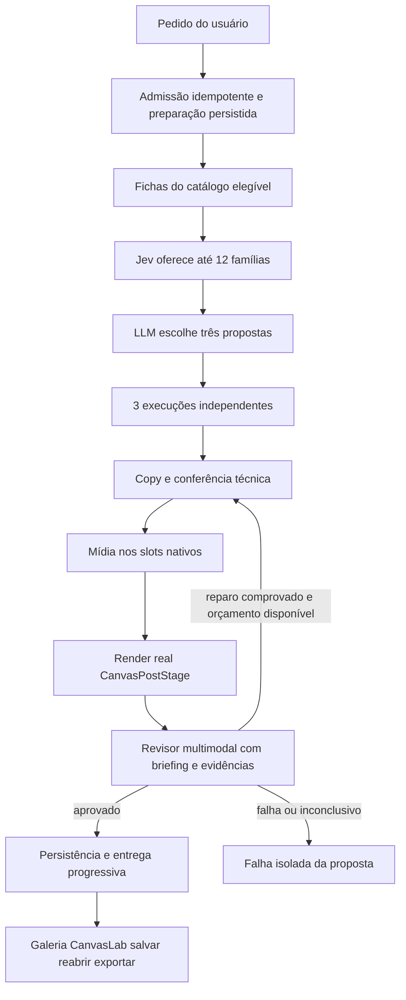

# Contexto e decisões da consolidação do PostSpark

Atualizado em 9 de outubro de 2026. Registro da intenção do proprietário e das decisões desta conversa, para orientar a continuidade do trabalho. O [DOCUMENTO_MESTRE](../DOCUMENTO_MESTRE.md) permanece a referência do funcionamento técnico; este arquivo preserva o objetivo da reforma, inclusive onde ele exige mudar o funcionamento atual.

## Leitura essencial para retomar o trabalho

**O objetivo é consolidar a arquitetura do PostSpark e concluir a experiência de criação. Integrar Jev é uma parte desse trabalho. O pipeline único foi implementado em 9 de outubro; publicação do lote curado e implantação externa são decisões operacionais separadas, com estado explícito no documento-mestre.**

1. O usuário fornece uma ideia e recebe três propostas de post ou carrossel prontas para uso. Editar é uma possibilidade rica, não uma obrigação para terminar o trabalho da IA.
2. A reforma precisa resolver o conjunto: produto, geração, acervo, contratos de IA, execução, persistência, editor e manutenção. Correções isoladas não substituem essa consolidação.
3. O destino acordado é um único caminho de geração. A bifurcação V4/V5 é uma transição incompleta, não uma característica permanente do produto.
4. A base recomendada e acolhida para a consolidação é a execução persistente hoje chamada V5, incorporando as capacidades necessárias do V4 e retirando o caminho substituído após validar a migração.
5. Cada uma das três propostas precisa ter estado, entrega e recuperação independentes. O sucesso de uma não deve depender do sucesso das outras.
6. Jev tem uma função restrita: avaliar a adequação dos designs ao pedido e oferecer uma lista curta à LLM. A LLM continua responsável pela escolha editorial e pelo restante do pipeline.
7. A implementação inicial usa **X = 12 famílias**, hipótese a calibrar com testes reais. Para carrosséis, cada opção precisa conter os modelos necessários à sequência. X não é o número de propostas finais, que continua sendo três.
8. Todas as possibilidades de design precisam de uma descrição comparável e útil. Descrever um modelo, torná-lo executável e aprovar sua qualidade são trabalhos diferentes.
9. Aumentar a variedade deve ampliar possibilidades criativas. Rótulos temáticos, funções comunicativas fixas e cortes ocultos não podem estreitar indevidamente a escolha.
10. A arquitetura deve permanecer proporcional ao problema. Evitar novas versões paralelas, cadastros redundantes e infraestrutura adicionada sem necessidade demonstrada.

**Ponto de retomada:** o motor único já está implementado, mas os testes reais expuseram lacunas de qualidade editorial e de acervo. Ler §13.86–13.88 do documento-mestre: cafeteria repete motivos; BizuMiner perdeu especificidade e entregou somente uma proposta; a conferência de Downloads encontrou apenas três das 22 referências gráficas com baseline válido. O proprietário concordou com preservar a informação ao longo do fluxo. As correções desse diagnóstico ainda não foram implementadas. Melhorar o fluxo existente, sem reabrir caminhos V4/V5 concorrentes.

## Como chegamos ao problema atual

No início, o PostSpark trabalhava com poucos designs, escolhidos editorialmente pela LLM conforme o pedido. O proprietário citou estilos como glitch, neobrutalism e brutal split. A seleção tinha menos alternativas, mas uma organização mais compreensível.

Depois, referências visuais foram convertidas em JSONs extensos, alguns com aproximadamente três mil linhas. A intenção original era modularizar os designs e ampliar o repertório. Segundo o proprietário, a modularização não produziu o resultado esperado, mas as estruturas permaneceram. O motor passou a conviver com abordagens diferentes para testes; correções e novas versões se acumularam.

O problema relatado é duplo: a manutenção ficou difícil e a variedade armazenada não se traduz em variedade percebida. Nos testes do proprietário, os mesmos designs reapareciam. Essa observação motivou investigar o que a IA realmente recebe, quais modelos são excluídos e quais características ficam invisíveis nas descrições.

A solicitação começou como diagnóstico, sem implementação. Evoluiu para uma revisão geral do aplicativo e para a decisão de consolidar a arquitetura. Em seguida, houve um recorte deliberado para estudar a seleção do acervo sem explodir a janela de contexto. Esse recorte não substituiu o objetivo maior.

O proprietário explicitou a premissa:

> “ser uma suite de criação de posts no qual o usuário não vai precisar editar. Mas se quiser, ele tem um arsenal imenso de ferramentas.”

Também explicitou a direção estrutural:

> “Preciso de uma unificação.”

## Decisões e limites do acordo

| Assunto | Direção registrada | Situação |
| --- | --- | --- |
| Produto | Entregar três propostas utilizáveis a partir da intenção do usuário, com edição ampla e opcional | Objetivo central |
| Arquitetura | Um único caminho de geração, com responsabilidade clara por etapa | Implementado: generation.start/get/cancel |
| Base de execução | Aproveitar a execução persistente atual do V5 e absorver capacidades necessárias do V4 | Implementado na base persistente; rota antiga aposentada |
| Versões | Manter versões de contratos e leitores quando necessárias para compatibilidade, sem manter motores concorrentes indefinidamente | Direção da consolidação |
| Jev | Pré-seleção de designs para a LLM, sem assumir copy, renderização ou coordenação do aplicativo | Integrado e verificado por chamada real |
| Quantidade de candidatos | Entregar mais de três opções; começar com 12 famílias | Estimativa implementada; qualidade a calibrar |
| Padronização | Uma ficha comparável para modelos completos e famílias básicas, derivada das fontes existentes | Contrato inicial implementado; enriquecimento e cobertura útil pendentes |
| Qualidade do acervo | Avaliar os designs derivados antes de decidir o que manter, corrigir ou retirar | 18 adaptações verificadas anteriormente; agora 24 originais comparados e mais 12 renders de seis designs. Há perdas de fidelidade e cobertura; publicação continua separada |
| Formatos | Revisar a exclusão precoce por proporção, considerando a liberdade de edição | Preocupação registrada; adaptação automática ainda precisa de definição e prova |
| Complexidade | Escolher a menor solução que atenda à experiência e à confiabilidade necessárias | Restrição permanente de projeto |

“Teoria fechada”, nesta conversa, autorizou avançar para a prática dentro dessa direção. Não tornou toda hipótese de qualidade ou detalhe de implementação uma conclusão validada.

## Arquitetura de destino

A preparação pode ser compartilhada. Depois da escolha, copy, mídia necessária, verificações e recuperação pertencem a cada proposta. Num carrossel, a unidade entregue é a sequência íntegra. Resultados concluídos devem sobreviver à falha de uma proposta irmã e à retomada da execução.

O Studio agora tem uma única forma de iniciar e acompanhar a geração. A escolha V4/V5 foi retirada do uso normal. Compatibilidade histórica pode conservar leitores, adaptadores e versões de schema; isso não exige conservar dois geradores ativos. Criar uma V6 ao lado das anteriores não satisfaz essa decisão.

### Fonte da verdade por responsabilidade

“Fonte única da verdade” significa eliminar autoridades concorrentes sobre a mesma informação. Não significa colocar catálogo, execução e documento editável em um único objeto gigante.

| Responsabilidade | Direção |
| --- | --- |
| Design disponível | Definição executável identificada e suas capacidades verificadas. A ficha de seleção é uma projeção dessa fonte |
| Execução | Estado persistido do pedido e de cada proposta, incluindo operações concluídas, falhas e retomadas |
| Post editável | `CanvasPostModel` no CanvasLab, com salvamento e reabertura fiéis em `canvas_model` |
| Histórico | Leitura compatível dos documentos existentes, sem reativar motores antigos para novas gerações |

## O que a revisão do acervo precisa resolver

**Qualidade dos modelos derivados.** O proprietário questionou se composições montadas a partir das referências têm qualidade suficiente e se devem permanecer. Uma amostra de 18 adaptações foi inspecionada com duas copies e o renderer real; isso não certifica os 112 registros do acervo. Hierarquia, legibilidade, composição, encaixe real, utilidade e diversidade precisam orientar a avaliação. Não manter um modelo apenas porque ele já existe; não descartá-lo apenas por ter sido derivado artificialmente.

**Informação desigual.** Designs prontos têm muitos parâmetros; famílias básicas têm descrições mais pobres. Uma ficha com os mesmos campos é o começo da padronização, mas não garante evidência equivalente. Características ausentes precisam ser extraídas das definições, verificadas em renders ou registradas como desconhecidas. Não inventar capacidade para preencher campos.

**Função comunicativa sem aprisionamento.** A preocupação expressa foi que descrever um design como “reflexivo” pode favorecer alguns pedidos e excluir outros que também funcionariam nele. Priorizar características e possibilidades observáveis: hierarquia, densidade, ritmo, contraste, tipografia, espaço para imagem e estrutura do conteúdo. Afinidade comunicativa, se usada, deve ser um sinal flexível, não uma autorização exclusiva de uso.

**Cobertura real.** Um design armazenado pode estar ausente da seleção por publicação, baseline técnico, proporção, marca, papéis ou falta de informações. Registrar por que cada conjunto está fora e o que falta para se tornar utilizável. A expressão “todos os elegíveis foram avaliados” não prova que todas as possibilidades do PostSpark participaram.

**Mudança de formato.** O usuário não considera satisfatório organizar a escolha criativa apenas pelo formato inicial, pois a proporção pode mudar no editor. A reforma precisa revisar esse filtro. A existência de edição manual não prova que qualquer design possa ser adaptado automaticamente com qualidade; essa capacidade precisa ser definida e testada antes de ampliar a elegibilidade.

**Crescimento contínuo.** O proprietário continuará adicionando referências. A entrada de um design deve alimentar o mesmo catálogo e o mesmo método de descrição, sem exigir uma nova versão do motor ou um segundo cadastro manual de seleção.

**Conferência dos originais em 9 de outubro.** A pasta `/home/many/Downloads/sources postspark/` contém 22 designs gráficos, uma fotografia e uma imagem de estudo tipográfico; todos os arquivos estão íntegros. Das referências gráficas, somente Why, Grid Systems e Holding têm alguma variante com baseline válido; as outras 19 são bloqueadas antes da escolha. Na cafeteria, nenhuma dessas três referências entrou na shortlist final. Os 59 componentes tecnicamente válidos incluem 40 variantes de presets e 16 derivados. Essa contagem não mede variedade visual independente.

**Fidelidade e informação que precisa continuar útil.** A reconstrução histórica simplificou texturas, tipos, perspectiva e efeitos; o relatório antigo comparava a conversão com o preview da receita, não com o original baixado. Notas úteis sobre fotografia e composição permanecem no snapshot, mas não chegam como requisitos à geração. A lista de benefícios de Why também perdeu seu contrato de itens. Preservar informação significa manter fatos/entidades e progressão narrativa do usuário, além das regras verificadas de cada design, nos contratos consumidos pelas próximas etapas. O proprietário concordou explicitamente com essa direção. Não basta armazenar informação nem enviar todo JSON à LLM. Não considerar todo bloqueio técnico prova de baixa qualidade: o baseline e o runtime divergem, por exemplo, na classificação de sobreposição texto/foto. Ver evidências e limites em §13.87–13.88.

## Seleção com Jev e alternativas discutidas

Jev foi considerado para reduzir o contexto entregue à LLM: ele recebe descrições padronizadas e identifica opções relacionadas ao pedido. O acordo restringe sua função a essa etapa. A escolha não constitui prova de superioridade estética; o ranking ainda precisa ser comparado com escolhas humanas e com uma alternativa simples de referência.

O valor inicial de 12 oferece espaço para a LLM escolher três propostas sem carregar o catálogo inteiro. No código atual, são até 12 famílias, com os modelos necessários por papel de carrossel. Catálogos com até 12 cards dispensam a chamada. A discussão de expansão para 18 não virou comportamento implementado. Tamanho da lista, diversidade e custo devem ser calibrados com briefs reais, sem multiplicar regras antes dessa medição.

| Possibilidade levantada | Contexto preservado |
| --- | --- |
| Bússola SGC ou Compass D0 | Foi proposta uma recuperação inspirada na indexação, sem exigir a suíte completa, difusão de calor ou Dirichlet. Não há experimento comparativo registrado nesta entrega que demonstre sua superioridade ou inferioridade |
| pgvector | Foi levantado como possível apoio à recuperação e à consciência do acervo. Não foi adotado como requisito da pré-seleção atual nem substitui a necessidade de boas descrições |
| Harness de IA | Interesse em organizar contratos, execução, persistência, tentativas e avaliação de resultados. Isso não implica construir uma plataforma adicional para a seleção |
| LangGraph | O proprietário reconheceu flexibilidade e preocupou-se com a complexidade lógica. Foi mantido no coordenador/grafos; a consolidação não adicionou outro framework |
| Playwright | Foi perguntado qual seria seu papel e se serviria ao avaliador. Agora fornece os pixels do CanvasPostStage ao revisor obrigatório; não é o modelo avaliador nem desenha outra versão do post |

Há liberdade para propor bibliotecas, contratos, fluxos e métodos diferentes. Documentação e regras herdadas descrevem o que existe e podem ser revistas à luz do objetivo do produto. Essa liberdade deve ser usada com evidência e responsabilidade pelos impactos, sem transformar toda possibilidade técnica em requisito.

## Estado vigente após implementação

**Perícia posterior, 9 de outubro às 21h:** §13.87 do documento-mestre registra repetição na seleção da cafeteria e copy genérica no BizuMiner. As 12 alternativas chegaram à seleção, mas falta memória de resultados anteriores e diversidade visual efetiva; o contrato privilegia preenchimento de caixas sem plano narrativo e o revisor não certifica qualidade editorial. BizuMiner entregou uma de três propostas, com duas falhas de encaixe; uma envolve largura de espaço final. Também foram encontrados rastros agregados vazios apesar de chamadas reais no journal. Esses pontos reabrem a qualidade de produto como trabalho necessário; a implementação técnica e os testes de §13.86 não os resolvem. Nesta perícia foram atualizadas apenas documentação e evidências locais.

| Item | Estado em 9 de outubro de 2026 |
| --- | --- |
| Geração | Um caminho: `generation.start/get/cancel`; `post.generate` aposentado |
| Execução | Worker separado, journal, deadline, cancelamento, três propostas independentes |
| Seleção | Fichas derivadas → Jev em lotes → até 12 famílias → LLM; teste real confirmado |
| Revisão | Obrigatória, todos os slides, com PNG do CanvasLab real e evidências do briefing |
| Reparo | Um reparo localizado compartilhado com overflow; rerender/recheck; nenhum veto de gosto |
| Post editável | CanvasPostModel, preservado em `canvas_model` |
| Billing | Admissão/reserva atômicas; totais 10/40; parcial por proposta; zero entregas sem débito |
| Catálogo | 112 definições locais, 59 baseline válidas, 53 inválidas; 18 adaptações renderizadas em quatro formatos |
| Publicação | Lote inspecionado aguarda autorização específica; revisão de agente será identificada, sem simular decisão humana |
| Operação | Migrações 0036/0037 aplicadas; API/worker locais verificados; implantação externa não realizada |

A revisão cruzada corrigiu perda de formato ao chegar a primeira proposta, mistura de histórico com pedido antigo, cancelamento de fontes/mídia, encerramento do Chromium e sondas de banco que poderiam escrever. Os detalhes estão em §13.86: 1.577 testes aprovados, geração real de três posts e três carrosséis, foto privada salva/reaberta e ZIP 4K verificado. Seleção/shortlist/mídia ainda não conservam todos os IDs externos dos providers; o journal conserva identidade e resultados das operações.

O revisor não pode alterar conteúdo com base em uma citação ambígua: correção numérica automática exige enunciado inteiro do usuário e corroboração literal integral, sem contexto adicional. Essa política foi ampliada em §13.89: perdas editoriais ancoradas na fonte podem acionar uma reescrita localizada; suspeitas sem evidência continuam diagnósticos. `visual_only` conserva o texto fornecido. A aprovação técnica/visual não garante que todo usuário preferirá o design, e não dispensa calibrar a seleção com briefs diversos.

## Atualização após a perícia do acervo — 9/10/2026

O pedido continua sendo consolidar o produto inteiro: entrada → avaliação dos candidatos → três propostas independentes → revisão → edição opcional. A recuperação do acervo e a preservação editorial fazem parte desse fluxo único.

O diagnóstico §§13.87–13.88 confirmou que os originais estavam íntegros, mas a conversão simplificou elementos visuais e deixou informações fora dos contratos operacionais. A implementação §13.89 transporta autoria específica entre shortlist, seleção, copy, mídia e revisão; acrescenta plano factual/narrativo, recuperação localizada e rastros de custo/uso completos. Memória curta e similaridade visual reduzem repetição entre candidatos de adequação próxima, sem sortear designs nem restringir função comunicativa por tema.

O lote recuperado r4 é **uma revisão do catálogo, não uma nova versão do motor**: 96 definições, 79 baselines técnicos válidos, 34 famílias tecnicamente disponíveis. Há duas restaurações visuais efetivas (papel/computador), 22 fichas específicas e seis referências gráficas diretas com baseline válido, antes três. Ainda existem referências com proporção incompatível, geometria bloqueada ou fidelidade visual insuficiente; o lote não certifica todo o acervo. A imagem baixada voltou a ser a referência real do comparador.

O revisor agora declara cobertura de cada fato e aponta citações conferidas nos campos visíveis; uma resposta sem achados não basta para aprovar uma copy com plano factual. Perdas parciais acionam o mesmo reparo localizado, com novo render/revisão. Isso aumenta a auditabilidade sem criar outro agente e sem prometer uma prova mecânica de equivalência semântica. Redução de fonte só usa limites autorados, é persistida no post e não apaga texto. O limite de uma recuperação por proposta continua valendo após retomadas e mudanças de preflight.

O contexto antigo de 112 definições/59 baselines continua como histórico. Publicação, rascunho elegível para administradores, baseline técnico e aprovação estética são estados distintos. O cadastro remoto do lote novo depende da confirmação específica solicitada após bloqueio de aprovação automática; não confundir artefato local com catálogo já disponível na aplicação.

Os dois testes reais cafeteria/BizuMiner foram autorizados para OpenRouter, com journal local, fonte/render/revisor reais e sem publicação. Uma falha de nome encontrada na cafeteria foi corrigida e retestada sem recomprar seleção/copy. Os resultados e limitações finais devem ser lidos em §13.89 e nos relatórios, não inferidos da passagem dos testes automatizados.

O teste real revelou uma lacuna persistente: o Flash aprovou “promoção real” como se demonstrasse “verificamos promoções”, inclusive com raciocínio maior. O contrato tornou o falso positivo auditável, mas não o eliminou. A comparação única com Pro terminou por timeout e ficou com cobrança incerta; não houve retry nem mudança do modelo padrão. Portanto, o BizuMiner **não está homologado como entrega completa**. Não retomar esta conversa assumindo que a preservação semântica foi concluída só porque testes de contrato passaram. A cafeteria gerou três propostas prontas; a proposta fotográfica do BizuMiner não foi executada pelo harness local. Detalhes, custos e snapshots estão em §13.89.

## Critérios permanentes de conclusão e manutenção

O mapa de responsabilidades foi consolidado em §13.86. Manter entrada, briefing, marca, catálogo, copy, imagem, recuperação, galeria, histórico, editor, persistência e billing coerentes com o mesmo caminho; não abrir outra linha de implementação paralela.

Critérios para considerar a consolidação concluída:

1. Novos pedidos percorrem um único caminho de geração; o Studio não exige escolher uma versão do motor.
2. Seleção, geração, conferência e persistência têm responsabilidades identificáveis, sem duas implementações produtivas concorrentes para a mesma tarefa.
3. As três propostas têm execução, entrega e recuperação independentes, com retomada consistente e preservação do trabalho concluído.
4. O catálogo possui critérios explícitos de entrada e exclusão, fichas úteis e um procedimento sustentável para novos designs. A variedade e a adequação são verificadas com pedidos reais.
5. Prévia, edição, salvamento, reabertura e exportação preservam o post; mídia necessária chega preenchida; autenticação, autorização de assets e cobrança continuam coerentes com a entrega.
6. Caminhos substituídos, seletores de versão, flags e dependências sem uso são retirados ou isolados como compatibilidade documentada. Renomear arquivos ou compartilhar um helper não basta.
7. As evidências distinguem testes simulados, execução real, qualidade percebida e implantação. O documento-mestre descreve o fluxo efetivamente entregue.

## Referências para a continuidade

- [DOCUMENTO_MESTRE](../DOCUMENTO_MESTRE.md): estado técnico e histórico de verificações; §13.85 registra a etapa Jev. Seções antigas precisam ser lidas com suas revisões posteriores.
- [Arquitetura por composições](./arquitetura-geracao-por-composicoes.md): origem e responsabilidades do caminho V4; não é a definição final da arquitetura consolidada.
- [Blueprint da geração orquestrada](./blueprint-geracao-orquestrada.md): contratos, independência e preservação de capacidades; suas afirmações de implantação precisam ser cruzadas com o runtime atual.
- [Studio ativo](../client/src/pages/StudioApp/StudioAppV2BPage.tsx), [entrada persistente](../server/routers/generation.ts) e [runtime persistente](../server/ai/workflows/generationRuntime.ts): pontos centrais da migração.
- [Fichas comuns](../shared/designSelection.ts), [pré-seleção Jev](../server/designCatalog/designShortlist.ts) e [entrada de designs](../designs/README.md): etapa já implementada e procedimento de ampliação do acervo.

## Como manter este contexto útil

Ao retomar o trabalho, ler primeiro a seção essencial deste arquivo e o estado atual no documento-mestre. Uma tarefa sobre Jev, formato, copy ou um bug do editor deve ser situada no objetivo de consolidação; não presumir que o assunto mais recente substituiu a direção original.

Atualizar decisões, estado e pendências nas seções correspondentes quando houver mudança. Não marcar uma intenção como implementada nem uma implementação como validada sem a evidência adequada. Se houver uma nova decisão do proprietário, registrá-la explicitamente e substituir a orientação superada, evitando acumular conclusões incompatíveis.

Esta revisão registra a implementação autorizada pelo proprietário, seus testes e os limites operacionais. As intenções anteriores continuam preservadas como contexto, sem contradizer o estado vigente.
