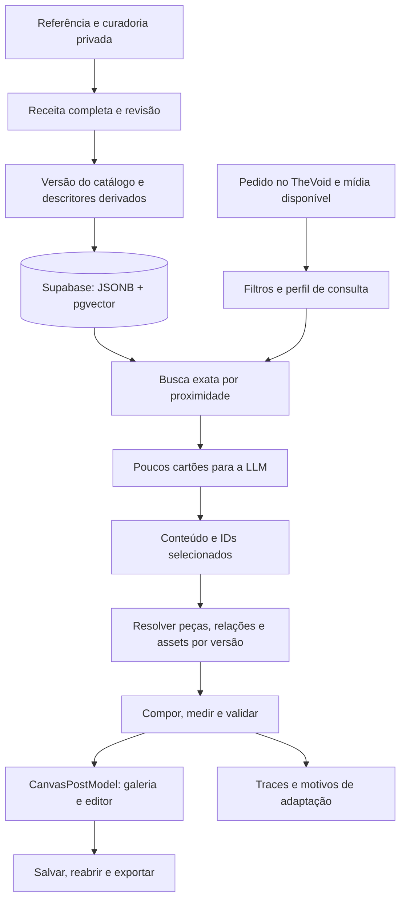

# Plano de implementação — arsenal de designs, pgvector e TheVoid

> Atualização de formato (2026-10-01): novas gerações usam retrato 4:5 (1080×1350). As referências 5:6 neste plano descrevem o piloto histórico. Leitura dos documentos antigos preservada; Minimal Air ganhou versão 2 draft com variante nativa 4:5. Ver contrato §14 e documento-mestre §13.40.

> Atualização autorizada (2026-10-01): conteúdo variável V3, contrato por pedido e guardrails estão especificados em `contratos-arsenal-v2.md` §13 e implementados conforme `DOCUMENTO_MESTRE.md` §13.37–13.38. Novas gerações usam contrato versão 2 com quantidade livre quando o pedido não a especifica, sem defaults 8/4/15 e com orientação positiva. Para clientes V3 estáticos, isso substitui título/corpo fixos e teto V2 de 12 itens; critérios de revisão/publicação do catálogo permanecem.

> Data: 2026-10-01. **Plano fechado para execução posterior por agente Sol**, com [contratos normativos e critérios de aceite](./contratos-arsenal-v2.md). As seis questões levantadas na revisão foram decididas; não ficam para definição durante a implementação. Esta entrega é documental; não aplica migrations, não importa o acervo no banco e não ativa a nova seleção no produto.
>
> Referências obrigatórias: [DOCUMENTO_MESTRE](../DOCUMENTO_MESTRE.md), [contratos V2](./contratos-arsenal-v2.md), [tutorial de autoria dos JSONs](./tutorial-curadoria-json-designs.md), `AGENTS.md` e contratos atuais. Plano e anexo formam uma única especificação: este arquivo organiza responsabilidades/fases; o anexo fixa os contratos e comportamentos futuros. O [plano histórico](./plano-dnapost-curadoria.md) conserva decisões e ensaios anteriores.

## 1. Objetivo e recorte de entrega

Permitir que o proprietário acrescente referências curadas continuamente e que o `/thevoid` selecione composições adequadas, gere o conteúdo, materialize um post bem composto e entregue edição livre no CanvasLab.

Primeira entrega utilizável: **posts estáticos, composições aprovadas, campos substituíveis, mídia em slots e relações flexíveis explícitas**, com persistência/reabertura fiel. Carrosséis mantêm o comportamento atual; sua integração será uma etapa posterior com regras entre slides.

**Primeiro marco (M1):** uma composição de janelas, variante explícita 5:6 (1080×1296), edição livre/vinculada, upload no editor, salvar/reabrir/exportar. Depois vêm catálogo e assets (M2), geração no TheVoid restrita ao administrador (M3) e ativação geral após critérios mensuráveis (M4). Não adicionar upload à etapa Criação nesta entrega. Composição que exige foto fica fora da seleção automática sem mídia real; placeholder não é resultado pronto. Detalhes e flag `DESIGN_ARSENAL_V2_MODE=off|admin|all` no [anexo, §1](./contratos-arsenal-v2.md#1-escopo-marcos-e-ativação).

O caminho deve ser completo:



Adicionar uma referência deve gerar dados novos, descritores novos e, após publicação, disponibilidade na próxima busca. Não deve exigir deploy para cada design nem enviar o acervo completo à LLM.

## 2. Estado confirmado e lacunas

| Área | Código/estado atual | Trabalho necessário |
| --- | --- | --- |
| Receita portátil | `shared/designRecreation.ts`, V1/V2/V3 | Manter leitores; criar evolução explícita para relações flexíveis. |
| Grupos/slots | `shared/designMatrix.ts` | V3 tem caixas fixas, grupos sem nesting, campos/listas e até quatro mídias. |
| Compositor experimental | `harness/designCombinations/engine.ts`, `textFlow.ts` | Extrair lógica pura e generalizar relações; retirar dependência de exemplos/arquivos locais. |
| Avaliação | `harness/designRepresentation/quality.ts` | Generalizar IDs e papéis; conservar desconhecido/medido e limites contextuais. |
| Busca experimental | `harness/designRepresentation/descriptors.ts` | Migrar cálculo puro para módulo compartilhado, versionar e persistir. |
| Catálogo de produção | `shared/designCatalog.ts`, `server/designCatalog/` | V1 só tem duas peças; evoluir leitura/seleção/compilação mantendo V1. |
| Banco | `drizzle/0018_design_catalog.sql` | Quatro tabelas existentes; criar documentos de busca e evidências, sem reescrever versões anteriores. |
| Seleção | `retrieveCatalog`, `catalogPrompt`, `selectCatalogForVariation` | Hoje filtros/pontuação, até cinco candidatos e leitura paginada das definições completas. |
| Conteúdo/reparo | `applyDeterministicCopyGuards`, `validateRevisedCandidate`, composição anterior à seleção | Despachar V2 antes dos cortes e da composição V1; validar conteúdo canônico e bindings no schema principal e de reparo. |
| Transporte | `CatalogSelection`, uma definição por variação | Bundle V2 com até três candidatos fixados por versão/variante; preservar V1. |
| Entrada de mídia | `server/routers.ts` e `generationOrchestrator.ts` | Duas consultas usam `hasImage: false`; substituir por estado real e permitido de mídia. |
| Materialização | `StudioApp/lib/studioGeneration.ts::materializeCatalogVariations` | Ponto comum para geração inicial, gerar mais e histórico. |
| Editor oficial | `CanvasPostModel`, `CanvasPostStage`, `handleUpdatePost` | Criar representação oficial de elementos/relações; modo diagnóstico não entrega essa edição. |
| Persistência | `CanvasLab/lib/saveAdapter.ts`, `posts.canvas_model` | Preservar todos os novos campos, versões, assets e overrides. |

### Acervo de entrada

- Coleção `family-library-2026-10-01T02-59-27-361Z`: 69 receitas, 45 cartões.
- Índice experimental: 43 designs, uma variante por design, excluindo fotografia pura e catálogo tipográfico.
- 27 renders do `combination-pilot`: aprovação explícita dos exemplos vistos.
- Matriz de janelas `cfaccad3`: exemplo aprovado com mídia do proprietário.
- Nove pares do `quality-pilot-2026-10-01T14-56-36-703Z`: evidências novas; não herdar aprovação dos exemplos anteriores.
- As 12 famílias originais possuem backup e 36 conversões. Conversão técnica não é aprovação de todas as variantes.

A migration 0018 foi aplicada historicamente, segundo §13.32 do documento-mestre. Confirmar o banco atual antes de implementar; esta documentação não consultou o estado remoto nem a versão instalada da extensão `vector`.

## 3. Decisões de arquitetura

### 3.1 Fontes autoritativas e representações derivadas

1. **Curadoria:** receita e pacote de autoria preservam o desenho observado e sua procedência.
2. **Catálogo:** definição publicada e imutável contém componentes, relações e requisitos reutilizáveis.
3. **Índice:** vetor e cartão são derivados da definição/variante identificada por versão e hash.
4. **Post do usuário:** `CanvasPostModel` materializado é autoritativo. Reabrir não consulta o catálogo para recalcular o desenho.

Arquivo portátil, definição do catálogo e documento do usuário têm ciclos de vida diferentes. A conversão entre eles deve ser explícita, versionada e auditável.

### 3.2 JSONB e pgvector juntos

- JSONB conserva parâmetros completos e relações de tamanho variável.
- `vector(48)` conserva a projeção estrutural inicial usada na busca.
- Sete características de estilo, categorias de fonte e matrizes N×14 permanecem disponíveis para comparação adicional.
- Não achatar matrizes N×14 variáveis em um vetor de tamanho arbitrário para fingir equivalência com a comparação de componentes.
- Começar com busca **exata**. HNSW é uma otimização posterior condicionada a medidas de latência e recuperação.

O pgvector oferece distância L1 e busca exata; índices aproximados alteram o compromisso entre velocidade e recuperação de vizinhos. Confirmar a versão instalada antes de escolher operadores/classes. [Referência primária](https://github.com/pgvector/pgvector#querying).

### 3.3 Liberdade de edição

O design nasce com vínculos úteis. O usuário pode editar texto, mudar fonte, mover, redimensionar, rotacionar, trocar mídia, remover elementos e desligar vínculos. Limites editoriais de geração não se transformam em bloqueios de edição.

Na edição vinculada, título centralizado cresce para os lados, quebra por palavras ao atingir largura útil, realce acompanha as linhas e os elementos dependentes acompanham a altura. Redução de fonte não ocorre silenciosamente durante digitação. Conflitos geram aviso e possibilidade de ajuste; a opção livre congela os valores resolvidos e desliga a relação correspondente.

## 4. Contratos definidos

Os contratos abaixo e o [anexo normativo](./contratos-arsenal-v2.md) definem APIs futuras; ainda não existem no código. A Fase 1 materializa essas decisões em tipos/Zod/adaptadores. O anexo inclui conteúdo, geração/reparo, exemplos, transporte, variantes, publicação e critérios quantitativos.

### 4.1 Catálogo V2

Evoluir `CatalogBlueprint` para uma união discriminada por `schemaVersion`, preservando V1 byte/hash semanticamente. Uma definição V2 deve conter:

- Identidade e descrição: nome, tags, intenções, origem e limitações.
- `compilerVersion` e capacidades de renderer necessárias.
- Variantes por formato: prancheta, composição-base, slots, peças e relações explícitas.
- Campos semânticos: título, apoio, CTA, lista, número, atribuição, imagem etc., com IDs e obrigatoriedade.
- Peças referenciadas por hash/versão e instâncias posicionadas na composição.
- Papéis de cor e política tipográfica, preservando marca quando fornecida.
- `requires`/`conflictsWith` de conteúdo/capacidade, com referências verificáveis.
- Política de adaptação e fallbacks suportados.
- Procedência: hashes de receitas/fontes, fontes das relações e das variantes.

A forma canônica é: definições deduplicadas em `design_catalog_pieces` e referências/instâncias na versão. Resolver o conjunto para um snapshot ao compilar. Não manter cópias editáveis conflitantes da mesma peça em múltiplos lugares.

**Conteúdo da referência:** textos de demonstração ficam no pacote privado de conferência. Campos publicados precisam de papéis e valores de exemplo separados, para evitar reprodução acidental de nomes, marcas, URLs e promessas da referência. Ornamentação textual realmente fixa exige classificação explícita.

### 4.2 Relações executáveis

Criar contrato pequeno e determinístico, suficiente para os três componentes já ensaiados:

| Relação | Comportamento |
| --- | --- |
| Alinhar a âncora | Centro ou borda do elemento em relação a outro/à área. |
| Superfície acompanha texto | Largura/altura medidas mais padding; contorno/sombra vinculados. |
| Fluxo vertical | Posição inferior depende da altura resolvida anterior e do gap. |
| Largura útil e quebra | Crescer até limite; quebrar por palavras; preservar conteúdo. |
| Transformação de grupo | Mover/rotacionar o conjunto com coordenadas locais consistentes. |
| Slot de mídia | Área, crop, foco e ordem de desenho. |

Cada relação tem ID, membros, parâmetros, versão e estado ativo/desligado. Validar referências, ciclos e conflitos de propriedade; resolver em ordem topológica. Só uma relação ativa pode escrever cada propriedade de um elemento: conflito rejeita a definição. Override manual desliga o vínculo da propriedade alterada e conserva a geometria como base, sem apagar vínculos independentes. Tipos e ordem de execução no anexo, §3.

Materialização sempre recalcula a partir de bases + conteúdo + overrides; não acumular deslocamentos sobre a saída da compilação anterior. Guardar geometria resolvida junto dos vínculos no documento do post. A mesma entrada/versão/seed produz o mesmo resultado no mesmo ambiente.

### 4.3 Receita portátil futura

Manter V1/V2/V3 intactas e criar **envelope V4** quando introduzir relações no arquivo portátil. Mapear V3 para relações fixas equivalentes; não inventar comportamento flexível na importação. Atualização de uma receita para flexível é uma derivação explícita.

Não acrescentar chaves ao schema V3 estrito nem alegar que um snapshot do harness já transporta seu algoritmo de reflow. O arquivo V4 deve poder fazer exportação/importação sem perder relações ou desligamentos manuais.

### 4.4 CanvasPostModel

Adicionar por slide uma composição oficial tipada, com elementos ordenados, grupos, slots, relações, valores-base e overrides. Posts novos desse caminho usam `modelVersion: 2` e `slides[].composition.version: 2`, com adaptador de leitura para modelos antigos. Guardar identidade completa da variante, conteúdo canônico e hash, revisão de edição, snapshot resolvido e origem do layout conforme anexo, §5.

Para um slide com composição, seus elementos são a fonte visual. Campos de copy compatíveis são projeções por bindings; não renderizar simultaneamente os títulos antigos e os novos. `ReferenceSceneContents` pode fornecer primitivas, mas não será usado como imagem opaca ou “atalho” para dispensar interação.

Toda mutação continua por `CanvasLabPage.handleUpdatePost`, com seleção, undo/redo, autosave, exportação e controles desktop/mobile. Textos são editados pelo mesmo motor/ponte de teclado do CanvasLab. Sem recompilação consultando uma versão mais recente do catálogo ao reabrir.

### 4.5 Assets e portabilidade

Pacotes Admin2 podem conter base64. Catálogo e respostas de geração não devem trafegar essas cópias em cada candidato.

Para assets compartilhados do arsenal, criar bucket privado Supabase `design-arsenal` e manifesto por hash: ID/key durável, SHA-256, MIME, tamanho, dimensões ou família/peso/licença. Upload e obtenção autenticados pelo backend; URLs assinadas são resolvidas em tempo de uso e não são a identidade persistida. Limites e grants de acesso estão fixados no anexo, §7; arquivar ou desligar novas seleções não revoga assets de posts já entregues. Não haverá exclusão física/garbage collector nesta entrega.

`server/storage.ts` usa atualmente outro proxy; **não pressupor** que esse helper já representa Supabase Storage. O novo fluxo de assets do arsenal deve ser explícito e não alterar o armazenamento de imagens do usuário sem necessidade.

Importação de fontes/assets é idempotente por hash. A publicação exige assets presentes e verificáveis. Pacote parcialmente enviado continua rascunho. Receita original da curadoria e fonte tipográfica não podem ser perdidas pela deduplicação. Fotos pessoais/de demonstração não entram automaticamente no catálogo público de sugestões.

## 5. Busca por proximidade com significado preservado

### 5.1 Preservar a métrica atual

O ensaio usa L1 estrutural ponderada:

```text
d(a,b) = soma_i [ w_i × |a_i − b_i| ] / soma_i [ w_i ]
```

Para usar L1 nativa no pgvector sem alterar esses pesos:

```text
v_i = a_i × w_i / soma(w)
q_i = b_i × w_i / soma(w)
distância no banco = L1(v,q)
```

Persistir o descritor bruto para auditoria e o vetor projetado para consulta. Aplicar **a mesma projeção** na gravação e na consulta. Não normalizar para comprimento unitário nem trocar para cosseno por conveniência. Guardar `descriptorVersion` e `metricVersion`/hash dos eixos e pesos.

Definir uma cena-base canônica por variante para derivar o descritor: conteúdo de demonstração, fontes, prancheta e relações resolvidas com versões fixas. A adaptação ao texto de cada usuário altera geometria, mas não deve atualizar silenciosamente o vetor da versão publicada. Guardar o hash dessa cena-base e, se necessário, um descritor separado do resultado gerado apenas para avaliação. Na primeira extração compartilhada, conservar a heurística atual de título; substituí-la por papéis explícitos exige nova versão de descriptor e comparação dos rankings.

O tipo `vector` usa precisão finita; conferir erro absoluto máximo de `1e-5` e desempatar por IDs estáveis, tratando diferenças dentro dessa faixa como empates na comparação SQL/JS. Não prometer igualdade bit a bit. Se a tolerância falhar, investigar e registrar a causa; não alterá-la silenciosamente para obter aceite.

O comparador experimental arredonda a distância exibida em seis casas. A consulta pode ordenar pela distância não arredondada e desempatar por ID; conferir os empates no mesmo critério ao comparar resultados, sem tratar uma diferença de apresentação como erro de recuperação.

Primeira versão de produção usa a distância estrutural, sem reordenação por estilo/Jaccard/matrizes N×14. Esses dados permanecem para análise e evolução posterior. Uma pontuação combinada futura exige avaliação própria: Top K estrutural seguido de reordenação não é necessariamente o Top K global da combinação.

### 5.2 De onde vem o vetor de consulta?

**Texto do pedido não é um vetor estrutural.** Não comparar um embedding de frase diretamente com as 48 dimensões de geometria.

Na primeira entrega, usar perfis versionados e explicáveis:

1. Reaproveitar briefing estruturado, intenção já interpretada, formato solicitado, conteúdo disponível e estado de mídia.
2. Filtrar necessidades obrigatórias: dois lados para comparação, dado real para métrica, mídia quando indispensável.
3. Selecionar uma pequena lista de **composições-âncora** elegíveis por objetivo/metadados. A âncora fornece o vetor completo no mesmo espaço do acervo.
4. Buscar vizinhos de cada âncora; mesclar com desempate determinístico e diversidade de estruturas.
5. Caso o administrador/usuário peça “parecido com este design”, usar a versão exata desse design como âncora.
6. Quando não houver âncora apropriada, usar o ranking de requisitos/metadados disponível e registrar ausência de consulta estrutural adequada. Não preencher coordenadas desconhecidas com zero e chamá-las de preferência do usuário.

Perfis são dados pequenos ligados a versões do catálogo, com procedência e estado. Nesta entrega ficam na configuração validada de backend `query-profiles-v1`, sem nova UI de perfis. Novos designs publicados entram na recuperação sem deploy; introduzir uma nova regra de intenção/âncora no perfil pode exigir mudar essa configuração. Não há chamada LLM extra. Proximidade geométrica entre dois designs não resolve sozinha relevância para um pedido textual.

Não criar perfil apenas para privilegiar todos os novos designs. Usar metadados compatíveis, manter diversidade e permitir que a LLM escolha `none`.

### 5.3 Algoritmo inicial

- Consulta exata no Supabase, dentro dos filtros e da versão de descritor/metric.
- Até três âncoras por pedido e vinte candidatos por âncora; limites fixados para a primeira versão.
- Deduplicar variantes/blueprints e evitar repetições no mesmo conjunto gerado.
- Aplicar requisitos antes da distância; mesclar resultados por rodadas entre âncoras na prioridade do perfil, conservando distância/ID dentro de cada lista e diversidade por blueprint. Na ausência de âncora, usar ranking por metadados. Algoritmo fechado no anexo, §6.
- Enviar no máximo cinco cartões compactos à chamada de geração já existente.
- Cartão: `candidateId`, versão/variante/hashes, descrição curta, formato, bindings/cardinalidades, mídia, hierarquia e limitações. Sem JSON completo, base64 ou vetor bruto.
- Após a escolha, resolver a definição completa e conferir compatibilidade com a copy final e a mídia efetiva.

A lista de vinte é um orçamento inicial de recuperação, não garantia matemática de melhor composição. Registrar candidatos descartados e variar esse orçamento nas medições de qualidade.

### 5.4 Crescimento e atualização

Nova versão validada recebe descritores antes de poder ser publicada. A aprovação torna a versão elegível para a próxima consulta; arquivar a versão a remove das buscas futuras. Posts existentes ficam intactos.

Retirar a leitura de todas as definições e o teto atual de paginação como mecanismo normal de busca V2. Buscar apenas documentos de índice/cartões e carregar receitas completas depois da seleção. Se houver cache, invalidar por revisão do catálogo e manter duração limitada; por padrão, começar consultando o índice diretamente.

Uma mudança de eixos/pesos exige nova versão de descritor/métrica. Reindexar a partir das definições imutáveis, validar completude, então ativar a nova versão de consulta. Durante a transição, não comparar espaços incompatíveis. A receita não precisa ser reextraída por vision para recalcular seu índice.

## 6. Persistência e migrations propostas

### 6.1 Reutilizar tabelas existentes

Manter `postspark.design_catalog_versions`, `design_catalog_pieces`, `design_catalog_version_pieces` e `design_catalog_events`. Versões de definição continuam imutáveis, aprovação/arquivamento transacionais e peças deduplicadas por conteúdo.

Adicionar suporte a definições V2 nos leitores/RPCs, sem recanonicalizar V1 ou alterar seus hashes. Se o parse acrescentar defaults, eles não podem mudar retroativamente o documento utilizado pelo verificador de hash.

### 6.2 Novos registros

| Registro proposto | Campos/regras essenciais |
| --- | --- |
| `design_catalog_search_documents` | `version_id` FK, `variant_key`, descriptor/metric version, hash da definição/variante, vetor `vector(48)`, descritor JSONB bruto, cartão/metadata compacto, data de derivação. Chave única por versão + variante + versões de descriptor/métrica. |
| `design_catalog_evidence` | ID, versão/variante, hash da receita/PNG/briefing, política de avaliação, métricas e desconhecidos, decisão humana, origem do review, ator autenticado e data conhecida. Append-only. |
| `design_catalog_assets` | Hash/ID, storage key, MIME, bytes e metadata de fonte/imagem; sem expor referência privada no payload de geração. |
| `design_catalog_version_assets` | Links imutáveis por versão/asset, necessários à verificação de publicação e retenção. |
| `design_catalog_asset_grants` | Autorização por usuário/asset concedida pelo backend ao entregar candidatos; persiste após arquivamento para salvar/reabrir. |

Componentes N×14 e arestas ficam dentro do descritor JSONB nesta entrega; um índice próprio por componente só entra quando a busca de peças precisar dele. Não criar tabela para cada feature numérica.

O status de aprovação é consultado na versão do catálogo, não uma segunda flag desatualizável no índice. A publicação verifica que todas as variantes declaradas têm índice compatível, assets e capacidades. Guardar metadados de filtro junto do documento de busca pode evitar carregar definições grandes; tais metadados são derivados e conferidos pelo hash.

### 6.3 Integridade e atomicidade

- FK/index nas relações necessárias; unicidade e número de dimensões no banco.
- Validar números finitos, versões, limites e vínculo ao hash no backend; rejeitar payloads de busca incompatíveis.
- Criar definição/links em transação como `draft`. Upload verificado e derivação do índice podem ocorrer em etapas; o draft fica indisponível até a finalização transacional. Definição é imutável inclusive em draft; correção cria outra versão.
- Publicação transacional verifica completude, arquiva a aprovação anterior do mesmo blueprint e registra eventos.
- Guarda de banco para entrada em `approved` por INSERT/UPDATE V2 aplica os mesmos requisitos à RPC antiga e à atualizada. Validar assets, índice e evidência por variante/hash; proteger links/índices ativos contra invalidação posterior. Detalhamento no anexo, §7.
- Retry com mesma definição retorna a mesma versão; não duplicar por timestamp aleatório de importação.
- Assinaturas/hashes de arquivo original, pacote portátil e definição canônica são distintos e têm nomes próprios.
- Reindexação idempotente não altera aprovação nem receita; versões antigas de descriptor permanecem auditáveis até limpeza explícita.

### 6.4 RPC de busca

Criar `postspark.design_catalog_search_v2`, com uma âncora `vector(48)` por chamada, formato, capacidades, estado de mídia, perfil de conteúdo, versões de descriptor/métrica e limite de 1–20. Retornar identidade completa da variante, distância e cartão. Resolver a definição completa somente após seleção. Até três consultas compartilham o orçamento agregado de servidor definido no anexo, §4.

Aplicar filtros de status e requisitos **antes** do `ORDER BY distância LIMIT`. Escolher schema real da extensão e qualificar operadores/tipos quando o `search_path` estiver vazio. Não pressupor `public.vector`. Usar `SECURITY INVOKER`, `search_path` controlado e privilégios mínimos, como o catálogo atual. O cliente Supabase pode chamar consultas desse tipo por RPC. [Documentação](https://supabase.com/docs/guides/ai/vector-columns).

### 6.5 Acesso

- Escrita/curadoria apenas por `adminProcedure`.
- Busca para geração por backend autenticado, mantendo `protectedProcedure` e ownership dos runs.
- Novas tabelas com RLS; revogar acesso direto de `PUBLIC`, `anon` e `authenticated` quando o desenho for backend-only.
- Serviço backend recebe somente privilégios necessários. Chave de serviço não entra no frontend.
- Funções não ficam executáveis por `PUBLIC` por padrão.
- Feedback do navegador é declaração do cliente: validar ator, ownership, versão/hash e idempotência no servidor. Aprovação administrativa exige ação autenticada; importar um arquivo local marcado “approved” não é autorização suficiente.
- Bucket privado e autorização de leitura dos assets selecionados. Identidade de revisor em `localStorage` não equivale a autenticação.

Esse desenho conserva o modelo atual de acesso administrativo; revisar concessões e políticas conforme a [documentação de RLS do Supabase](https://supabase.com/docs/guides/database/postgres/row-level-security).

### 6.6 Procedimento de migration e rollback

1. Inspecionar schema, migrations já aplicadas, extensões e versão real do pgvector via MCP/CLI autenticado.
   - Conferir especificamente disponibilidade de L1 (`<+>`). Se ausente, implementar a soma SQL exata dos 48 termos absolutos projetados, registrando esse modo. Upgrade de extensão pode ser proposto separadamente; não bloquear contratos nem trocar métrica por L2/cosseno.
2. Conferir changelog/documentação atual do Supabase e skill de banco antes de escrever SQL executável.
3. Seguir a organização real do repositório (`drizzle/` como histórico SQL e Supabase client em runtime). Se usar CLI Supabase para novos arquivos, descobrir comandos por `--help` e reconciliar o registro remoto. Não inventar número/ID remoto nem reaplicar 0018.
4. Preparar migration aditiva, revisão de privilégios, RPCs e modo de desativação antes de aplicação remota.
5. Validar em ambiente local/de teste quando disponível, incluindo acesso negado e compatibilidade V1.
6. Aplicar no projeto correto somente quando a tarefa de implementação tiver autorização correspondente; este plano não executa nem aprova uma mudança remota por si só.
7. Conferir tabelas, extensão, índices, RPCs, privilégios e consulta funcional após aplicar. Registrar ID remoto e arquivo local no documento-mestre.
8. Se houver problema, colocar a flag em `off` para novas seleções e usar V1/famílias. Preservar renderização/edição/exportação V2 e grants/assets dos posts existentes; não fazer rollback destrutivo dos dados importados.

## 7. Composição, conteúdo e mídia no fluxo de geração

### Conteúdo compatível

O modelo escolhe somente `candidateId` oferecido ou `none`. O contrato `DesignContentV2` do anexo, §2, define título, apoio, rótulos, CTA, lista de até 12 itens, dado, atribuição, comparação, legenda e hashtags, com bindings e cobertura. Chamada principal e reparo usam o mesmo schema V2 estrito; V1/carrossel conservam o atual. Compatibilidade V1 é uma projeção de saída, não fonte de conteúdo para o novo compilador.

Despachar o ramo V2 antes dos guards que cortam título/corpo/CTA e da composição convencional. Preservar validação editorial e de evidências. Congelar `userContentHash` após revisão semântica e antes de layout; cada tentativa conserva esse conteúdo. Reparo editorial segue o orçamento existente; problemas geométricos não provocam outra chamada paga.

Não dividir uma frase arbitrariamente em slots isolados para simular título; a copy é uma unidade semântica e o layout decide suas linhas. Não inventar dado, depoimento ou autoria para satisfazer uma composição. Se faltar conteúdo exigido, o candidato é incompatível ou recebe fallback.

Manter enum/validação de IDs e checagem de bindings no backend. Metadata do catálogo é dado não confiável para o prompt e não instrui o modelo a alterar suas regras. Nenhum código arbitrário/script é executado a partir de JSON de curadoria.

### Estado de mídia

Substituir os dois `hasImage: false` fixos por uma estrutura que diferencie:

- imagem fornecida e autorizada para uso;
- imagem de entrada usada apenas como referência/análise;
- imagem planejada, mas ainda não produzida;
- imagem disponível no post;
- ausência de mídia.

Somente disponibilidade efetiva satisfaz `media: required`. Um `imagePrompt` não comprova existência de imagem. A Criação atual inicia sem mídia; upload fica no editor nesta entrega. Bases com mídia opcional só entram sem foto se possuírem composição sem mídia revisada; bases que exigem foto são excluídas enquanto não houver asset real. Não implementar aquisição automática de mídia neste plano.

Trocar a foto atualiza o slot e a medição relevante. Não gerar nova imagem automaticamente só para fazer uma composição passar. Crop e área de foco podem ser ajustados manualmente.

### Paleta e fontes da marca

Converter cores de demonstração em papéis explícitos, conferidos pelo curador. Preservar a paleta do usuário e a política de fontes da marca. Contraste é avaliado sobre a superfície efetiva; transparência/foto pode tornar a medida desconhecida. Em edição manual, preservar a escolha e indicar o problema, conforme o editor atual.

### Fallback hierárquico

1. Composição preferida com conteúdo intacto e crescimento/quebra/fluxo normais.
2. Até duas alternativas compatíveis, presentes no bundle versionado enviado pela API.
3. Mesma ordem com adaptações adicionais publicadas, incluindo redução tipográfica limitada quando permitida na geração.
4. Família convencional conhecida, com conteúdo integral e motivo registrado; se ainda não couber, documento editável sinalizado como `needs_adjustment`, sem declarar sucesso técnico.

Máximo seis tentativas V2 por variação; até 2 s adicionais de catálogo dentro do deadline do servidor e 15 s separados de materialização no navegador por lote, com reserva para fallback. Bundle, limites de bytes e tratamento de `none` no anexo, §4. Não repetir chamada paga para resolver uma caixa que não cabe. Falha de busca/trace/compilação não pode apagar copy ou duplicar cobrança.

## 8. Edição, reabertura e formatos

### Compartilhar medição e desenho

Extrair primitivas e cálculos comuns de CanvasPostStage/ReferenceSceneContents quando necessário, sem copiar um segundo renderer divergente. Carregar fontes/pesos antes de medir. Preservar o motor `layoutRichText` na prévia, edição e exportação.

As verificações nativas são úteis, mas a aceitação exige navegador real: títulos, grupos, mídia, seleção, teclado/IME, undo/redo e PNG. Nenhum resultado do harness prova sozinho a experiência do usuário.

### Formatos

O produto atual declara `1:1`, `5:6` e `9:16`. Alguns exemplos aprovados do laboratório têm **736×920 (4:5)**. Não renomear 4:5 como 5:6 e não esticar a imagem.

Preservar a receita original no arquivo. Para disponibilidade no produto, gerar uma variante explícita em formato suportado, recalcular relações e conferir o resultado. A variante recebe procedência e estado próprios. Adicionar 4:5 a toda a aplicação seria outra mudança de contrato, fora do recorte inicial deste plano.

Fixar identidade por `versionId + variantKey + variantHash` em toda a cadeia. Troca de formato prepara prévia e aplica atomicamente, com undo. Sem override geométrico e com variante da mesma versão, usar a variante; com ajustes livres ou variante ausente, preservar o conjunto por escala uniforme centralizada, registrando `manual-projection`. Aplicar variante substituindo ajustes de posição exige ação explícita. Regras completas no anexo, §5; nunca apenas trocar a proporção do documento.

### Persistência e replay

- `normalizeCanvasModel`, `savedPostToCanvasModel` e serialização de save/update preservam elementos/relações/overrides e versão do compilador.
- Salvar valores resolvidos, conteúdo atual, crop, seed e referências duráveis dos assets.
- URL assinada expirada é renovada por asset ID; não recalcular layout por isso.
- `fitSavePayload.ts` pode substituir imagens inline para reduzir payload. Assets com hash não podem ser recomprimidos silenciosamente mantendo o hash antigo. Evitar base64 no documento oficial; se houver conversão, atualizar identidade/procedência explicitamente.
- Verificar que cópia, gerar mais, histórico, troca de formato, download e edição guiada não apagam a composição. `composePost`/presets genéricos só substituem uma matriz em uma operação explícita e reversível.
- Na geração, fonte indisponível recusa candidatos dependentes dentro do prazo de assets. Ao reabrir, preservar documento/geometria e sinalizar falta; exportação fiel aguarda recuperação ou substituição explícita pelo usuário. Não medir com fonte substituta e trocá-la silenciosamente depois.

## 9. Qualidade e aprovação

Separar três decisões:

1. **Exemplo aprovado:** receita/render/briefing específicos que o proprietário viu.
2. **Composição elegível para geração:** versão revisada com papéis, formatos, capacidades, assets e política de adaptação definidos.
3. **Resultado gerado:** nova materialização que passou nas verificações contextuais e pode ser editada pelo usuário.

Não inferir a segunda decisão apenas de `confidenceScore`, aprovação de um vizinho ou existência de arquivo. Não exigir revisão humana administrativa para cada post do usuário; a elegibilidade é da composição e a verificação técnica é de cada resultado.

Generalizar o avaliador para usar papéis/bindings, não IDs do piloto. Sobreposições intencionais entre texto/superfície não são colisão inválida. Contraste e visibilidade desconhecidos devem continuar desconhecidos; não converter ausência de evidência em zero falhas.

As métricas são condições de uso, não uma nota de beleza. Preferências humanas calibram os perfis e a seleção gradualmente. Sucesso de negócio/publicação não é inferido de exportação ou salvamento.

## 10. Traces e feedback

Reaproveitar `generationTrace`, `traceCatalog` e eventos existentes. Implementar etapas adicionais:

| Evento | Dados úteis |
| --- | --- |
| `catalog.import` | origem/hash, contagens, versões criadas/reutilizadas e erros por item. |
| `catalog.index` | definição/variante, descriptor/metric version, dimensões, duração e status. |
| `catalog.retrieve` | perfil/âncoras, filtros, algoritmo, candidatos/distâncias, descarte, duração. |
| `catalog.select` | ID pedido/escolhido, diversidade, regras e motivo de fallback. |
| `catalog.offer` | Identidades e hashes dos candidatos efetivamente entregues, vinculados ao bundle persistido. |
| `catalog.attempt` | Candidato/variante, ordinal, política aplicada e motivo de recusa. |
| `catalog.compile` | versão/hash, peças/relações, adaptações, métricas, incógnitas, renderer, duração. |
| `catalog.format` | Variante origem/destino, projeção preservadora, overrides e resultado. |
| `catalog.asset` | Resolução/falha por asset ID, sem URL assinada. |
| `catalog.review` | versão/hash avaliado, tipo de revisão, ator e decisão. |
| `catalog.feedback` | composição usada, edição posterior, ação observada e origem do relato. |

Correlacionar por `traceId`, generation run, slot, model/post ID, identidade completa da variante e hash do conteúdo. Separar cálculo do servidor de `client_report`. Limitar payload de evento a 8 KiB; não registrar base64, imagem, texto integral ou dados pessoais em cada trace.

Relatos do cliente: ownership e correspondência com qualquer candidato oferecido no bundle persistido, idempotência por materialização/tentativa/evento, limites de frequência/tamanho. Isso permite relatar a alternativa efetivamente usada, sem aceitar ID arbitrário. Erro de telemetria é observável e degradável. Preservar as métricas existentes de custo/Sparks.

`editedAfterGeneration` deve refletir mudança efetiva após o snapshot gerado, sem marcar carregamento ou normalização como edição. Exportação é evento próprio. `published` permanece desconhecido/não instrumentado enquanto não houver sinal real de publicação; dashboard mostra N/D.

## 11. Sequência executável para o agente Sol

Executar em etapas pequenas; atualizar o documento-mestre e relatar pendências concretas ao fechar cada etapa. As verificações abaixo são critérios planejados para a implementação; não foram executadas na entrega documental.

### Fase 0 — inventário e proteção

- Ler documentos e contratos; conferir worktree sujo sem descartar mudanças.
- Confirmar artefatos locais e backups; gerar manifesto de hashes dos inputs que serão usados.
- Auditar consumers de tipos, geração, mídia, persistência e editor.
- Inspecionar ambiente de banco e workflow de migrations apenas com leituras inicialmente.
- Criar `DESIGN_ARSENAL_V2_MODE=off|admin|all`, padrão `off`, governando novas seleções no servidor; leitura/edição/assets existentes independem da flag.

**Saída:** mapa de impacto, fixtures/inputs identificados, ambiente conferido e contratos deste plano localizados nos consumidores. Nenhum acervo aprovado sobrescrito. Divergência de checkout deve ser registrada, sem reabrir decisões já fechadas por conveniência.

### Fase 1 — contratos e núcleo puro

- Criar módulos compartilhados de definição V2, relações e descritores.
- Materializar os contratos do anexo: conteúdo principal/reparo, bindings/cardinalidade, candidato/variante, bundle com alternativas e persistência. Produzir fixture tipada do exemplo integrado de janelas.
- Preservar cálculo `structural-v1` e pesos; adicionar projeção L1 versionada.
- Criar leitor de receita V4 e adaptadores explícitos, mantendo V1–V3.
- Generalizar três componentes do piloto por dados; eliminar caminhos locais, nomes particulares e `fetch` simulado dos imports de produção.
- Implementar a semântica definida de edição vinculada/livre, ownership e snapshot resolvido.

**Aceite:** contratos antigos mantêm hashes; definições rejeitam vínculos inválidos/ciclos; fixture percorre parse de conteúdo/bundle/modelo; conteúdo não passa pelos cortes V1; descritores derivados reproduzem os resultados históricos dentro da tolerância declarada. A Fase 1 implementa contratos fechados, não transfere sua definição para o programador.

### Fase 2 — uma composição completa no CanvasLab

- Levar primeiro a composição de janelas já conhecida ao modelo oficial, com conteúdo/mídia atuais; fontes em manifesto de assets estáticos por hash para o piloto funcionar antes do storage M2, conforme anexo, §1.
- Renderizar camadas oficiais, campos e crop com ordem correta.
- Implementar seleção, texto inline, transformações, quebra/expansão, superfícies ligadas e desligamento de relações.
- Salvar/reabrir, undo/redo e exportar via caminhos oficiais.
- Preservar o caso original 4:5 no arquivo e produzir `portrait-5x6-v1`, 1080×1296, com upload apenas no editor. Exercitar troca de formato com/sem variante e overrides conforme o anexo.

**Aceite M1:** o proprietário consegue usar a composição como ponto de partida, trocar texto/foto e mover itens sem perder alterações após reabrir/exportar. Atender à sequência do anexo, §8. Não basta uma prévia diagnóstica; não é necessário ativar seleção no TheVoid para concluir esse marco.

### Fase 3 — Supabase e assets

- Preparar/aplicar migrations conforme autorização e procedimento da seção 6.
- Implementar store/RPCs versionados e upload/manifesto de assets do arsenal.
- Implementar publicação transacional com completude de índice/assets e evidência, guarda comum também para RPC antiga/INSERT/UPDATE e grants duráveis de assets.
- Conferir privilégios, idempotência e incompatibilidade de métricas.

**Aceite:** criar rascunho, reindexar, publicar, consultar e arquivar com eventos rastreáveis; V1 continua legível e consultas não expõem drafts ao gerador.

### Fase 4 — importação do acervo e curadoria

- Criar importador com dry-run, manifesto, limite de tamanho e relatório por arquivo.
- Importar cópias das 69 receitas/variantes disponíveis; deduplicar designs sem descartar formatos ou originais.
- Excluir fotografia pura/catálogo tipográfico da elegibilidade de composição, preservando-os no arquivo de pesquisa.
- Transferir evidência histórica apenas quando hashes conferirem; não publicar todos os candidatos automaticamente.
- Cadastrar as três composições do piloto no novo contrato, com revisão de formato e relações.
- Admin2 mostra biblioteca compartilhada, variantes, aprovação, índice/asset incompleto e origem local/servidor claramente.

**Aceite:** novos uploads viram versões pesquisáveis após publicação, sem deploy. Arquivo de receita, pacote de catálogo e feedback têm importação identificada; erros são compreensíveis.

### Fase 5 — consulta estrutural e seleção

- Implementar perfis/âncoras e busca exata L1 no Supabase.
- Validar ranking contra o cálculo local sobre os mesmos candidatos/filtros.
- Implementar cartões compactos, diversidade e escolha/recusa por IDs.
- Corrigir estado de mídia nos dois pontos do fluxo existente.
- Medir busca de vizinhos conhecidos e casos sem âncora; registrar falsos positivos.

**Aceite:** shortlist relevante e rastreável; nenhuma receita inteira nem vetor bruto entra no prompt; candidatos indisponíveis/arquivados/incompatíveis são excluídos.

### Fase 6 — integração ao `/thevoid`

- Despachar V1/V2 em `materializeCatalogVariations`/compiladores.
- Cobrir geração inicial, gerar mais e replay/histórico pelo mesmo adaptador.
- Conferir geração/validação de conteúdo por campos e mídia antes de compor.
- Entregar até três candidatos fixados no bundle; implementar fallback hierárquico, cobertura integral e orçamentos separados de servidor/navegador.
- Integrar traces do cliente ao run autorizado e preservar billing, autenticação e refund existentes.

**Aceite M3:** percurso pedido → galeria → editor → salvar → reabrir → exportar funcional, com flag `admin` primeiro e fallback convencional em falhas induzidas. Um resultado `needs_adjustment` não conta como composição pronta. Bundle persistido permite validar traces de alternativas.

### Fase 7 — ampliar peças e relações já demonstradas

- Levar papel e tarjas para o núcleo compartilhado e conferir os exemplos históricos.
- Adaptar as 12 famílias convertidas sem perder originais; declarar filtros/blur ainda aproximados.
- Permitir cruzamentos limitados por interfaces de componente e relações; não gerar produto cartesiano irrestrito de todas as peças.
- Registrar quais combinações são revisadas, quais são novas e quais falharam nos critérios.
- Oferecer no admin uma comparação de novas combinações antes de ampliar suas capacidades de produção.

**Aceite:** comportamento orientado por dados, com mesma regra de crescimento em exemplos diferentes; novos designs entram sem condicionais por arquivo/hash.

### Fase 8 — medidas e ativação gradual

- Comparar caminho V1/famílias e V2 com corpus de pedidos representativos.
- Medir latência p50/p95, bytes carregados, qualidade da shortlist, edição posterior e fallbacks por motivo.
- Rodar comparações em cópias de catálogo de tamanhos distintos, explicitando dados sintéticos; não publicar duplicatas para inflar volume.
- Se a busca exata falhar nas metas, apresentar evidência para uma proposta posterior de HNSW com recall@K, incluindo filtros; não adicionar HNSW silenciosamente nesta entrega.
- Ativar gradualmente e documentar como desativar a flag sem afetar posts salvos.

**Aceite M4:** cumprir o corpus, denominadores, latências, taxas e invariantes do anexo, §10; relatório de resultados e limites, versões/migrations registradas e nenhum caminho crítico sem verificação declarada. Não reduzir metas para esconder uma falha.

## 12. Matriz de conferência para a implementação

| Área | Casos mínimos |
| --- | --- |
| Compatibilidade | JSONs V1/V2/V3 antigos; V4 novo; catálogo V1; post antigo sem composição. |
| Geometria | Texto curto/longo, acentos, várias linhas, expansão central, rotação, pad/gap, resize manual e vínculo desligado. |
| Mídia | Sem foto, foto obrigatória ausente, paisagem/retrato, crop ajustado, asset indisponível e URL expirada. |
| Fontes | Peso correto, demora/falha de carga, fonte de marca e fonte aproximada. |
| Banco | Duplicidade, reindexação, versão arquivada, draft, índice incompleto, hash incorreto e acesso por papéis indevidos. |
| Busca | L1 local versus SQL, desempates, filtros, dimensão/versão errada, sem âncora, catálogo vazio, falha de RPC. |
| Produto | Inicial, gerar mais, histórico, save/update, reload, exportação, undo/redo e interfaces desktop/mobile. |
| Conteúdo | Dado obrigatório ausente, lista com mais de três itens, atribuição, comparação, CTA, título acima dos antigos limites, reparo V2 e nomes/URLs da referência não vazando para a copy. |
| Fallback e identidade | Alternativa real transmitida/compilada, ambos os prazos, `none`, overflow integral, mudança de formato com/sem variante e overrides. |
| Retenção | Reabertura/exportação após arquivamento, flag off, renovação de URL e aprovação incompleta recusada também pela RPC antiga. |
| Regressão | Originais preservados; renders aprovados comparados no mesmo ambiente; falhas conhecidas registradas. |
| Custos | Sem chamada extra de LLM para cada tentativa geométrica; sem cobrança/refund duplicados em fallback. |

Usar testes focados na alteração e conferir no navegador real conforme autorização da tarefa. O comando global de build gera `api/index.js`; evitar tratar esse artefato como edição de fonte e explicar se for produzido. Não afirmar que testes nativos confirmaram interação React.

## 13. Limites de escopo e pendências explícitas

Não há decisão de produto/contrato pendente para iniciar. As verificações de execução restantes são estado remoto, versão da extensão, disponibilidade do ambiente e resultados reais de qualidade/latência. Dependências externas não devem ser declaradas concluídas antecipadamente.

- Recorte de pessoas/objetos, remoção de fundo e inpainting continuam fora desta entrega.
- Embeddings semânticos/visuais aprendidos não são necessários para a primeira consulta estrutural; podem ser um índice separado futuramente, com avaliação própria.
- HNSW não é pré-requisito para usar pgvector nem para receber novos registros.
- Não criar autoaprovação por espera/confiança. Nesta integração, publicação exige revisão explícita; a regra antiga não está implementada.
- Não prometer fidelidade de fontes desconhecidas nem nota universal de beleza.
- Não ativar carrossel novo sem tratamento de identidade e relações entre slides.
- Não criar worker/cron/fila apenas para o acervo atual; importação e reindexação podem ser operações administrativas explícitas com lotes limitados e checkpoints.
- Não criar cadastro público de receitas. A curadoria continua privada.
- Não adicionar upload na Criação, aquisição automática de foto, UI de perfis, reranking N×14/estilo ou garbage collector de assets nesta entrega.

## 14. Entregáveis e instrução de passagem para Sol

Ao final da implementação, entregar código, contratos, migrations e IDs aplicados, importador/documentação de uso, evidências de conferência, traces demonstrados, instruções da flag e pendências de ambiente/qualidade. Atualizar `DOCUMENTO_MESTRE.md` em cada mudança permanente e manter o tutorial sincronizado quando V4/edição flexível existirem no produto.

Prompt sugerido para iniciar a tarefa do Sol:

> Implemente `docs/plano-arsenal-pgvector-thevoid.md` e seu anexo normativo `docs/contratos-arsenal-v2.md`, consultando antes `AGENTS.md`, `DOCUMENTO_MESTRE.md` e `docs/tutorial-curadoria-json-designs.md`. Os seis contratos discutidos com o Sol estão fechados no anexo; materialize-os, sem reintroduzir truncamento, cardinalidade fixa de três ou seleção de foto obrigatória sem asset. Trabalhe por fases, preserve alterações locais e artefatos aprovados, mantenha `CanvasPostModel` autoritativo e compatibilidade com V1. Conclua primeiro M1: janelas em 5:6 com edição livre/vinculada, upload no editor, persistência e exportação. Depois implemente catálogo, busca exata L1 ponderada, perfis, bundle de alternativas e ativação administrativa no TheVoid. Preserve variantes/hashes, proteja publicação inclusive pela RPC antiga e retenha acesso a assets após arquivamento/flag off. Inclua traces e cumpra os critérios mensuráveis do anexo, distinguindo evidência nativa de navegador. Prepare migrations revisáveis e confirme projeto/escopo de aplicação conforme minha autorização na tarefa. Ao fechar cada fase, atualize o documento-mestre e relate conclusão e pendências reais. Não publique candidatos sem aprovação de curadoria, não altere cobrança nem amplie o escopo para carrosséis/HNSW/upload na Criação.

O proprietário pode acrescentar autorização específica para ambiente de banco, chamadas pagas e deploy na tarefa de execução. Este plano não cria nem dispara esse agente.
