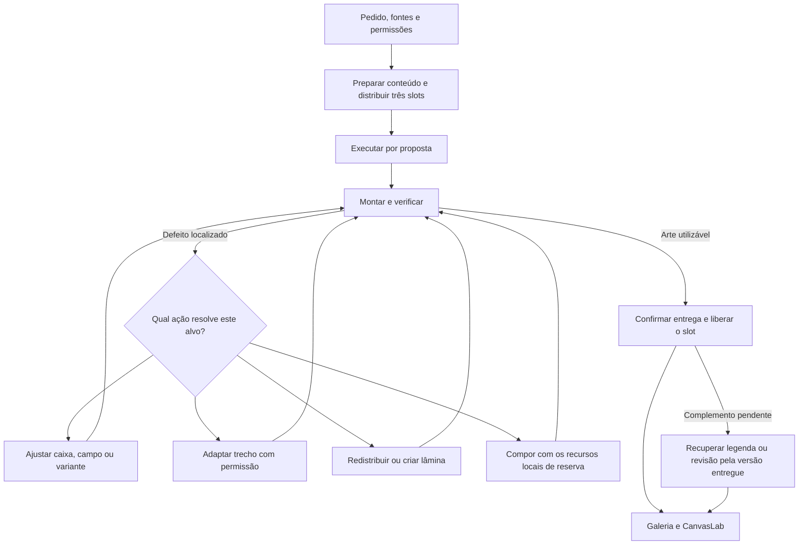

# Plano de implementação da recuperação de carrosséis no PostSpark

**Objetivo.** Entregar três propostas distintas e editáveis na galeria do Studio. Cada uma aparece assim que fica disponível. Se o texto estourar na lâmina 4, a aplicação pode trocar a composição dessa lâmina, abreviar um trecho autorizado ou desdobrá-lo em duas páginas. A capa, as demais lâminas e as outras propostas conservam o trabalho já validado.

O plano se aplica à geração comum de carrosséis com três slots. O fluxo em que o usuário escolhe um design fixo tem contrato próprio de uma proposta. A prioridade do slot 1 é a aderência ao pedido. Os slots 2 e 3 podem usar uma abordagem ou família visual de menor afinidade, preservando a mensagem, os fatos e as condições do briefing.

## Ponto de partida

| Evidência da sessão de 25/11/2026 | Consequência para a implementação |
| --- | --- |
| O pedido de sete lâminas em `visual_only` entregou 0/3. As três respostas acrescentaram texto ao roteiro literal. | Distribuir o texto diretamente da fonte. A arte precisa poder nascer mesmo quando o modelo insiste em reescrever o roteiro. |
| O pedido em `light_optimize` entregou 1/3. Na reconstrução da seleção, 17 das 22 sequências avaliadas foram descartadas apenas pela exigência de um campo específico para o CTA. | Testar se o convite final cabe em outro campo visível. As 17 sequências são candidatas a uma prova de encaixe. |
| A proposta entregue já tinha legenda vazia na saída de escrita. O renderizador de revisão ficou indisponível em etapa posterior. | Definir a política de legenda antes da escrita e tratar sua recuperação e a revisão visual como operações independentes. |

O coordenador já usa `@langchain/langgraph` 1.0.0 para executar três ramos. A proposta é acrescentar arestas condicionais dentro de cada ramo, com o PostgreSQL do PostSpark responsável por checkpoints, operações e entrega. A implementação parte da versão instalada e do Studio Debugger existente. [Coordenador atual](../../server/ai/workflows/generationCoordinator.ts) · [Graph API do LangGraph](https://docs.langchain.com/oss/javascript/langgraph/graph-api)

## Como o grafo escolhe o reparo

A primeira tentativa conserva o texto solicitado. Para cada defeito, o roteador identifica as ações capazes de resolvê-lo e prefere a que preserva mais conteúdo e trabalho aprovado. No desempate, considera evidência de encaixe, afinidade, diversidade entre os slots, tempo e custo restantes. Uma legenda ausente vai diretamente para o reparo de legenda. Um CTA que só precisa de mais largura vai para o ajuste de layout. A decisão fica registrada com suas entradas. Uma ação que já falhou só volta a ser candidata quando mudar algo capaz de resolver o defeito.

| Situação | Ação preferida | Alternativas disponíveis |
| --- | --- | --- |
| Texto excede uma caixa | Medir com a fonte real. Ajustar quebra, espaço disponível ou variante dentro dos critérios de leitura. | Abreviar só o trecho permitido. Se faltar espaço, repaginar ou compor uma lâmina com a geometria adequada. |
| O design não tem campo chamado CTA | Atribuir o convite a um campo visível compatível e medir o resultado com os demais fatos presentes. | Mudar a variante de fechamento ou criar uma lâmina de encerramento. |
| Há uma única família com boa afinidade | Comparar sequências pela composição visível. Admitir a mesma família com uma organização diferente. | Ampliar a busca nos slots 2 e 3. Compor propostas tipográficas distintas com recursos locais. |
| O modelo muda um roteiro literal | Reconstruir os campos com os trechos originais, na ordem de leitura. | Trocar ou criar lâminas para o texto. Preservar palavras, pontuação e ordem. |
| A legenda esperada veio vazia | Recuperar só a legenda com base no briefing e na arte confirmada. | Usar uma composição textual sustentada pelas fontes ou indicar que a legenda está em preparação. |

**Quantidade de lâminas.** O número solicitado é um alvo editorial. Sete podem virar seis ao reunir dois trechos curtos ou oito para preservar a leitura de um trecho longo. A proposta registra a quantidade pedida, a entregue e a justificativa. A decisão considera os limites atuais de 2 a 10. Somente uma exigência inequívoca de contagem ou de correspondência por página fixa essa estrutura. Nesse caso, o reparo trabalha o layout dentro dela. Se as restrições forem fisicamente incompatíveis, conservar as partes válidas e indicar qual trecho ou restrição precisa de ajuste. O usuário mantém o ajuste manual pelo CanvasLab. [Contrato de entrada](../../shared/generationRequest.ts)

## Ordem de implementação

### 1. Reproduzir as duas falhas e definir o que conta como entrega

Criar casos de regressão anonimizados com o roteiro, as permissões editoriais e as decisões de seleção necessárias para reproduzir 0/3 e 1/3. Usar as respostas capturadas ou equivalentes controlados e registrar qual tipo de evidência cada caso usa. Medir quantos slots chegaram ao banco, quantos o Studio conseguiu montar e se a legenda esperada chegou ao editor.

Fixar no pedido a versão da política de recuperação. Cada proposta deve conhecer o texto-fonte, os trechos protegidos, a política de legenda, a quantidade desejada e a permissão para repaginar. Manter identificadores estáveis de proposta, lâmina e campo, inclusive após inserir uma página. Registrar quais intervalos do texto-fonte deram origem a cada lâmina.

**Aceite.** Os dois casos reproduzem as falhas anteriores. O teste distingue um cartão de progresso, uma arte editável e uma entrega com todos os complementos pedidos.

### 2. Tornar cada slot recuperável e entregar uma reserva local

Extrair do fluxo de proposta os nós de montagem, diagnóstico, escolha da ação, reparo, validação e entrega. Reaproveitar as funções de ajuste e revisão existentes. Fazer a preparação produzir um briefing mínimo a partir do conteúdo disponível mesmo quando falhar a seleção de famílias. O sinal `selection_insufficient_fit` passa a encaminhar o slot para outra estratégia. [Preparação](../../server/ai/workflows/generationPlanning.ts) · [Execução da proposta](../../server/ai/workflows/proposalGraph.ts) · [Recuperação atual](../../server/ai/workflows/generationDeliveryRecovery.ts)

Implementar primeiro uma reserva tipográfica local que consiga preencher os três slots quando o acervo ou o provedor estiverem indisponíveis e já houver texto-fonte suficiente. Preparar três composições reconhecíveis, por exemplo uma sequência de leitura, uma com destaques e uma dividida em blocos. Variar a hierarquia de capa, desenvolvimento e fechamento, mantendo a identidade visual do projeto. Reservar tempo de execução para essa saída e verificar o encaixe no texto real. Adequar a admissão, a prontidão e o agendamento do worker para que a indisponibilidade da IA permita executar os nós locais. Para URL ou imagem ainda sem conteúdo recuperável, preservar o pedido e retomar a leitura da fonte. [Worker](../../server/ai/workflows/generationWorker.ts)

Reaproveitar as primitivas que já convertem autoria de lâminas em camadas editáveis. A rota atual de criação a partir de uma capa exige design fixo e um único slot. Para o trio, acrescentar uma variante versionada de entrega de carrossel composto, aceitando em cada página uma cena de catálogo validada ou camadas nativas validadas. Isso permite substituir apenas a lâmina problemática. Estender a projeção do histórico, o commit transacional, a autorização dos assets, o consumidor do Studio e a montagem no `CanvasPostModel`. Fixar a posição de cada proposta na galeria a partir de sua primeira exibição. [Compositor atual](../../server/ai/workflows/artworkCarousel.ts) · [Contrato de entrega](../../shared/generationContracts.ts) · [Commit do design fixo](../../drizzle/0082_generation_artwork_carousel.sql) · [Montagem no Studio](../../client/src/pages/StudioApp/StudioAppV2BPage.tsx)

**Aceite.** Com roteiro válido e catálogo ou IA indisponíveis, as três propostas de reserva abrem no CanvasLab e têm composições distintas. Uma falha no slot 2 permite abrir e editar os outros assim que ficam prontos.

### 3. Recuperar a qualidade antes de acionar a reserva

Converter afinidade temática, repetição de família, preferência de variante e capacidade estimada em critérios classificatórios. Aplicar isso na busca inicial, no planejamento e na escolha das reservas. Carregar o campo de CTA escolhido até a escrita, a validação física e a revisão. Conferir que o convite continua visível e que nenhum fato obrigatório perdeu seu espaço. Para distinguir as três propostas, reutilizar a assinatura da disposição visível das páginas e reservar a composição por slot, inclusive após reinício. Dentro de cada carrossel, permitir repetição quando duas lâminas compartilham uma função editorial e favorecer mudança de composição quando a função muda. [Busca de famílias](../../server/designCatalog/familyRetrieval.ts) · [Capacidade por campo](../../server/designCatalog/designCapacity.ts) · [Seleção editorial](../../server/ai/workflows/editorialDesignSelection.ts)

Aplicar o ajuste geométrico antes de intervir no texto. No modo literal, usar o mapa de trechos para validar a reconstrução integral do roteiro na ordem certa, inclusive após uma divisão autorizada. Nos modos que permitem edição, preservar fatos, ressalvas, marcas e textos protegidos. Quando a intervenção local for insuficiente, criar a lâmina a partir do conteúdo. Propagar a contagem efetiva pelo plano de páginas, cópia, revisão, miniaturas, editor, histórico e exportação. [Ajuste de texto](../../shared/arsenalAdaptiveTextFit.ts) · [Escrita por campo](../../server/ai/workflows/compactProposalCopy.ts)

**Aceite.** Os dois casos de regressão chegam a 3/3. Há cobertura para CTA em campo alternativo, uso da mesma família com composições distintas e contagens de seis, sete e oito. A página recomposta mantém a identidade das páginas vizinhas. O teste compara o conteúdo e a geometria das páginas preservadas.

### 4. Acionar IA pontualmente e recuperar a legenda

O nó de reparo envia ao modelo apenas o alvo, o defeito medido, o contexto necessário e as mudanças autorizadas. A resposta é um patch sobre a revisão de origem. Validar fatos, escopo, encaixe e contraste antes de aceitá-lo. Uma resposta que mexa em outro campo ou repita uma tentativa sem progresso encaminha o ramo para outra ação. Deduplicar por alvo, revisão e ação. Respeitar prazo e orçamento do pedido.

Resolver a política de legenda no briefing e propagá-la pelos caminhos compacto e convencional. Usar uma legenda fornecida, produzir uma complementar nos modos que permitem autoria e respeitar o pedido de omissão. Em `visual_only`, preservar o material autorizado para legenda e hashtags. Na falta de uma legenda esperada, executar seu reparo sem disparar novamente escrita de slides, imagens ou seleção. [Política na preparação](../../server/ai/workflows/generationPlanning.ts) · [Escrita e revisão por alvo](../../server/ai/workflows/proposalGraph.ts)

**Aceite.** Em ensaios independentes, devolver uma legenda vazia, interromper uma chamada de IA e provocar estouro em uma lâmina. Verificar o alvo modificado, os demais campos preservados e a ausência de recompra do mesmo efeito. No Studio, o usuário pode comparar o trecho original com o ajustado e ver o motivo. Um exemplo de aviso é “Dividimos a lâmina 4 para manter o texto legível. O carrossel passou de 7 para 8 lâminas.”

### 5. Garantir retomada, rastreabilidade e edição segura

Antes de cada efeito externo, gravar a decisão e sua chave estável no diário de operações existente. Persistir a revisão-base, os alvos aprovados, a próxima ação e o orçamento consumido. Ao recuperar a concessão de execução do worker, reutilizar o resultado confirmado. Um efeito pago com resultado incerto segue para reconciliação. Confirmar a entrega de cada slot, suas permissões de mídia e a cobrança prevista pelas regras vigentes com idempotência. [Diário e execução](../../server/ai/workflows/generationRuntime.ts) · [Persistência e commit](../../server/ai/workflows/generationStore.ts)

Registrar pendências de legenda ou revisão visual na mesma transação da entrega. Dar à pendência chave, concessão de execução e agendamento próprios para o worker retomá-la mesmo após o encerramento do pedido principal. Versionar o schema, as regras de commit e o estado exibido no Studio para distinguir arte disponível de revisão visual concluída. Quando o renderizador cair, uma arte verificada localmente segundo essa política pode abrir com revisão pendente. Aplicar cada complemento pela revisão do campo na galeria, no histórico e no editor aberto. Se o usuário já tiver alterado o alvo, conservar a edição e apresentar o complemento como sugestão.

Estender a linha do tempo no Studio Debugger com slot, lâmina/campo, defeito, ação escolhida, motivo, revisão, resultado, duração e custo conhecido. A pessoa que abre a galeria vê as adaptações relevantes e as pendências. A depuração conserva as referências à fonte e respeita o acesso do proprietário. [Studio Debugger](../../server/studioDebugger.ts) · [Fluxo de edição](../../client/src/pages/CanvasLab/CanvasLabPage.tsx) · [Persistência do editor](../../client/src/pages/CanvasLab/lib/saveAdapter.ts)

**Aceite.** Reiniciar o worker antes e depois de uma chamada externa e do commit. Simular disputa entre workers, perda de conexão e edição manual durante a revisão. Os slots conservam a identidade, a cobrança confere com o extrato e a linha do tempo explica como cada proposta chegou à galeria.

### 6. Validar a jornada e liberar gradualmente

| Ensaio | Evidência exigida |
| --- | --- |
| Os dois pedidos da sessão e um pedido que hoje funciona bem | Três artes distintas por pedido, fidelidade à fonte, legenda conforme o modo e qualidade da melhor opção preservada. |
| Roteiro longo, contagem flexível e contagem expressamente fixa | Conferência visual das quebras, ausência de corte e sobreposição, aviso do ajuste e edição manual da quantidade. |
| Renderizador ou IA indisponíveis, seguido de retorno | Reserva local utilizável quando aplicável, estados de revisão verdadeiros e complemento recuperado sem refazer a arte. |
| Commit interrompido, acesso a mídia privada e plano com débito de Sparks | Um único efeito financeiro previsto, assets autorizados pelo proprietário e reabertura pela mesma pessoa após o reinício. |
| Jornada autenticada no desktop e no celular | Criar → ver as três opções → editar uma delas → salvar → recarregar → reabrir → exportar. Na reabertura, conferir camadas editáveis e legenda. Nos arquivos exportados, comparar texto visível, ordem, contagem e aparência com o editor. |

Liberar primeiro para uma coorte de novos pedidos, com leitores e migração compatíveis já instalados. Medir a distribuição de 0/1/2/3 entregas entre todos os pedidos admitidos para o trio, a diferença entre slots confirmados no banco e montados no Studio, o tempo até o primeiro e o terceiro, a taxa de legendas esperadas vazias e o custo por trio completo. Acompanhar também admissões recusadas e pendências antigas para detectar onde o problema se deslocou. Comparar os resultados com a linha de base antes da ampliação.

Para reverter, voltar a admitir novos pedidos na política anterior e concluir os que já começaram com a versão gravada. O primeiro marco demonstrável é abrir os três slots dos dois casos que falharam. O aceite da liberação exige também a jornada no Studio e a conferência de persistência e cobrança com pedidos de teste na instalação oficial da VPS. [Integração com a VPS](../contrato-integracao-supabase-vps.md)
