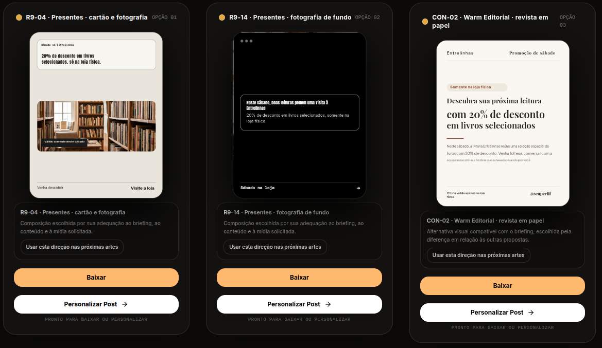

# Referência aprovada — Livraria Entrelinhas

Data do aceite: 2026-11-06 (America/Sao_Paulo).
Identificador documental: entrelinhas-20261106.
Contexto de trabalho: branch codex/acervo-82, ambiente local da worktree em localhost:3182.
Fonte do aceite: avaliação explícita do usuário nesta conversa, acompanhada de captura da galeria.

## Resultado e declaração do usuário

**3 de 3 composições aprovadas pelo usuário, publicáveis sem ajustes.**

> As 3 composições sairam PERFEITAS. Eu as publicaria sem problemas.

> a escolha foi bem feita, satisfaz o usuário, o texto está perfeito, bem diagramado e espaçado, as propostas são suficientemente diferentes para trazerem uma diversidade. Tudo 100%. Eu publicaria sem ajustes

“100%” registra o aceite humano deste conjunto; não é uma nota calculada pelo revisor nem uma taxa geral de sucesso do sistema.

## Prompt original

> Crie um post para a livraria Entrelinhas: neste sábado, livros selecionados com 20% de desconto, somente na loja física. Quero uma composição expressiva que valorize o prazer de descobrir uma boa leitura e deixe claras as condições da oferta.

## Composições identificadas na captura

| Posição na tela | Design exibido | Aceite do usuário |
| --- | --- | --- |
| Opção 01 | R9-04 · Presentes · cartão e fotografia | Publicável sem ajustes |
| Opção 02 | R9-14 · Presentes · fotografia de fundo | Publicável sem ajustes |
| Opção 03 | CON-02 · Warm Editorial · revista em papel | Publicável sem ajustes |

Os nomes acima são os rótulos visíveis na interface; não constituem uma verificação da execução interna de cada design.

## O que este caso estabelece como parâmetro

- Entrega completa: três propostas disponíveis e aprovadas na mesma geração.
- Escolha das composições adequada ao pedido e satisfatória para o usuário.
- Copy aprovada, comunicando a oferta e suas condições: sábado, 20% de desconto, livros selecionados e loja física.
- Diagramação, espaçamento e legibilidade aprovados no resultado apresentado.
- Diversidade suficiente entre as três propostas para oferecer escolhas reais.
- Prontidão para publicação: nenhuma intervenção editorial ou visual solicitada pelo usuário.

## Uso em avaliações futuras

Usar este prompt e esta captura como referência positiva de aceitação humana ao avaliar mudanças de seleção, redação, encaixe de texto e revisão. Comparar a utilidade e a qualidade do conjunto de três propostas, preservando a liberdade criativa: outros designs, textos e composições podem atingir o mesmo nível de aprovação.

Este aceite não implica fixar estes três designs, aumentar seus pesos globais, exigir reprodução pixel a pixel ou acrescentar regras rígidas ao revisor. Também não deve ampliar automaticamente os prompts enviados à API. O registro é uma referência de avaliação, sem mudança de configuração do produto.

## Evidência e alcance

Captura original preservada integralmente, sem edição.
SHA-256: `4f75dadafe2d79bc8a775e45ce2ba812e29b16955b4de4b8ebbe3575c2d167f5`.

O registro confirma o relato do usuário e a captura da galeria. Não foram consultados os logs desta geração para correlacionar request_id, modelos, custo, latência, acionamento de correção ou notas de revisão. Não atribuir este sucesso a um mecanismo específico sem essa correlação. Exportação, persistência e reabertura não foram verificadas neste registro.
