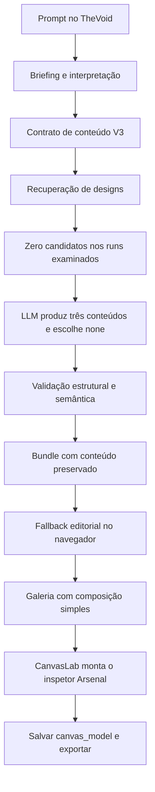
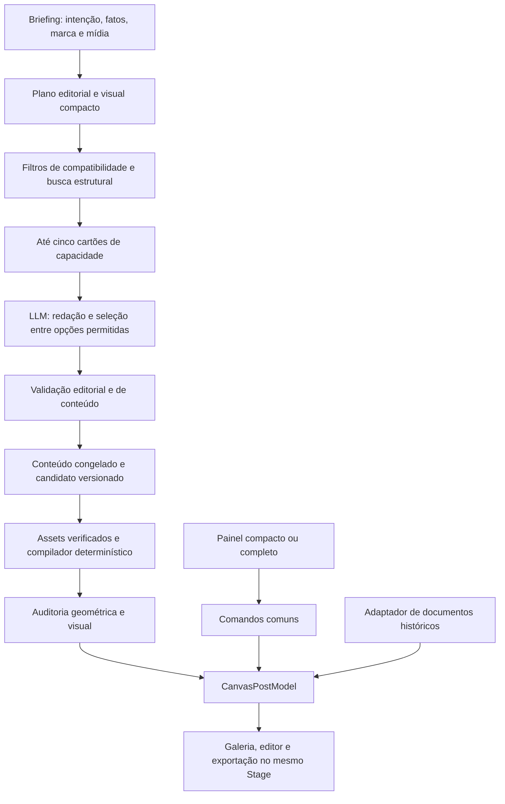

# Auditoria da geração, do Arsenal e do editor unificado do PostSpark

Data: 2 de outubro de 2026. Estado: diagnóstico e especificação de correções; a implementação descrita neste relatório ainda deve ser executada.

Leitura orientada: [diagnóstico do BizuMiner](#4-investigação-do-caso-bizuminer), [acervo operacional](#5-o-tamanho-real-do-acervo-operacional), [contratos de geração](#8-contratos-de-geração-que-precisam-ser-fechados), [novo editor](#11-nova-integração-do-editor), [plano de execução](#19-plano-de-execução-em-entregas-verificáveis) e [critérios de conclusão](#20-matriz-de-testes-e-critérios-de-conclusão).

Documentos derivados para execução: [roteiro de implementação](</home/many/Documentos/Projetos linux/PostSpark 3/docs/implementacao-geracao-arsenal-editor-unificado.md>) e [roteiro de conferência independente](</home/many/Documentos/Projetos linux/PostSpark 3/docs/conferencia-geracao-arsenal-editor-unificado.md>). Eles compartilham os requisitos R01–R22 e distinguem trabalho planejado de evidência de conclusão.

## 1. Conclusão executiva

O PostSpark já possui uma base valiosa: receitas reproduzíveis, conteúdo variável, peças e grupos, relações determinísticas, busca estrutural com pgvector, assets verificados e renderização no CanvasLab. O problema atual está na continuidade entre essas partes. A coleção demonstrada nas galerias ainda não corresponde ao catálogo disponível para geração, e o novo caminho de conteúdo chega a um editor com menos ferramentas acessíveis.

**O próximo trabalho deve ser uma integração de produto, acompanhada de recuperação da qualidade editorial e visual.** Implementar somente o plano de painéis deixaria a geração fraca. Publicar somente alguns designs deixaria as ferramentas incompletas. Alterar somente o prompt deixaria a composição de fallback sem hierarquia.

As quatro queixas têm explicações distintas:

| Queixa | Diagnóstico confirmado | Ação necessária |
| --- | --- | --- |
| Aviso de novos designs indisponíveis | A consulta remota encontrou 11 versões, todas `draft`, e 21 documentos de busca. Os runs examinados receberam zero candidatos. | Concluir conversão, revisão e publicação; mostrar prontidão por capacidade e motivo. |
| Três resultados com texto demais | A LLM escreveu copy nova. O fallback V3 aplica tratamento quase uniforme aos papéis semânticos e o contrato não estabelece adequadamente a relação entre mensagem visual e explicação. | Recuperar direção editorial, planejamento de densidade e hierarquia do compilador. |
| Ferramentas antigas ausentes nos novos posts | A presença de `composition` troca tanto o painel quanto o ramo do renderer. Isso acontece também no fallback, sem catálogo publicado. | Criar comandos e capacidades comuns, completar o documento e então montar o novo painel. |
| Contratos LLM pouco coerentes | Há schema rigoroso, cobertura e proteção de conteúdo, mas a avaliação técnica não assegura impacto, síntese, diversidade visual ou legibilidade. | Contratos explícitos entre briefing, conteúdo, capacidade visual, composição, edição e entrega. |

### 1.1 Correção importante sobre o relato de cópia

O proprietário esclareceu que o prompt não foi copiado literalmente. A dificuldade foi a quantidade de texto na arte e a impressão de que havia blocos ausentes. A investigação deve partir dessa correção.

No post salvo **95**, correspondente ao run **53704704-a586-46c8-853d-fde1326efa9e**, os quatro blocos de conteúdo visual estão presentes no JSON e visíveis na tela examinada. Legenda e hashtags existem separadamente e não devem aparecer automaticamente na arte. Não foi reproduzida perda de blocos nesse post específico.

A aparência de parágrafo corrido foi reproduzida e tem uma causa concreta no código. Outros relatos de ausência de conteúdo continuam exigindo o documento e o trace correspondentes; este caso não autoriza concluir que todo possível problema de cobertura esteja resolvido.

### 1.2 Ordem recomendada

1. Corrigir fallback, orientação editorial, diagnóstico de prontidão e telemetria enganosa.
2. Fechar o contrato comum de documento/comandos e migrar uma composição completa com todas as operações essenciais.
3. Recuperar o acervo original e artístico por famílias de problemas, com revisão visual por versão.
4. Implantar o painel compacto e completo sobre os mesmos comandos.
5. Validar geração real, edição, persistência, exportação, carrosséis e cobrança; ampliar o rollout com evidências.

Essas frentes podem avançar em paralelo quando não compartilham contratos em mudança. O aceite final depende do fluxo inteiro.

## 2. Escopo, método e limites

Esta auditoria cruzou o plano solicitado, o documento-mestre, os planos do DNA/Arsenal, os contratos, o relatório de implementação, o código produtor/consumidor, os registros de importação e os resultados históricos dos ensaios. O plano de editor foi lido integralmente. O plano histórico de curadoria foi revisado por suas decisões, atualizações e seções pertinentes ao fluxo atual.

Também foram realizadas consultas **somente de leitura** pelo MCP Supabase e inspeção visual da sessão já aberta em `http://localhost:3000/thevoid`. A sessão mostrava o editor do post salvo analisado. O banco consultado é o projeto `spbuwcwmxlycchuwhfir`.

Classificação usada neste relatório:

- **Confirmado:** observado no código, documento salvo, trace, consulta atual ou tela, com a fonte indicada.
- **Evidência histórica:** resultado de um ensaio registrado anteriormente; não foi repetido nesta auditoria.
- **Recomendação:** comportamento que deve ser implementado e validado.
- **Pendente:** algo que as evidências disponíveis não permitem garantir.

Não houve nova geração paga, alteração de posts, publicação de designs, migration, teste automatizado ou build nesta rodada. Os resultados de testes citados pertencem às rodadas anteriores. O código local contém muitas alterações prévias; não foi estabelecida equivalência entre esta árvore e o último deploy de produção.

A ausência do MCP Compass foi contornada com busca local dirigida. O MCP Supabase funcionou nesta auditoria; relatos anteriores de indisponibilidade desse conector não representam o estado observado hoje.

## 3. Fluxo atual e onde ele perde qualidade

O fluxo chega ao fim, mas isso não comprova a qualidade desejada. Três conteúdos válidos podem ser desenhados pelo mesmo fallback; o editor pode salvar corretamente um documento que ainda oferece ferramentas insuficientes.

### 3.1 V3 e disponibilidade do Arsenal são decisões diferentes

O cliente envia `designContractVersion: 3`. Para posts estáticos, o orquestrador usa o caminho novo quando existe contrato de conteúdo variável, mesmo que o catálogo esteja desligado, vazio ou sem candidato compatível. Portanto, desativar a seleção do Arsenal não restaura automaticamente a experiência anterior. O despacho V3 examinado é condicionado a `postMode === "static"`; não comprova migração do gerador de carrosséis.

A mensagem “Gerar agora usa as famílias atuais” não descreve o caminho observado: o resultado usa o fallback de conteúdo variável. O nome `Editorial` também não comprova que a família histórica Editorial de Luxo tenha sido utilizada.

Fontes: [StudioAppV2BPage.tsx:260](</home/many/Documentos/Projetos linux/PostSpark 3/client/src/pages/StudioApp/StudioAppV2BPage.tsx:260>), [aviso ao administrador:494](</home/many/Documentos/Projetos linux/PostSpark 3/client/src/pages/StudioApp/StudioAppV2BPage.tsx:494>), [generationOrchestrator.ts](</home/many/Documentos/Projetos linux/PostSpark 3/server/ai/generationOrchestrator.ts>).

### 3.2 Prontidão genérica é insuficiente

`generationReadiness` executa uma consulta com post estático, texto vazio e sem marca bloqueada. Isso é útil como sonda inicial, mas não responde se o briefing atual pode receber lista, comparação, citação, foto, determinada fonte ou formato.

A resposta deve separar:

- disponibilidade da infraestrutura;
- ativação para o usuário;
- quantidade publicada e compatível;
- cobertura por formato, mídia e estrutura de conteúdo;
- motivos de exclusão;
- alternativa realmente utilizada quando não há candidato.

O painel administrativo pode mostrar esses detalhes. O usuário final precisa apenas de uma experiência previsível e uma indicação compreensível quando houver uma limitação relevante. Falha de infraestrutura e catálogo sem publicação não devem compartilhar uma mensagem ambígua.

Fonte: [designCatalog.ts:282](</home/many/Documentos/Projetos linux/PostSpark 3/server/routers/designCatalog.ts:282>).

## 4. Investigação do caso BizuMiner

### 4.1 Insumo fornecido

O briefing explica que um desconto de 50% só pode ser avaliado em relação ao histórico de preços e apresenta o BizuMiner como serviço de acompanhamento diário com favoritos. Ele contém fatos e contexto para a redação. O usuário não solicitou expressamente que toda a explicação se tornasse texto visual.

### 4.2 Evidências correlacionadas

| Evidência | Resultado |
| --- | --- |
| Run principal | `53704704-a586-46c8-853d-fde1326efa9e`, criado em 02/10/2026 às 13:34:07 UTC, 10:34:07 em São Paulo |
| Outros runs examinados | `5142fea3-1e0d-4f39-829c-f7548445dad8` e `766cfd8b-c0f8-4353-92d9-3336ab75b27a` |
| Recuperação | Modo administrativo; nenhum candidato elegível nos três runs |
| Seleção | `none`; não houve seleção de uma composição publicada |
| Copy | Três propostas diferentes, incluindo texto expositivo, lista e comparação |
| Run principal, primeira proposta | Chamada “COMPRAS ONLINE”, título e dois parágrafos de corpo |
| Título salvo | “Desconto de 50% de verdade ou metade do dobro?” |
| Persistência examinada | Post 95; registro `createdAt` 2026-10-02 13:50:15.77335 |
| Conteúdo visual salvo | Quatro blocos e quatro elementos de texto correspondentes |
| Composição | Fallback, sem candidato selecionado; estado de composição `applied` |
| Tipografia resolvida | Arial, tamanho 64 e peso 400 nos quatro elementos |
| Formato salvo | 1:1; base de fallback 4:5 projetada com escala 0,8 e deslocamento horizontal 108 |
| Tela observada | Os quatro blocos estão visíveis, com hierarquia visual insuficiente |

O trace registra o modelo solicitado como `llama` e o modelo efetivo como `google/gemini-3.8-flash`. Isso descreve o registro da execução; não é uma avaliação de disponibilidade comercial ou preço desse modelo. Trocar o modelo por um mais caro não corrige, por si, os problemas determinísticos identificados.

### 4.3 Por que a hierarquia se perdeu

O fallback V3 calcula tamanho pelo número de fontes de conteúdo, aplicando o mesmo cálculo a todas. Além disso, o peso usa `source === "headline"`. No conteúdo V3 a origem é um seletor como `content:<id>:text`; o título não satisfaz essa comparação e recebe peso 400.

O resultado preserva conteúdo e ordem, mas trata chamada, título e explicação como uma coluna tipograficamente uniforme. A validação de cobertura considera isso válido. A percepção humana de qualidade não considera.

Fonte direta: [arsenalFallback.ts:42](</home/many/Documentos/Projetos linux/PostSpark 3/client/src/pages/CanvasLab/lib/arsenalFallback.ts:42>) e [peso da fonte:93](</home/many/Documentos/Projetos linux/PostSpark 3/client/src/pages/CanvasLab/lib/arsenalFallback.ts:93>).

### 4.4 Por que não classificamos este caso como texto cortado

O último corpo termina aproximadamente em Y=1206 nas coordenadas da base. A prancheta final tem altura 1080, mas a composição tem projeção de escala 0,8. O limite projetado fica aproximadamente em 964,8 e cabe na prancheta.

Qualquer auditoria geométrica precisa aplicar transformações de grupos, rotações, escalas e projeção antes de declarar overflow. Comparar coordenadas brutas da receita à altura final produziria um falso diagnóstico.

Também é necessário diferenciar conteúdo visual, legenda, hashtags, prompt de imagem e campos internos. A presença de texto no JSON não implica que aquele campo deva ser desenhado.

### 4.5 Como o contrato editorial deveria tratar esse briefing

Uma proposta possível, apresentada apenas como exemplo editorial para orientar a implementação:

- Chamada: “DESCONTO REAL?”
- Título: “50% abaixo de qual preço?”
- Apoio: “Acompanhe o histórico com o BizuMiner.”
- Ação opcional: “Salve seus favoritos e acompanhe os preços.”
- Legenda: desenvolver a explicação sobre comparação histórica, acompanhamento diário e favoritos.

Outra direção poderia organizar “Oferta anunciada” e “Histórico de preço” em comparação visual. Uma terceira poderia enfatizar o benefício de acompanhar antes de comprar. As três preservam a proposição central. Não é necessário inventar três teses ou números adicionais.

Isso não constitui um limite universal de quatro blocos. É uma recomendação editorial para um pedido de post estático sem exigência de conteúdo literal. Se o usuário pedir explicação detalhada, 15 itens ou uma frase exata, esse pedido continua prevalecendo.

## 5. O tamanho real do acervo operacional

### 5.1 Coleção em arquivos, importação e publicação

| Etapa | Evidência disponível |
| --- | --- |
| Biblioteca reunida nos ensaios | 69 receitas no manifesto usado pela importação |
| Conversão das 12 famílias de `shared/creative` | 36 receitas, três formatos históricos por família |
| Importação inicial para o contrato operacional | 18 receitas preparadas e importadas |
| Bloqueadas nessa importação | 51 receitas |
| Estado remoto atual | 11 versões draft e 21 documentos de busca; nenhuma versão aprovada |
| Acréscimo posterior | Minimal Air versão 2, com três variantes incluindo 4:5 |
| Geração real examinada | Zero candidatos publicados disponíveis |

As 21 variantes não representam 21 designs independentes prontos para o usuário. Há variantes de formato e versões diferentes do mesmo design. A quantidade de cards, receitas, blueprints, versões, variantes e designs publicados precisa aparecer separadamente nas métricas.

Fonte: [relatório de importação](</home/many/Documentos/Projetos linux/PostSpark 3/artifacts/arsenal-v2/import-2026-10-01T21-16-01-495Z/report.json>) e consulta Supabase de 02/10/2026.

### 5.2 As 51 pendências formam quatro classes de trabalho

| Classe | Quantidade | Correção geral |
| --- | ---: | --- |
| Papel semântico não reconhecido | 35 | Manifesto explícito de bindings e vocabulário semântico; classificar textos de demonstração, marca, conteúdo e ornamentos |
| Campo com rotação/geometria/estilos múltiplos | 7 | Conteúdo ligado a grupos ou fragmentos tipográficos com identidade estável e relações executáveis |
| Texto em arco ou extrusão | 6 | Capacidade gráfica tipada e renderer correspondente, ou variante autorada com limitação declarada |
| Peso solicitado diferente dos bytes da fonte | 3 | Corrigir registro/resolução da fonte e sua instância real; remedir antes de validar |

As quantidades são classificadas pelo primeiro bloqueio registrado. Corrigir esse bloqueio pode revelar outros. Não devem ser estimadas como 51 correções isoladas nem presumidas prontas após remover uma validação.

O importador atual protege o produto ao recusar estruturas que não sabe representar. A correção deve ampliar a representação e a autoria, preservando essas garantias.

### 5.3 Apenas quatro famílias originais chegaram à importação inicial

Brutal Split, Glass Veil, Minimal Air e Duotone Wash representam 12 das 18 variantes importadas. As seis restantes são combinações do piloto de papel, janela e foto. Entre essas quatro famílias originais, três foram importadas com exigência de mídia.

Isso ajuda a explicar a baixa cobertura sem foto. O conversor marca toda entrada de mídia da matriz como obrigatória, e as composições do piloto importadas estavam em 5:6. Novas gerações usam 4:5, 1:1 e 9:16; 5:6 permanece apenas para compatibilidade histórica.

Ajustes necessários:

1. Distinguir mídia necessária, opcional, decorativa e substituível por composição sem foto.
2. Não interpretar `imagePrompt` ou imagem sintética de ensaio como asset disponível.
3. Criar variantes atuais 4:5 com geometria validada; não renomear 5:6 mantendo proporções erradas.
4. Preservar versões, hashes e arquivos antigos.
5. Revisar o relatório de importação após cada ampliação de capacidade.

Fonte: [convertRecipe.ts](</home/many/Documentos/Projetos linux/PostSpark 3/harness/arsenalV2/convertRecipe.ts>).

### 5.4 As 12 famílias não cobrem todos os estilos ativos do CanvasLab

Existem 12 famílias em `shared/creative/families.ts` e 14 no CanvasLab ativo. Há correspondência entre `glitch-signal` e `cyber-glitch`; `stroke-impact` e `cinematic-depth` não estavam cobertos pela conversão das 12.

Há ainda diferença entre os dois renderers históricos. A conversão usa a composição de `shared/creative`, não uma captura semântica completa do ramo convencional do `CanvasPostStage`. Exemplos registrados: Quote Authority usa Lora no compositor compartilhado e Cinzel na família ativa; Kinetic Type apresenta Anton em uma representação e Syne na outra.

Portanto, “foi convertido para JSON” não equivale a “preserva o design original ativo”. A referência para paridade precisa ser escolhida explicitamente. Para preservar a experiência do produto, o CanvasLab ativo deve ser a referência principal; variações históricas diferentes podem ser preservadas como designs identificados, sem substituição silenciosa.

Fontes: [conversor das famílias](</home/many/Documentos/Projetos linux/PostSpark 3/harness/designFamilies/convert.ts>), [famílias compartilhadas](</home/many/Documentos/Projetos linux/PostSpark 3/shared/creative/families.ts>) e [metadados do CanvasLab](</home/many/Documentos/Projetos linux/PostSpark 3/client/src/pages/CanvasLab/components/types.ts>).

### 5.5 Situação das famílias no relatório de importação

| Família | Situação registrada | Trabalho imediato |
| --- | --- | --- |
| Editorial Poster | Peso incompatível com bytes da fonte | Corrigir asset e remedir |
| Chromatic Block | Papel `cd-sticker-rot` não classificado | Autoria de binding/ornamento e sua relação |
| Brutal Split | Três variantes draft; mídia exigida | Revisar mídia, 4:5 e equivalência visual |
| Glitch Signal / Cyber Glitch | Arco/extrusão ou capacidade gráfica não suportada | Representar o efeito ou autorar variante explicitamente distinta |
| Glass Veil | Três variantes draft; mídia exigida | Revisar mídia, 4:5 e equivalência visual |
| Kinetic Type | Campo headline com geometria/estilos múltiplos | Preservar fragmentos/grupo e tipografia da referência ativa |
| Data Punch | Papel `cd-stat` não classificado | Binding de métrica e evidência factual |
| Versus | Papel `section-0` não classificado | Estrutura semântica da comparação |
| Quote Authority | Papel `cd-attribution` não classificado | Citação/atribuição e fonte correta |
| Minimal Air | Três variantes draft iniciais; versão 2 posterior com 4:5 | Revisão/publicação e teste de cobertura |
| Mosaic Grid | Papel `section-0` não classificado | Lista/seções e relações de grade |
| Duotone Wash | Três variantes draft; mídia exigida | Revisar mídia, 4:5 e equivalência visual |
| Stroke Impact | Fora da conversão das 12 | Inventariar e preservar o design ativo |
| Cinematic Depth | Fora da conversão das 12 | Inventariar e preservar o design ativo |

Os bloqueios são os registrados pelo importador, não uma lista exaustiva de problemas visuais de cada família. A coluna de trabalho é a recomendação desta auditoria.

## 6. O que manter, complementar e retirar dos planos

| Decisão anterior | Avaliação | Encaminhamento |
| --- | --- | --- |
| Peças, blueprints e compilador determinístico | Adequada | Preservar responsabilidades e composição por relações |
| JSON completo com representações derivadas | Adequada | JSON continua canônico; vetor e card são índices de seleção |
| Busca estrutural com pgvector e filtros | Implementada em parte operacional | Ampliar cobertura publicada e âncoras; medir relevância real |
| Medição pelo mesmo motor do CanvasLab | Essencial | Exigir fontes carregadas e configuração idêntica na compilação, edição e exportação |
| Conteúdo V3 variável e edição livre | Adequada | Preservar; complementar com direção editorial e orçamento visual |
| Congelar conteúdo antes da geometria | Adequada | Redação/revisão editorial ocorre antes; compilador nunca corta ou reescreve |
| Contratos com limites técnicos | Necessários | Separar de preferências editoriais e de liberdade de edição |
| Nova interface básica e avançada | Direção correta | Implementar comandos/capacidades antes do shell definitivo |
| Adaptadores convencional/composição | Úteis para compatibilidade | Usar como transição; novos designs devem convergir no documento comum |
| Autoaprovação histórica por confiança e tempo | Não demonstra qualidade do pacote operacional | Não substituir os guardas atuais de publicação por versão/variante/hash |
| Extração híbrida com OCR, visão e segmentação | Pesquisa anterior | Não colocar como dependência da integração atual |
| Reprodução fiel de toda referência | Meta histórica refinada pelo usuário | Trabalhar com adaptação reutilizável e áreas de mídia, preservando intenção visual |
| Publicar tudo porque as galerias agradaram | Evidência insuficiente para pacotes transformados | Reutilizar aprovações apenas quando houver correspondência verificável com o artefato final |
| Índice vetorial aproximado/HNSW agora | Não resolve ausência de candidatos | Adiar até volume, métrica compatível e medições justificarem |

### 6.1 Revisão específica do plano de editor unificado

O plano identifica corretamente a bifurcação dos painéis, os campos ignorados pelo renderer e a necessidade de camadas autorais. Sua matriz de recursos deve permanecer como critério de aceite.

Faltam definições operacionais para:

1. Resolver a regressão de copy e fallback antes da nova interface.
2. Separar renderer de compatibilidade de um segundo modelo permanente para novos designs.
3. Definir cada comando com entrada, alvo, campos autoritativos, conflitos, undo e persistência.
4. Representar novos textos, imagens, logo e efeitos sem criar outra fonte de conteúdo.
5. Definir o comportamento de edição sobre relações automáticas.
6. Demonstrar paridade com as 14 famílias ativas, além das 12 receitas convertidas.
7. Integrar restrições de marca, mídia real, fontes e cobrança.
8. Diferenciar aprovação estrutural, visual e publicação.
9. Exigir o percurso HTTP autenticado completo em vez de encerrar na galeria de harness.
10. Planejar rollout e compatibilidade entre clientes/servidor com schemas diferentes.

O presente relatório complementa o plano com essas definições. Não altera retroativamente o status das entregas anteriores.

## 7. Arquitetura de destino

### 7.1 Responsabilidades

| Componente | Responsabilidade | Limite |
| --- | --- | --- |
| Curadoria administrativa | Criar, decompor, revisar e publicar designs | Não faz parte do fluxo obrigatório do usuário final |
| Catálogo | Versões, variantes, peças, fontes, compatibilidade e evidências | Não armazena o post do usuário como nova base publicada |
| Recuperação | Filtrar e ordenar candidatos viáveis | Similaridade não é aprovação estética |
| LLM editorial | Interpretar o pedido e redigir uma mensagem adequada | Não calcula pixels nem recebe todos os JSONs |
| Compilador | Vincular conteúdo, resolver relações e desenhar deterministicamente | Não inventa fatos nem omite blocos para caber |
| Auditoria | Distinguir integridade, legibilidade e qualidade visual | Não promete uma pontuação universal de beleza |
| Editor | Permitir ajustes livres e reversíveis sobre o documento | Não escreve silenciosamente em campos ignorados |
| Persistência | Conservar documento, assets, versão e proveniência | Não depende da disponibilidade futura da referência original |

### 7.2 Uma fonte autoritativa por responsabilidade

O documento final continua sendo `CanvasPostModel`. Em slides com composição, `composition.content` contém o conteúdo semântico. As peças publicadas e a base são imutáveis. Os elementos resolvidos são a projeção renderizável, reconstruída a partir da base, conteúdo, relações e edições autorais.

O editor não deve manter simultaneamente um texto editável em `headline`, outro em `composition.content` e um terceiro em uma camada autoral. Campos legados, quando necessários, são projeções de compatibilidade. Cada operação deve deixar explícito qual fonte modifica.

Para novos posts, famílias originais, designs artísticos e fallback devem convergir para a representação comum. Documentos antigos podem continuar usando um adaptador de compatibilidade até existir migração com paridade comprovada. Abrir um histórico não é autorização para recriá-lo visualmente.

### 7.3 O papel dos vetores e das combinações

A representação estrutural de 48 eixos e a métrica L1 ponderada continuam úteis para proximidade. As composições e relações executáveis preservam dependências que um vetor resumido não expressa sozinho.

O caminho recomendado é: filtros de capacidade → similaridade → diversidade → cartão compacto → escolha → definição completa → composição → verificação. A LLM escolhe entre IDs e capacidades. Os parâmetros completos acompanham a escolha, sem ocupar todo o contexto da geração.

Combinações inéditas devem ser produzidas apenas dentro de contratos compatíveis e avaliadas no resultado resolvido. Uma composição próxima de outra aprovada não herda automaticamente sua aprovação. A expansão inicial deve reutilizar os grupos e relações já demonstrados, mantendo um espaço de combinação verificável.

## 8. Contratos de geração que precisam ser fechados

### 8.1 Contrato de briefing

O briefing precisa distinguir três intenções editoriais, mesmo que a interface não exija um formulário para todas:

| Intenção | Comportamento |
| --- | --- |
| Criar a partir de uma ideia/contexto | Redigir a mensagem visual e desenvolver contexto na legenda quando apropriado |
| Adaptar uma copy existente | Preservar significado, fatos e termos exigidos; propor organização e síntese autorizadas |
| Usar texto literal | Preservar exatamente os trechos indicados; adaptar composição, não reescrever |

Campos lógicos recomendados: intenção, público, objetivo, tom, fatos sustentados, trechos literais, informação obrigatória, formato solicitado, preferência de densidade, marca e disponibilidade real de mídia. São recomendações de contrato, não nomes de campos já implementados.

A classificação automática pode inferir esses valores quando o usuário não especificar. Ambiguidade material deve gerar uma opção simples ou uma suposição registrada; não precisa bloquear toda geração. A preferência padrão para um post estático promocional pode ser leitura rápida, mantendo espaço para pedidos educativos e detalhados.

O usuário não deve precisar escrever “não coloque meu briefing inteiro na arte” para receber uma composição comunicativa.

### 8.2 Plano editorial antes de congelar o conteúdo

O plano deve definir o que o leitor precisa entender primeiro, o que apoia essa mensagem, o que é ação e o que pertence à legenda. Isso pode ser incluído na chamada atual; não exige uma nova chamada LLM por etapa.

O código já possui `ContentStrategy` e `EditorialMeaningPlan`, além de instruções de preservação do significado. Reaproveitar essa base e conciliar as instruções atuais: um módulo permite compartilhar a proposição e prioriza diversidade visual, enquanto o prompt V3 pede três direções de conteúdo distintas. A variedade não deve forçar três teses diferentes sobre o mesmo briefing.

Antes da composição, validar:

- a proposição principal é recuperável na primeira leitura;
- o título/chamada tem um papel claro, quando existir;
- os apoios acrescentam informação e evitam repetir a mesma explicação;
- números, nomes, comparações e promessas vêm do insumo;
- o texto visual é adequado à intenção de leitura;
- legenda e hashtags são coerentes com o assunto;
- trechos literais e quantidades solicitadas foram preservados.

Fonte: [postGenerator.ts](</home/many/Documentos/Projetos linux/PostSpark 3/server/ai/postGenerator.ts>) e [prompt Arsenal:265](</home/many/Documentos/Projetos linux/PostSpark 3/server/ai/arsenalGenerationOrchestrator.ts:265>).

### 8.3 Orçamento visual sem retornar aos maxLength arbitrários

Quantidade livre de blocos significa liberdade semântica. Não significa que todos devam receber a mesma fonte ou ocupar uma prancheta sem planejamento.

Cada família/composição deve declarar uma faixa de uso validada: papéis suportados, quantidade de regiões, formatos, densidades recomendadas, comportamento de expansão e dependências de mídia. Essas informações alimentam a seleção. O encaixe final usa medição real, incluindo fonte, peso, tamanho, largura, linhas e relações.

Limites técnicos de geração, payload e segurança continuam existindo. Recomendações editoriais são preferências de qualidade. Edição manual permanece livre: avisos de encaixe não viram bloqueios de digitação nem cortes automáticos.

Se o conteúdo literal não couber, oferecer alternativas de composição, formato ou paginação. Se o usuário pediu post estático, não transformar em carrossel silenciosamente. Se o usuário pediu 15 itens, não devolver oito para facilitar o layout.

### 8.4 Cartão compacto enviado à LLM

O cartão deve resumir capacidades, não replicar o JSON inteiro:

| Informação | Uso |
| --- | --- |
| ID, versão, variante e hashes | Escolha permitida e reprodução rastreável |
| Linguagem visual e intenção | Adequação ao briefing |
| Papéis/blocos suportados | Cobertura semântica |
| Perfil de densidade e expansão | Escolha de conteúdo compatível sem calcular pixels |
| Mídia necessária/opcional | Evitar oferecer foto ausente |
| Formato e zonas funcionais | Conhecer a distribuição geral |
| Capacidade de marca e fontes | Evitar escolhas incompatíveis |
| Restrições e relações relevantes | Preservar conjuntos que funcionam juntos |

Esses campos devem ser derivados/versionados junto à definição, com teste de consistência. A recuperação deve oferecer no máximo a shortlist prevista no contrato vigente; o volume de JSON do acervo não aumenta o contexto da LLM.

### 8.5 Validação, reparo e congelamento

Preservar o schema rigoroso e a mesma forma de contrato na chamada principal e no reparo. Continuar restringindo IDs aos candidatos oferecidos e `none`.

A revisão editorial ocorre antes do congelamento. Depois dele, o compilador tenta alternativas geométricas compatíveis. Não pode resumir, excluir um corpo ou transferir texto para a legenda silenciosamente. Uma ação explícita do usuário, como “Resumir texto”, cria uma nova revisão de conteúdo com antes/depois.

O limite atual de reparo deve continuar controlado. Falta de qualidade editorial não deve produzir um ciclo indefinido de chamadas, aprovação, correção e nova chamada. Registrar o motivo exato e distinguir uma recusa técnica de uma proposta que precisa de decisão do usuário.

### 8.6 Contrato entre resposta e frontend

Cada variação deve entregar conteúdo, origem visual, definição selecionada ou fallback identificado, formato, assets, hashes, IDs estáveis e estado de avaliação. O frontend precisa saber se recebeu uma proposta visual pronta, uma alternativa degradada ou uma composição que requer ajuste.

“Aprovado” pelo schema não deve equivaler a “aprovado visualmente”. Usar estados separados para validade do conteúdo, compilação, qualidade visual e entrega. O nome mostrado na galeria deve refletir a origem real.

### 8.7 Preferências de estilo e marca

Preferências de família/estilo precisam chegar ao recuperador e ao compilador como dados estruturados. Acrescentar o nome de um estilo ao prompt não garante seleção correspondente. Cores, tipografia da marca e bloqueios devem ser resolvidos em políticas explícitas.

Preservar a regra existente: escolher estilo não troca as cores do usuário implicitamente. Aplicar uma paleta é uma operação própria, reversível e com escopo visível. Se a marca inviabilizar um efeito, oferecer uma adaptação explicada, em vez de declarar compatibilidade inexistente.

## 9. Recuperação e seleção de elementos

### 9.1 A busca precisa de cobertura antes de otimização

O perfil de consulta atual tem uma âncora explícita para `headline-body-minimal-air`, com variantes do mesmo blueprint. Publicar apenas esse design ajuda a exercitar a infraestrutura, mas não entrega três direções de arte diferentes. A recuperação também faz deduplicação por blueprint; três formatos do mesmo design não devem ser contados como diversidade de estilo.

Ampliar perfis/âncoras para os casos reais: título curto, conteúdo educativo, lista, comparação, citação, métrica com evidência, foto predominante, composição tipográfica, janela/painel e superfícies ligadas ao texto. A representação estrutural dessas consultas deve ser determinística, versionada e comparável à dos designs.

Não ampliar âncoras cegamente para toda receita. Cada perfil deve ter casos positivos e negativos conhecidos, com revisão das primeiras posições da busca.

Fonte: [arsenalQueryProfiles.ts](</home/many/Documentos/Projetos linux/PostSpark 3/server/designCatalog/arsenalQueryProfiles.ts>).

### 9.2 Ordem da decisão

1. Filtrar publicação, formato, compilador suportado, assets, mídia e marca.
2. Verificar cobertura de papéis, cardinalidades e relações necessárias.
3. Buscar proximidade estrutural dentro do conjunto compatível.
4. Diversificar por linguagem/composição, evitando três variantes quase iguais.
5. Enviar cartões compactos para a escolha editorial.
6. Hidratar somente as definições necessárias.
7. Compilar, medir e auditar cada opção efetivamente entregue.

A LLM participa da seleção, mas não controla sozinha a elegibilidade. O sistema deve recusar um candidato incompatível mesmo que o modelo o escolha.

### 9.3 Combinação de partes

As unidades de recombinação devem ser grupos com contrato: texto com sua superfície, moldura com slot de mídia, selo com texto, título com transformações e decorações dependentes. Separar tudo em átomos sem relações perderia o que funcionou nos ensaios.

O contrato do grupo deve definir entradas semânticas, limites geométricos, pontos de ancoragem, política de escala, tokens de cores/fontes, dependências e incompatibilidades. O compilador valida compatibilidade antes de compor. A ordem de desenho e as sobreposições intencionais precisam fazer parte da definição.

Para o primeiro rollout, priorizar combinações já demonstradas e ampliar uma capacidade por vez. Nenhuma nota de similaridade ou tensor substitui a inspeção do resultado composto.

### 9.4 Eliminar caminhos redundantes

Quando a recuperação nova não oferece candidatos, `server/routers.ts` também consulta o catálogo anterior. É necessário definir quando esse segundo caminho é uma alternativa real e quando é apenas custo adicional sem consumidor útil.

Manter um contrato único de decisão de recuperação: candidatos encontrados, motivo de ausência, estratégia de fallback, duração e orçamento restante. Se houver compatibilidade com um catálogo antigo, converter sua oferta para esse contrato explicitamente.

Fonte: [routers.ts:596](</home/many/Documentos/Projetos linux/PostSpark 3/server/routers.ts:596>).

## 10. Recuperar a qualidade do fallback

O fallback é parte do produto. Ele aparece justamente quando o catálogo tem menos cobertura e não deve reduzir qualquer briefing a uma pilha de parágrafos.

### 10.1 Correções imediatas

- Resolver o papel semântico a partir do bloco V3 e do binding, sem comparar o seletor completo com `headline`.
- Definir escala tipográfica por papel e contexto: chamada, título, apoio, lista, métrica, atribuição e ação.
- Medir texto com as fontes reais e a mesma configuração de `RichTextRenderer`/Konva.
- Dimensionar regiões pela composição e conteúdo medido; a contagem de blocos sozinha não informa a altura necessária.
- Aplicar contraste e margens à composição inteira, incluindo superfícies e imagens.
- Entregar diversidade visual quando forem prometidas três propostas, respeitando a mesma mensagem.
- Registrar a identidade/versionamento do fallback, seu motivo e os ajustes utilizados.

### 10.2 Base visual do fallback

Reutilizar uma pequena coleção de estruturas do produto já verificadas: uma direção tipográfica, uma direção com regiões/superfícies e uma direção adequada a lista/comparação, por exemplo. A escolha depende do conteúdo. Não significa forçar esses três layouts em todo pedido.

Essas estruturas podem ser empacotadas no mesmo formato canônico das demais, com procedência de recurso embutido e testes de renderização. Isso deve ficar separado de declarar um draft remoto como publicado. Um fallback também precisa de qualidade visual conhecida e versão reproduzível.

### 10.3 Falha de encaixe

Preservar a estratégia hierárquica: opção preferida → alternativa compatível → adaptação geométrica autorizada → estado explícito de ajuste necessário. Antes de entregar um resultado degradado, usar o orçamento finito de tentativas do contrato.

No modo de geração, a adaptação pode redistribuir regiões e escolher uma escala tipográfica dentro dos parâmetros validados do design. No modo de edição, digitar não deve reduzir continuamente a fonte sem ação do usuário. São políticas distintas e precisam de testes separados.

Se nenhuma estrutura suporta conteúdo literal extenso, preservar os dados e apresentar as alternativas. Não rotular esse resultado como visualmente aprovado apenas porque todos os caracteres existem no documento.

## 11. Nova integração do editor

### 11.1 O problema é de modelo e comandos

`CanvasLabPage` monta `ArsenalCompositionInspector` quando o slide tem composição. O modo de edição e a origem passam a competir como critérios de interface. No renderer, o ramo da composição também separa logo, extras e estilos convencionais.

O funil `handleUpdatePost` retorna cedo no ramo de composição, enquanto o caminho convencional possui outros tratamentos. Há ações que chamam `setPost` diretamente. Isso exige auditoria de comandos, incluindo contraste, histórico, seleção e persistência; reunir os componentes antigos numa mesma sidebar não resolve a diferença.

Fontes: [CanvasLabPage.tsx:262](</home/many/Documentos/Projetos linux/PostSpark 3/client/src/pages/CanvasLab/CanvasLabPage.tsx:262>), [seleção dos painéis:869](</home/many/Documentos/Projetos linux/PostSpark 3/client/src/pages/CanvasLab/CanvasLabPage.tsx:869>) e [CanvasPostStage.tsx](</home/many/Documentos/Projetos linux/PostSpark 3/client/src/pages/CanvasLab/components/CanvasPostStage.tsx>).

### 11.2 Modelo de interação

O usuário abre um único editor. A origem do design pode aparecer em informações do documento, mas não define quais ferramentas ele pode acessar. A organização principal é por tarefa e por seleção.

**Modo compacto:** editar texto, mudar visual, ajustar cores/fundo, trocar/adicionar imagem e incluir logo. Selecionar um elemento abre os controles mais úteis para ele. A prancheta mantém prioridade de espaço.

**Modo completo:** oferece as mesmas operações, mais camadas, grupos, efeitos, geometria, múltiplas mídias e ajustes automáticos. Trocar de modo não modifica o documento, a seleção ou o resultado renderizado.

“Compacto” e “completo” são níveis de exposição das ferramentas. Ambos permitem trabalhar no mesmo post com o mesmo histórico.

### 11.3 Matriz do painel por seleção

| Seleção | Compacto | Completo |
| --- | --- | --- |
| Nada/prancheta | Texto do post, visual, paleta, fundo, imagem, logo | Formato, margens, guias, camadas, assets, informações do documento |
| Texto | Editar, fonte, tamanho, cor, alinhamento, destaque | Peso, entrelinha, espaçamento, rich text, contorno, sombra, rotação, caixa e política de expansão |
| Grupo texto + superfície | Texto, cor de fundo, respiro, alinhamento | Relações, padding por lado, limites, transformações e desagrupamento controlado |
| Imagem | Trocar, enquadrar, ajustar posição/foco | Recorte, opacidade, rotação, overlay, máscara suportada, ordem e vínculo ao slot |
| Logo | Trocar, tamanho, posição, visibilidade | Área de proteção, alinhamento, ordem e comportamento ao replicar |
| Forma/decoração | Cor, tamanho, posição, duplicar/excluir | Traço, pontos quando suportados, giro, sombra, grupo e relações |
| Múltiplos elementos | Mover, agrupar, alinhar, duplicar | Distribuir, transformar conjunto, editar propriedades comuns e resolver relações |
| Slide/carrossel | Navegar, duplicar, mudar ordem | Replicar aparência por escopo e adaptar layouts entre slides |

Legenda e hashtags devem ficar identificadas como **texto da publicação**, separadas do **texto na arte**. Isso responde diretamente à confusão observada no relato de blocos ausentes.

Os nomes de bindings, hashes, compiler e relações técnicas ficam em diagnóstico/curadoria. No editor do usuário, relações podem ser apresentadas como “Acompanhar o tamanho do texto”, “Manter centralizado” e “Organizar verticalmente”.

### 11.4 Matriz mínima de comandos

Os nomes abaixo são ilustrativos. A implementação deve centralizar comandos tipados, sem obrigatoriamente adotar esses identificadores.

| Comando | Fonte modificada | Invariante |
| --- | --- | --- |
| Editar conteúdo por ID | Bloco semântico autoritativo | IDs de outros blocos e copy não selecionada permanecem estáveis |
| Editar formatação por trecho | Apresentação/rich text vinculado ao conteúdo | Intervalos são atualizados corretamente ao digitar e desfazer |
| Alterar tipografia | Override autoral + referência de fonte | Fonte carregada antes de medir; não substitui conteúdo |
| Transformar elemento/grupo | Transformações autorais | Coordenadas locais/mundiais e pivô permanecem coerentes |
| Alterar fundo/paleta | Apresentação da prancheta/tokens | Escopo explícito; cores manuais não são sobrescritas por preset |
| Inserir texto | Novo bloco autoral e ligação visual | Não cria duas cópias editáveis da mesma string |
| Inserir imagem/logo | Asset do usuário + camada e colocação | Funciona mesmo sem slot na variante original |
| Duplicar/excluir | Conteúdo/camadas/relações conforme alvo | Novos IDs, sem referências penduradas nem apagar a base publicada |
| Reordenar/agrupar | Ordem e estrutura autoral | Ordem de desenho e vínculos preservados; ciclos rejeitados |
| Liberar ajuste automático | Relação desativada + resultado materializado | A aparência atual não salta ao liberar a relação |
| Restaurar design | Nova proposta de geometria/base | Prévia, escopo e undo; não apaga assets/textos do usuário sem ação explícita |
| Trocar formato | Projeção ou variante nativa | Sem deformação; diferenças apresentadas antes de aplicar |
| Replicar aparência | Patch de estilo/estrutura por destino | Conteúdo e mídia preservados conforme seleção de escopo |

Todo comando deve declarar alvos, revisão de documento, pré-condições, capacidade necessária, patch autoritativo, efeitos derivados e registro de undo. Aplicar uma ação guiada deve formar uma transação única no histórico.

### 11.5 Funil de mutação

Recomendação de percurso:

`UI → comando → validação/capacidades → atualização do CanvasPostModel → resolução de relações → auditoria → histórico → Stage`.

Os adaptadores leem o documento convencional ou a composição. A UI não precisa conhecer campos legados. Migrar gradualmente os handlers diretos de `setPost` para esse caminho, distinguindo estado transitório da interface de mudança persistente do post.

Eventos de digitação devem preservar cursor, seleção e composição de IME. Arraste contínuo pode atualizar prévia, mas deve gerar uma transação coerente ao finalizar. Respostas assíncronas de fonte, imagem ou reorganização não podem sobrescrever uma revisão mais recente do documento.

### 11.6 Relações e edição livre

O exemplo “Ver” → “Verificar todos os dias” deve seguir a âncora e a política da caixa. Em um grupo centralizado, a caixa e sua superfície podem crescer para ambos os lados até o limite definido; depois podem quebrar linha ou sinalizar necessidade de ajuste, conforme o design.

O comportamento precisa ser explícito para cada relação:

- quais propriedades ela controla;
- que ação manual suspende ou substitui esse controle;
- como conservar o resultado atual ao liberar o vínculo;
- como reativar o ajuste sem surpresa;
- o que acontece quando dois ajustes tentam escrever a mesma propriedade.

Não manter uma relação automática que devolva um elemento à posição anterior após o usuário arrastá-lo. Também não desativar todas as relações do post ao mover apenas um elemento.

### 11.7 Recursos que não podem desaparecer na integração

Fonte do catálogo e fonte enviada pelo usuário; rich text; contorno e sombra; destaques; alinhamento e espaçamento; fundo sólido, imagem e efeitos suportados; upload e geração de mídia com cobrança existente; recorte e enquadramento; logo; textos e imagens adicionais; ordem de camadas; grupos; zoom, guias e ímã; undo/redo; salvar/reabrir; exportar e arquivo portátil; slides e replicação.

O plano atual já lista boa parte disso. A entrega deve ser medida por funcionamento completo, não pela presença dos botões. Um controle indisponível por limitação transitória precisa indicar a causa; uma versão anunciada como unificada não pode depender permanentemente da origem para oferecer menos ferramentas.

### 11.8 Mobile e acessibilidade

Sidebar e drawer podem ser recipientes diferentes, mas devem consumir os mesmos comandos. Validar teclado virtual, foco, edição por toque, seleção de elementos pequenos, rolagem do painel e retorno à prancheta. O modo compacto deve evitar que um formulário longo esconda o design.

As ações precisam de nomes acessíveis, foco previsível e operação por teclado. Nenhuma função essencial deve depender apenas de hover, duplo clique ou uma indicação de cor.

## 12. Extensões do documento e compatibilidade

### 12.1 Não confundir as versões

| Objeto | Estado atual observado | Proposta a fechar |
| --- | --- | --- |
| API de geração | `designContractVersion: 3` no cliente ativo | Evoluir por capacidade negociada se o payload mudar |
| Conteúdo | V2 e V3 legíveis; V3 variável na geração atual | Preservar ambos; decidir adições sem migração silenciosa |
| Contrato de quantidade | `VariableContentContract.version: 2` | Manter quantidade livre e requisitos explícitos |
| Envelope de composição | V2 | V3 para extensões autorais do plano de editor |
| Bundle de catálogo | V2 | Alterar somente se sua estrutura exigir; não renumerar por associação |
| Receita portátil | V4 | V5 quando carregar as novas extensões |
| Compilador | V2 e `arsenal-v3.0.0` para bindings V3 | Versionar mudanças de semântica de resolução |
| Formato | 1:1, 4:5 e 9:16 novos; 5:6 histórico | Preservar leitura histórica e variantes por formato |

### 12.2 Dados autorais necessários

O contrato novo deve representar camadas adicionais, alterações e exclusões de instâncias, efeitos, mídia/fundo/logo, fontes do usuário, grupos e relações editadas. A base publicada continua intacta.

Para evitar ambiguidade:

- usar referências estáveis para conteúdo e assets;
- distinguir ocultar uma instância de excluir conteúdo semântico;
- representar exclusões como alteração autoral rastreável quando a instância vem da base;
- manter transformações hierárquicas e ordem de desenho explícitas;
- tratar elementos resolvidos como resultado verificável, não um segundo conteúdo editável independente;
- permitir congelar uma geometria manual sem perder a origem;
- versionar dependências de efeitos e do compilador;
- calcular hashes dos componentes corretos, sem misturar edição do usuário com identidade da base.

Uma camada de texto adicionada manualmente deve ter sua fonte de texto no mesmo domínio de conteúdo autoritativo. O editor não deve exigir que ela se torne um campo obrigatório de toda receita do catálogo.

### 12.3 Leitores e escritores que precisam mudar juntos

Inventariar schemas compartilhados, compilador, `CanvasPostModel`, `saveAdapter`, normalizadores do histórico, serialização do frontend, procedimentos de salvar/clonar, payload fitting, receita portátil, importação, galeria e exportação. Incluir qualquer leitor que faça parse estrito ou reconstrua objetos a partir de uma allowlist.

Uma extensão que o Stage desenha, mas o salvamento remove, não está implementada. Também não basta salvar JSON bruto se a reabertura o descarta por versão desconhecida.

O upgrade deve ocorrer quando uma edição exigir o novo contrato. Reabrir um documento antigo deve manter aparência e dados, sem recompilação automática com regras novas. O cliente incompatível deve apresentar uma condição clara, em vez de salvar uma versão amputada.

### 12.4 Compatibilidade durante o deploy

Publicar leitores compatíveis antes de começar a gravar a nova versão. Controlar escrita do envelope novo por capacidade/flag durante a transição. Testar um cliente antigo diante de um documento novo e o inverso, incluindo recarregar uma aba aberta antes do deploy.

Não usar rollback de código que torne ilegíveis os documentos recém-salvos. Manter leitura da versão nova mesmo se uma ferramenta for temporariamente desativada.

## 13. Mídia, fontes e interação entre imagem e texto

### 13.1 Múltiplas áreas de mídia

O inspetor atual usa o primeiro elemento `media` encontrado. A interface nova deve permitir selecionar cada slot, além de inserir imagem livre, fundo e logo.

Cada uso precisa de asset, colocação, recorte, foco, fit, transformações, opacidade e ordem. O mesmo asset pode ser usado em várias colocações sem duplicar bytes. Substituir a foto de um slot não deve trocar a imagem de outro automaticamente.

Fonte: [ArsenalCompositionInspector.tsx:70](</home/many/Documentos/Projetos linux/PostSpark 3/client/src/pages/CanvasLab/components/ArsenalCompositionInspector.tsx:70>).

### 13.2 Fazer imagem e texto trabalharem juntos

As referências demonstraram que superfícies, molduras, áreas de respiro e sobreposições intencionais comunicam tanto quanto a tipografia. Representar essa interação por relações e zonas:

- texto sobre uma superfície que cresce com seu conteúdo;
- imagem recortada dentro de janela ou cartão;
- faixa/etiqueta ancorada ao enquadramento;
- região preferencial de respiro para texto;
- overlay de contraste sobre uma parte da mídia;
- texto ancorado a uma moldura, com espaço de segurança;
- formas decorativas com sobreposições permitidas e ordem explícita.

O prompt de geração de imagem pode usar o resumo dessas zonas, mas a precisão final vem do recorte, das camadas e dos ajustes determinísticos. Não presumir que a imagem gerada obedecerá exatamente a uma região vazia solicitada.

Remoção de fundo, reconstrução de imagem sob letras e segmentação avançada continuam fora da dependência inicial, conforme a decisão do usuário. Áreas de mídia e ajustes manuais já permitem resultados úteis.

### 13.3 Fontes como dependência de renderização

O seletor atual das composições oferece as fontes da composição e Arial. A integração precisa recuperar o catálogo e upload de fontes, preservando família real, peso, estilo e bytes/licença quando aplicável.

Uma fonte regular não deve ser registrada como cinco pesos diferentes apenas para satisfazer metadados. Para fontes variáveis, registrar e aplicar os eixos necessários; para fontes estáticas, usar o arquivo correspondente. Recalcular medidas após carregamento e invalidar caches dependentes.

Exportação e reabertura não podem substituir a fonte silenciosamente. Em falha, mostrar a limitação, permitir escolha explícita de substituta e registrar a nova revisão. URLs assinadas temporárias são transporte; a identidade persistida deve permitir resolver novamente o asset autorizado.

### 13.4 Persistência de assets e payload

O upload atual usa FileReader/data URL e depende do pipeline de salvamento. A nova integração deve garantir armazenamento durável antes de considerar o post salvo, sem remover composição ou imagem para caber no payload.

Conferir tamanho, tipo, dimensões e leitura do arquivo; usar referências de storage no documento persistido; limpar temporários quando apropriado. Assets do catálogo permanecem protegidos por grants e ownership. Assets do usuário não se tornam públicos pelo simples uso numa composição.

O arquivo portátil deve indicar claramente o que contém e suas dependências. Importar, exportar e reabrir precisam produzir o mesmo resultado com fontes e mídia resolvidas.

## 14. Preservação e conversão das famílias

### 14.1 Inventário que deve ser entregue

Para cada uma das 14 famílias ativas e cada design artístico: ID de origem, renderer de referência, receita, versão convertida, formatos, tipos de conteúdo, mídia exigida, fontes, efeitos, relações, preview, hash, status técnico, status visual e bloqueios.

Manter o backup anterior, seu manifesto e verificações de integridade. Acrescentar capturas de referência produzidas pelo Stage ativo antes de alterar o caminho de geração. Os registros históricos das galerias devem continuar disponíveis.

### 14.2 Estratégia de conversão

1. Identificar semanticamente grupos e campos, sem depender apenas de nomes arbitrários de camada.
2. Reunir linhas que pertencem ao mesmo conteúdo; preservar fragmentos tipográficos quando houver intenção visual distinta.
3. Representar superfícies e fundos do texto como elementos vinculados, não como pixels fundidos ao texto.
4. Associar cada mídia ao seu papel e condição de obrigatoriedade.
5. Resolver fontes reais e efeitos suportados.
6. Criar variantes atuais de formato com geometria própria quando necessário.
7. Executar o compilador/Stage oficial e comparar com a referência correta.
8. Fazer trocas de conteúdo curto, médio e longo para provar reutilização.
9. Registrar aprovação do artefato final e publicar somente versões compatíveis.

Não usar o conversor para preencher automaticamente texto desconhecido como `body`. Campos como marca, rodapé, atribuição, métrica e etiqueta podem ter responsabilidades diferentes. Resolver essa classe por um manifesto de autoria e um vocabulário extensível, com validação de cobertura.

### 14.3 Preservar liberdade sem perder qualidade

Uma receita publicada define um ponto de partida com relações úteis. O usuário pode alterar elementos, textos, cores e enquadramentos. A edição modifica a instância do post e não publica uma nova receita automaticamente.

Combinações aprovadas no piloto devem virar fixtures de referência. Novas combinações ou conversões que alterem fontes, grupos, geometria ou formato precisam de nova evidência. Uma aprovação anterior pode ser reaproveitada quando o artefato e suas condições forem de fato os mesmos, com hashes/proveniência demonstráveis.

### 14.4 Critério para declarar a conversão concluída

As 12 famílias solicitadas precisam estar no contrato comum, com equivalência visual revisada, e as duas famílias adicionais precisam de decisão explícita de preservação/incorporação. Não encerrar a tarefa mostrando somente um número total de JSONs.

O aceite exige: abrir, variar conteúdo, inserir mídia, editar livremente, salvar, reabrir e exportar sem perda. Recursos não representáveis ainda devem constar como pendência real; não converter silenciosamente sombra/extrusão/arco em texto simples e manter o status “preservado”.

## 15. Supabase, migrations e cobrança

### 15.1 O que já existe

Os registros de implantação documentam as migrations 0019 a 0024 do Arsenal, incluindo persistência, fontes/marca, publicação, busca L1, colunas de trace e conteúdo variável. A consulta atual confirma que o catálogo e seus documentos de busca existem. Não há motivo para criar outro banco vetorial ou repetir toda a implantação para resolver o aviso.

O runtime usa Supabase client direto. Toda mudança de persistência precisa reconciliar SQL, RPC, políticas, tipos compartilhados, acesso em `server/db.ts` e manifesto de runtime; editar apenas `drizzle/schema.ts` não atualiza o banco operacional.

### 15.2 Mudanças que podem exigir migration

| Mudança | Tratamento |
| --- | --- |
| Envelope novo dentro de `canvas_model` JSONB | Pode exigir somente leitores/escritores novos, desde que constraints, RPCs e validadores não rejeitem a estrutura |
| Novos campos de cartão/capacidade em JSONB | Revisar validadores, publicação e reindexação; migration se RPCs/constraints consultarem esses campos |
| Novos tipos de assets ou grants | Revisar tabelas, políticas e resolução; migration quando mudar o contrato persistido |
| Eventos adicionais em JSON de trace | Geralmente adição contratual; revisar limites, coleta e consultas |
| Colunas/índices agregáveis de qualidade ou entrega | Migration explícita e estratégia de backfill, se adotados |
| Nova versão de descritor/métrica | Armazenar versão e reindexar de modo compatível; não misturar vetores incompatíveis |
| Publicar uma versão existente | Operação de curadoria guardada, não uma migration de schema |
| Criar variante 4:5 | Nova definição/versionamento e evidências; não reescrever o hash histórico |

A decisão de migration deve vir de um diff concreto de contrato. Nenhuma mudança de banco foi executada nesta auditoria.

### 15.3 Publicação e isolamento

Manter publicação transacional com evidências vinculadas ao hash correto, assets existentes e compilador compatível. Rascunhos não devem vazar para seleção comum. Manter recuperação privilegiada no backend e acesso do usuário restrito aos assets/documentos autorizados.

O Admin2 precisa mostrar o percurso real: receita importada → autoria/conversão pendente → validação técnica → revisão visual → publicada → elegível para determinados pedidos. A interface deve explicar por que uma publicação não aparece numa consulta específica.

Um botão de “Aprovar” não deve esconder que a variante usa formato histórico, mídia ausente ou recurso sem suporte. Também não deve exigir refazer manualmente toda aprovação válida cuja identidade já possa ser comprovada.

### 15.4 Bloqueio independente de billing

O relatório de runtime anterior registra ausência de `spark_reservations` e das RPCs `reserve_sparks`, `commit_spark_reservation` e `refund_spark_reservation`. A consulta desta auditoria reconfirmou que a tabela `spark_reservations` não existe e que `next_spark_reservations` existe. As assinaturas e semânticas das RPCs precisam ser reconciliadas, não presumidas equivalentes por nome.

O código ativo chama a família de reservas antiga. O bypass DEV/FOUNDER permite ensaios administrativos, mas não prova geração para um usuário comum com saldo.

Antes de rollout geral:

1. Mapear os contratos reais de reserva, débito, commit, estorno e idempotência.
2. Escolher a integração correta com o ledger existente, sem criar um segundo ledger por conveniência.
3. Produzir migration/adaptador com preservação de dados e testes transacionais.
4. Validar sucesso, erro de LLM, falha de entrega, retry, timeout e requisições concorrentes.
5. Definir quando a entrega compilada é considerada cobrável e como uma falha posterior é tratada.

Fonte: [billing.ts](</home/many/Documentos/Projetos linux/PostSpark 3/server/billing.ts>) e [relatório Arsenal](</home/many/Documentos/Projetos linux/PostSpark 3/docs/relatorio-arsenal-v2.md>).

## 16. Telemetria e diagnóstico de qualidade

### 16.1 Defeito confirmado na interpretação dos contadores

Os runs examinados terminaram com três saídas e `accepted_count: 0`. O orquestrador Arsenal retorna `evaluations: []`, enquanto `finishGenerationTrace` calcula aceitos contando essas avaliações. Zero nesse campo representa ausência de avaliações nesse caminho, não três propostas necessariamente rejeitadas.

Também foi observado que os motivos de fallback visual não aparecem adequadamente no resumo genérico de fallbacks da geração. Parte da decisão acontece no frontend, depois da conclusão do servidor.

Corrigir o contrato de métricas: separar geradas, semanticamente válidas, compiladas, visualmente avaliadas, entregues, escolhidas e salvas. Para uma avaliação não realizada, usar estado explícito ou valor nulo; não atribuir nota zero nem aprovação implícita.

Fontes: [generationTrace.ts:164](</home/many/Documentos/Projetos linux/PostSpark 3/server/ai/generationTrace.ts:164>) e [arsenalGenerationOrchestrator.ts](</home/many/Documentos/Projetos linux/PostSpark 3/server/ai/arsenalGenerationOrchestrator.ts>).

### 16.2 Eventos mínimos do fluxo integrado

| Etapa | Dados úteis |
| --- | --- |
| Interpretação | Intenção editorial, formato, mídia, trechos literais, versão/hash do contrato |
| Plano editorial | Papéis e contagens propostas, densidade solicitada/inferida, critério de síntese |
| Recuperação | Perfil/âncora, métrica/versão, candidatos antes/depois de filtros, exclusões e latência |
| Oferta | IDs, versões, variantes, hashes e capacidades dos cartões oferecidos |
| LLM | Rota, modelo solicitado/efetivo, hashes de prompt/schema, tokens, duração e reparo |
| Validação de conteúdo | Cobertura, fatos, literalidade, cardinalidade e resultado editorial |
| Hidratação | Assets resolvidos/ausentes, grants, bytes/hashes e duração |
| Compilação | Candidato tentado, motivo de rejeição, alternativa, projeção, ajustes e compiler |
| Qualidade visual | Problemas geométricos, contraste, oclusão, fonte, densidade e avaliação humana quando existente |
| Entrega | Variações efetivamente renderizadas, falhas, fallback e versão do cliente |
| Edição | Comandos agregados, propriedades alteradas, modo compacto/completo e origem preservada |
| Persistência/exportação | ID do post, revisão/hash, reabertura, assets e resultado de exportação |

Correlacionar por run, slot, post, slide, candidato e revisão. O relatório de compilação enviado pelo cliente precisa continuar validado contra a oferta e o usuário; não aceitar aprovações ou métricas arbitrárias do navegador como evidência confiável de publicação.

### 16.3 Dashboard útil

Mostrar o funil: publicados → elegíveis → oferecidos → selecionados → compilados → escolhidos → salvos → exportados. Exibir razões de exclusão/fallback e cobertura por formato, mídia e tipo de conteúdo.

Separar taxa de edição de conteúdo, tipografia, geometria e mídia. Uma pequena personalização não indica fracasso do design; editar tudo pode sinalizar inadequação, mas também intenção criativa. Medir contexto antes de usar esse dado como rótulo de qualidade.

Exportação não equivale a publicação em rede social. O campo `published` só pode ser preenchido por uma ação explícita ou integração que comprove publicação. Não deduzir sucesso de comunicação, conversão ou estética apenas de clique, download ou ausência de edição.

### 16.4 Conteúdo sensível nos traces

Continuar respeitando a configuração de armazenamento de conteúdo. O run examinado conserva o insumo como hash; por isso foi necessário correlacionar a resposta, o post salvo e o texto enviado pelo usuário nesta conversa.

Registrar contagens, hashes, motivos e contratos permite diagnosticar grande parte do fluxo sem duplicar conteúdo privado. Quando necessário armazenar exemplos para avaliação, definir acesso e retenção coerentes com a aplicação.

## 17. O que os ensaios anteriores demonstram

| Evidência histórica | O que demonstra | O que ainda não demonstra |
| --- | --- | --- |
| Reconstruções e trocas de conteúdo no Admin2 | Viabilidade das receitas como ponto de partida editável | Fidelidade do pacote convertido e publicado no TheVoid |
| Piloto de 27 combinações aprovado visualmente pelo proprietário | Boa composição nos exemplos apresentados | Generalização irrestrita ou herança automática de aprovação após conversão |
| Biblioteca de 69 receitas | Acervo rico e diversidade de referência | 69 designs disponíveis no runtime |
| Testes de contrato, hash, cobertura e conteúdo variável | Preservação de dados e invariantes em casos automatizados | Síntese editorial, impacto visual e paridade de ferramentas |
| Probe PostgreSQL/pgvector isolado | Operações, filtros e métrica nos dados de ensaio | Relevância da recuperação sobre catálogo real aprovado |
| Benchmark remoto com catálogo elegível vazio | Latência da consulta naquele estado | Performance e qualidade de ranking com coleção crescente |
| Ensaio de 180 compilações, concentrado em Minimal Air | Estabilidade e latência de um percurso controlado | Diversidade de famílias ou validação visual de 180 designs diferentes |
| Probes com provedor real para conteúdo variável | Saídas V3 e cardinalidade em pedidos sintéticos | Billing, autenticação HTTP, persistência remota e editor completo |
| 1.139 testes e builds registrados na rodada 4:5 | Regressões cobertas naquela revisão | Ausência dos problemas de produto confirmados nesta auditoria |
| Post 95 salvo e aberto na sessão atual | Um fallback atravessou geração, persistência e editor | Geração por catálogo publicado ou qualidade final desejada |

O relatório anterior já registra exemplos de sobreposição/oclusão visual apesar de zero issues técnicos. Isso deve virar caso de regressão da auditoria visual. Um objeto existente e dentro da prancheta ainda pode estar escondido por outro.

Os números de testes e benchmarks são históricos, com revisões e ambientes distintos. Não somar nem apresentar como nova certificação. Não houve reexecução nesta auditoria.

## 18. Como medir se um design funciona

Recomenda-se uma avaliação em quatro níveis, com resultados separados:

1. **Integridade:** schema, bindings, conteúdo, IDs, assets, hashes e versões válidos.
2. **Renderização:** texto legível, sem cortes acidentais, fonte correta, contraste, ordem e sobreposições coerentes.
3. **Comunicação:** mensagem principal clara, hierarquia, densidade adequada, apoio útil e ação compreensível.
4. **Uso real:** escolha, quantidade/tipo de ajustes, salvamento, exportação e feedback explícito.

Os dois primeiros têm verificações determinísticas fortes. O terceiro precisa de rubrica e revisão visual/editorial; verificadores automáticos podem sinalizar candidatos a problema. O quarto informa evolução do produto, mas não prova sozinho causalidade ou qualidade estética.

### 18.1 Rubrica visual proposta

Avaliar clareza da mensagem, hierarquia, legibilidade, equilíbrio, contraste, coerência entre texto e imagem, adequação à marca e utilidade da variação. Usar exemplos aprovados/reprovados para calibrar o avaliador, registrando comentários objetivos.

Não criar uma nota final opaca que esconda texto ausente ou fonte errada. Falhas de integridade são bloqueios; preferências estéticas são avaliações graduais. A diversidade deve existir entre propostas viáveis, não ser obtida sacrificando legibilidade.

### 18.2 Medidas geométricas

Calcular limites no espaço final de renderização, incluindo grupos e projeção; usar medidas tipográficas reais; verificar elementos ocultos e sobreposições contra a lista de intenções do design; considerar a região visível do recorte de mídia.

Definir tolerâncias para antialiasing e diferenças de ambiente em comparações de imagem. Não usar igualdade de pixels como único critério de qualidade nem ignorar diferenças grandes porque a estrutura JSON passou.

### 18.3 O corpus de avaliação

Retomar os 30 briefings previstos no plano, cobrindo conteúdo curto, médio e longo; pergunta, oferta, educação, lista, comparação, citação e métrica; com/sem foto; marca restrita; três formatos atuais. Acrescentar o briefing BizuMiner como regressão obrigatória.

As metas históricas de 90% de adequação da shortlist, 95% de materialização e até 5% de fallback inesperado devem declarar denominador, amostra e critérios. Não contar casos sem design compatível como sucesso de recuperação nem excluir falhas silenciosamente da amostra.

## 19. Plano de execução em entregas verificáveis

### Entrega A — estabilizar geração e diagnóstico

**Prioridade P0.** Donos: `server/ai/arsenalGenerationOrchestrator.ts`, `server/ai/generationTrace.ts`, `shared/variableContent.ts`, `arsenalFallback.ts`, `arsenalGenerationCompiler.ts`, `StudioAppV2BPage.tsx` e router de prontidão.

- Corrigir resolução dos papéis semânticos no fallback.
- Estabelecer hierarquia, medição real e alternativas visuais de fallback.
- Conciliar as instruções editoriais, distinguindo contexto de copy literal e arte de legenda.
- Manter liberdade de quantidade e edição; não reintroduzir caps arbitrários.
- Mostrar a origem real e motivos de fallback.
- Corrigir os contadores de avaliações ausentes e acompanhar entrega do frontend.

**Aceite:** o caso BizuMiner produz leitura hierárquica e conteúdo coerente; texto literal continua preservado; três direções visuais são distintas quando prometidas; zero candidatos não é apresentado como uso comprovado das famílias históricas; salvar/reabrir conserva o resultado.

### Entrega B — fechar documento e comandos comuns

**Prioridade P1, dependência do novo painel.** Donos: `shared/designArsenal.ts`, `shared/arsenalRecipe.ts`, `components/types.ts`, `lib/documentCommands.ts`, `lib/arsenalComposition.ts`, `lib/saveAdapter.ts` e schemas de persistência.

- Especificar envelope V3/receita V5 e leitura dos formatos anteriores.
- Definir camadas autorais, exclusões, assets/fontes, grupos, efeitos e vínculos.
- Criar interface comum de seleção/capacidades/comandos e adaptadores transitórios.
- Centralizar mutações, undo e auditoria.
- Garantir round-trip de uma composição com texto, superfície, mídia, logo, efeito e camada adicionada.

**Aceite:** todas essas operações aparecem no Stage, sobrevivem a save/reopen/export e são desfeitas/refeitas; mudar o modo de edição não altera o documento; base publicada mantém hash.

### Entrega C — converter o acervo com paridade

**Prioridade P1, pode avançar junto à B após fechar os contratos usados.** Donos: `harness/designFamilies`, `harness/arsenalV2`, `server/designCatalog`, `shared/creative` e curadoria Admin2.

- Produzir inventário das 14 famílias e dos designs artísticos.
- Preservar backups e gerar referências do Stage ativo.
- Tratar as quatro classes de bloqueio da importação com capacidades gerais.
- Corrigir mídias obrigatórias, fontes e formatos.
- Publicar primeiro um conjunto diverso suficiente para o piloto, após aprovação dos artefatos finais.
- Concluir o restante do inventário, mantendo pendências identificadas.

**Aceite:** cada design declarado pronto tem pacote, preview oficial, evidências, formato atual, conteúdo substituível e capacidade de edição; quantidade de JSONs não substitui essa lista.

### Entrega D — recuperação orientada ao pedido

**Prioridade P1.** Donos: `server/designCatalog`, perfis/descritores compartilhados, contratos dos cartões e orquestrador.

- Ampliar âncoras/perfis e cartões de capacidade.
- Filtrar por conteúdo, mídia, marca e formato antes da similaridade.
- Diversificar por linguagem visual e resolver preferência de estilo estruturada.
- Unificar motivos de exclusão, orçamento e recuperação legada quando realmente necessária.
- Registrar os candidatos oferecidos e o motivo da seleção/recusa.

**Aceite:** casos com cobertura publicada recebem candidatos adequados; casos sem cobertura recebem fallback explicado; a LLM não recebe o corpus inteiro nem escolhe IDs não oferecidos.

### Entrega E — novo painel compacto e completo

**Prioridade P1/P2, dependente da B.** Donos: `CanvasLabPage.tsx`, componentes de painel, contexto de comandos, `CanvasPostStage.tsx` e renderer da composição.

- Montar um shell comum com controles por seleção/tarefa.
- Reaproveitar componentes úteis dos painéis antigos, ligando-os aos comandos novos.
- Completar tipografia, fontes, efeitos, fundo, múltiplas mídias, logo e camadas.
- Organizar metadados da publicação separadamente do texto na arte.
- Oferecer relações por linguagem compreensível e geometria completa no modo avançado.
- Implementar paridade desktop/mobile e acessibilidade.

**Aceite:** toda a matriz da seção 11 funciona em post histórico, família convertida, design artístico e fallback. A origem deixa de escolher outro editor.

### Entrega F — carrosséis, formatos e operações entre slides

**Prioridade P2.** Donos: comandos de documento/slide, replicação, renderers, galeria e exportação.

- Adaptar replicação por escopo, preservando conteúdo e mídia do destino quando solicitado.
- Suportar slides com estruturas diferentes sem copiar IDs conflitantes.
- Preservar sequência narrativa e continuidade visual na geração de carrossel.
- Diferenciar projeção uniforme de adoção de variante nativa.
- Garantir que duplicar, excluir, ordenar e exportar slides preserve todos os campos novos.

**Aceite:** um carrossel pode misturar documentos compatíveis durante a transição, replicar aparência com prévia e reabrir/exportar sem perda. Post estático não vira carrossel automaticamente.

### Entrega G — operação real e rollout

**Prioridade P0 para liberar usuários comuns; pode ser investigada em paralelo.** Donos: billing, persistência, runtime manifest, autenticação, observabilidade e deploy.

- Reconciliar reservas/ledger existentes.
- Executar matriz de autenticação, ownership e assets privados.
- Validar fluxo pelo endpoint real com conta comum e saldo.
- Manter leitores compatíveis durante deploy/rollback.
- Liberar por cohort/flag, acompanhando qualidade, fallback e edição.

**Aceite:** geração, cobrança, escolha, edição, salvamento, reabertura e exportação comprovados no ambiente correspondente. Piloto administrativo com bypass não encerra esta entrega.

### Entrega H — consolidação documental e retirada de duplicação

**Prioridade P2/P3, após paridade.** Donos: documentação e módulos substituídos.

- Consolidar versões e decisões vigentes dos planos/contratos.
- Marcar trechos históricos superados, mantendo a trilha das decisões.
- Atualizar `DOCUMENTO_MESTRE.md` em cada alteração funcional.
- Retirar código duplicado apenas após equivalência demonstrada.
- Manter fixtures, backups e um roteiro de autoria/importação/publicação utilizável.

**Aceite:** um novo agente consegue localizar a implementação ativa e distinguir código, plano, ensaio e pendência sem reconstruir toda a conversa.

## 20. Matriz de testes e critérios de conclusão

Esta seção especifica testes para a implementação futura. Não é um registro de testes executados nesta auditoria.

| Área | Casos obrigatórios | Evidência esperada |
| --- | --- | --- |
| Editorial | BizuMiner, briefing longo, copy curta, texto literal, quantidade explícita, livre | Conteúdo correto, hierarquia e separação arte/legenda |
| Estrutura | Uma frase, 15 blocos, 20 blocos livres, lista longa, métrica/citação/comparação | Cobertura completa; nenhum corte ou título obrigatório inventado |
| Catálogo | Off, sem publicados, incompatível, assets ausentes, timeout, válido | Motivo correto e alternativa previsível |
| Busca | Múltiplos estilos, mídia ausente, marca restrita, formatos | Filtros corretos, relevância e diversidade real |
| Fallback | Papéis repetidos, corpos longos, formatos, conteúdo literal | Hierarquia, medição e estado de ajuste honesto |
| Famílias | As 14 ativas e receitas artísticas | Comparação contra a referência correta e preservação de efeitos |
| Texto livre | Expandir “Ver”, quebrar linha, colar, acentos, IME, rich text | Cursor estável, ajuste coerente, sem bloqueio arbitrário |
| Comandos | Cada operação da matriz de edição | Efeito visível, undo/redo, salvar/reabrir/exportar |
| Relações | Crescimento, âncora, fluxo, grupos rotacionados, conflito, liberar/religar | Geometria determinística, sem saltos inesperados |
| Camadas | Adicionar texto/imagem/logo, duplicar, apagar, ordenar, agrupar | IDs íntegros, base intacta, sem conteúdo duplicado |
| Mídia | Vários slots, imagem livre, logo, fundo, recorte e foco | Colocações independentes e assets duráveis |
| Fontes | Pesos reais, fonte enviada, carregamento lento, falha e reabertura | Medidas e desenho coerentes; substituição nunca silenciosa |
| Geometria | Projeção 4:5→1:1, grupos, rotações, recorte e oclusão | Auditoria no espaço final; sem falso overflow do caso 95 |
| Formatos | 1:1, 4:5, 9:16 e leitura 5:6 | Dimensões corretas e nenhuma deformação |
| Carrossel | Ordenar, duplicar, replicar por escopo, slides heterogêneos | Conteúdo preservado, IDs únicos, exportação completa |
| Portabilidade | Receitas antigas e nova; assets presentes/ausentes | Round-trip íntegro e diagnóstico compreensível |
| Mobile | Teclado, drawer, toque, zoom, foco, áreas pequenas | Mesmas capacidades e uso sem obstrução da prancheta |
| Persistência HTTP | Criar, atualizar, clonar, reabrir, sessão expirada | Ownership, revisão e dados preservados |
| Billing | Sucesso, falha, timeout, retry e concorrência | Reserva/débito/estorno corretos e idempotentes |
| Observabilidade | Run aprovado tecnicamente, sem avaliação visual, fallback frontend | Contadores corretos e correlação até a entrega |
| Deploy | Clientes/servidores de versões distintas, rollback | Leitura compatível e prevenção de gravação destrutiva |

### 20.1 Critério de pronto do produto integrado

A integração termina quando um usuário comum pode fornecer um briefing, receber opções comunicativas e visualmente distintas, escolher uma, editar livremente no mesmo painel, salvar, reabrir e exportar com fidelidade, sem conhecimento sobre receita, vetor, compiler ou origem do design.

Para o administrador, termina quando é possível incorporar novas referências, identificar pendências, revisar a adaptação final, publicar e constatar elegibilidade/uso no gerador por traces claros. Criar mais exemplos não deve exigir mudanças manuais no pipeline para cada referência.

Não encerrar com apenas “testes passaram”, “migration aplicada” ou “preview ficou bom”. Esses são critérios intermediários; o produto exige o percurso completo.

## 21. Decisões fechadas e pendências reais

### 21.1 Direção recomendada, já sustentada pela investigação

- Manter o Arsenal e aproveitar o acervo/ensaios existentes.
- Recuperar qualidade editorial e fallback como correção imediata.
- Usar uma representação comum para novos designs e compatibilidade explícita para históricos.
- Implementar um painel por tarefas com modos compacto e completo sobre os mesmos comandos.
- Preservar texto variável e liberdade de edição.
- Manter JSON canônico, vetor para busca e grupos/relações para combinações.
- Concluir a publicação com evidências do artefato operacional correto.
- Medir qualidade técnica, visual e de uso separadamente.

### 21.2 Pendências que exigem evidência adicional

| Pendência | Como fechar |
| --- | --- |
| Qualidade da versão atualmente publicada em comparação ao código local | Identificar revisão/deploy e executar o mesmo briefing nas duas versões sob condições registradas |
| Blocos possivelmente ausentes em outros posts | Correlacionar conteúdo, bindings, elementos, projeção, oclusão e screenshot desses casos |
| Aprovação das variantes finais importadas | Comparar com aprovações anteriores por hash/proveniência ou apresentar os artefatos finais à revisão |
| Cobertura de cada família nos formatos atuais | Inventário e previews do Stage por família/formato |
| Contrato operacional de cobrança | Inspecionar assinaturas/ledger e validar com conta comum |
| Qualidade em escala | Executar corpus e avaliação humana, além dos probes técnicos |

Não é necessário decidir agora por outro modelo, uma nova suíte de visão, um banco vetorial diferente ou um sistema de aprendizado de estética. Esses investimentos não resolvem os bloqueios confirmados desta rodada.

## 22. Índice de evidências e pontos de entrada

### Documentos

- [Documento-mestre](</home/many/Documentos/Projetos linux/PostSpark 3/DOCUMENTO_MESTRE.md>): arquitetura ativa e histórico das entregas, especialmente §§13.34–13.41.
- [Plano de editor unificado](</home/many/Documentos/Projetos linux/PostSpark 3/docs/plano-editor-unificado-canvaslab.md>): matriz de preservação e proposta inicial de comandos/painéis.
- [Plano original de curadoria](</home/many/Documentos/Projetos linux/PostSpark 3/docs/plano-dnapost-curadoria.md>): evolução do objetivo e ensaios de adaptação.
- [Plano Arsenal/pgvector/TheVoid](</home/many/Documentos/Projetos linux/PostSpark 3/docs/plano-arsenal-pgvector-thevoid.md>): recuperação, publicação e integração.
- [Contratos Arsenal](</home/many/Documentos/Projetos linux/PostSpark 3/docs/contratos-arsenal-v2.md>): contratos operacionais e adendos V3/4:5.
- [Relatório da implementação Arsenal](</home/many/Documentos/Projetos linux/PostSpark 3/docs/relatorio-arsenal-v2.md>): ensaios, migrations e limitações.

### Código e artefatos principais

- [Geração e persistência do trace](</home/many/Documentos/Projetos linux/PostSpark 3/server/routers.ts:596>).
- [Orquestração Arsenal](</home/many/Documentos/Projetos linux/PostSpark 3/server/ai/arsenalGenerationOrchestrator.ts>).
- [Conteúdo variável](</home/many/Documentos/Projetos linux/PostSpark 3/shared/variableContent.ts>).
- [Contrato de composição](</home/many/Documentos/Projetos linux/PostSpark 3/shared/designArsenal.ts>).
- [Compilação no frontend](</home/many/Documentos/Projetos linux/PostSpark 3/client/src/pages/CanvasLab/lib/arsenalGenerationCompiler.ts>).
- [Fallback editorial](</home/many/Documentos/Projetos linux/PostSpark 3/client/src/pages/CanvasLab/lib/arsenalFallback.ts>).
- [Página do CanvasLab](</home/many/Documentos/Projetos linux/PostSpark 3/client/src/pages/CanvasLab/CanvasLabPage.tsx>).
- [Renderer oficial](</home/many/Documentos/Projetos linux/PostSpark 3/client/src/pages/CanvasLab/components/CanvasPostStage.tsx>).
- [Renderer da composição](</home/many/Documentos/Projetos linux/PostSpark 3/client/src/pages/CanvasLab/components/ArsenalCompositionContents.tsx>).
- [Persistência do Canvas](</home/many/Documentos/Projetos linux/PostSpark 3/client/src/pages/CanvasLab/lib/saveAdapter.ts>).
- [Conversor para o contrato operacional](</home/many/Documentos/Projetos linux/PostSpark 3/harness/arsenalV2/convertRecipe.ts>).
- [Relatório de importação de 69 receitas](</home/many/Documentos/Projetos linux/PostSpark 3/artifacts/arsenal-v2/import-2026-10-01T21-16-01-495Z/report.json>).
- [Pacote Minimal Air 4:5](</home/many/Documentos/Projetos linux/PostSpark 3/artifacts/arsenal-v2/instagram-4x5/>).

As linhas referem-se à árvore local examinada e podem mudar na implementação. Evidências remotas são um retrato de 02/10/2026; aprovações e disponibilidade posteriores devem ser consultadas novamente.

## 23. Resumo para quem implementar

O objetivo é restaurar a qualidade da geração e oferecer edição completa sobre o design produzido, com um acervo realmente acessível ao pipeline.

Comece pela Entrega A e pelo contrato da Entrega B. Preserve os exemplos aprovados como referências, reconcilie as famílias ativas e trabalhe as pendências de importação por capacidade. Publique um piloto diverso com evidências corretas, complete o painel e valide o fluxo autenticado com cobrança real. Amplie a coleção e retire duplicação somente após paridade.

O trabalho existente é aproveitável. Os principais problemas encontrados são localizados e explicáveis, mas atravessam conteúdo, catálogo, compilação e editor. Uma integração que trate apenas uma dessas camadas continuará produzindo a sensação de regressão relatada pelo proprietário.
