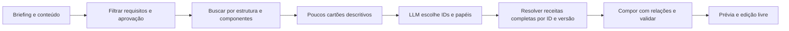

# Ensaio de representações para seleção e recombinação

Experimento offline autorizado para verificar três hipóteses: diminuir o contexto da LLM, buscar designs semelhantes e produzir derivações com relações preservadas. Não há integração ao gerador nesta etapa.

## Executar

Na raiz do repositório:

```bash
node --import tsx harness/designRepresentation/run.ts
pnpm exec tsc --noEmit -p harness/designRepresentation/tsconfig.json
```

A execução lê a coleção `family-library-2026-10-01T02-59-27-361Z`, cria uma pasta datada em `artifacts/design-recreation/representation-pilot-*` e recusa sobrescrever saídas. É possível definir `POSTSPARK_REPRESENTATION_OUTPUT` para um diretório novo. Bibliotecas/fontes/mídia locais; nenhuma chamada de IA, rede ou banco. O renderer nativo bloqueia `fetch`.

## Representações

| Camada | Uso | Limite |
| --- | --- | --- |
| Receita JSON com hash | Parâmetros completos e reprodução | Continua autoritativa; índice derivado não a substitui |
| Cartão descritivo | LLM recebe poucos candidatos e escolhe IDs | Sem avaliação de acurácia de um modelo neste ensaio |
| Vetor estrutural de 48 características | Comparar ocupação, posições, hierarquia e mídia | Heurística normalizada com pesos explícitos; sem treinamento |
| Sete características de estilo + nomes de fontes | Cor, peso e família tipográfica | Distância RGB e comparação nominal simples |
| Matrizes variáveis N×14 por grupo | Tipo e geometria local dos membros | Matrizes são tensores de ordem 2; organizar números não aprende compatibilidade |
| Arestas de grupo/campo/mídia | Preservar vínculos já declarados | Não inventam automaticamente regras de crescimento |
| Relações do compositor | Centralização, quebra por palavras, padding e fluxo vertical | Escritas manualmente para os três componentes do piloto |

O número de dimensões é definido pelas características úteis; não depende de ser menor que a quantidade de objetos do JSON. Vetores e matrizes permanecem no código de busca; enviar números sem significado à LLM não é o propósito.

O índice exclui fotografia pura e catálogo tipográfico, e seleciona uma variante por design (5:6 nas famílias nativas). Mantém o estado de aprovação original. As 43 candidatas do experimento não são 43 modelos publicados/aprovados.

## Busca e composição

`descriptors.ts` calcula as características deterministicamente. O título é aproximado pelas maiores fontes, e a grade 4×4 mede cobertura das caixas rotacionadas, sem examinar pixels, oclusão ou textura. O estilo é opcional: 0% ou 20% na galeria. Características, pesos e versões acompanham os resultados.

A busca de componentes usa distância simétrica entre linhas mais próximas, com penalidade de quantidade. Não é correspondência um a um; pode aproximar uma citação emoldurada de uma janela. Fontes, paletas e papéis semânticos precisam de critérios adicionais. Não confundir distância pequena com compatibilidade, utilidade para um briefing ou beleza.

Para as nove derivações, o motor de `designCombinations/engine.ts` conserva as relações dos três componentes conhecidos. A busca sugere uma tipografia entre as famílias nativas. Somente família, peso e espaçamento são transferidos; a composição inteira do doador não é transplantada. Candidatos que violam encaixe são registrados e rejeitados, com fallback para a tipografia original. Essa procura é uma heurística demonstrativa, não uma prova de que proximidade geométrica escolhe a melhor fonte.

O compositor foi extraído de `designCombinations/run.ts`, que preserva a interface e a saída histórica por padrão. Para repetir o piloto antigo sem sobrescrever a galeria aprovada, definir `POSTSPARK_COMBINATION_OUTPUT` para uma pasta temporária. A extração é conferida pelos hashes de nove PNGs aprovados.

## Evidência e limitações

- `sizes.json`: bytes UTF-8 de JSON minificado, incluindo comparação sem fotos/fontes; **não são tokens**.
- `index-descriptors.json`: eixos, pesos, vetores, matrizes, arestas e hashes dos originais.
- `retrieval.json` / `component-retrieval.json`: candidatos, distâncias e grupos comparados.
- `llm-shortlist-example.json`: exemplo de cinco cartões; nenhuma chamada à LLM.
- `traces/`: briefing, doadores, rejeições, fallback, relações, medições, contraste, colisões, duração e hashes.
- `checks.json`: invariâncias, sensibilidade, regressão visual por hash, preservação das fontes e roundtrip.
- `index.html` / PNGs: comparação visual. Galeria para abertura manual; automação `file:` bloqueada pela política da ferramenta, sem contorno.

As receitas exportadas são instantâneos V3 importáveis. O Admin2 ainda não executa as relações flexíveis do harness. Não se mede desempenho no Stage React/IndexedDB. Novas combinações precisam de revisão humana. Critérios de geometria e contraste não detectam toda quebra pouco elegante ou toda perda de intenção visual.

## Arquitetura recomendada após o ensaio

**Atualização de planejamento — 2026-10-01:** a próxima entrega passa a seguir [`docs/plano-arsenal-pgvector-thevoid.md`](../../docs/plano-arsenal-pgvector-thevoid.md), com persistência do índice em pgvector e busca exata L1 ponderada. O uso de HNSW continua condicionado a medidas. Esta é uma decisão para implementação posterior; o harness abaixo permanece offline. Para autoria de novas receitas, consultar o [tutorial](../../docs/tutorial-curadoria-json-designs.md).



Resumo resolve contexto; índice ajuda a procurar; relações tornam a recombinação controlável. Antes de ativar seleção automática, rotular pares de designs semelhantes/diferentes e preferências entre variantes, avaliar acerto da shortlist, explicitar requisitos por componente e melhorar quebras de texto. Tensor aprendido e embedding visual continuam dependentes de evidência de benefício. A persistência/busca em pgvector foi incluída no plano posterior para apoiar o crescimento do catálogo, preservando a métrica do ensaio.

## Continuação: quando uma composição funciona

```bash
node --import tsx harness/designRepresentation/qualityRun.ts
```

Gera uma pasta nova `quality-pilot-*`; `POSTSPARK_QUALITY_OUTPUT` permite escolher outra pasta inexistente. Usa os nove casos da rodada de representação para medir condições concretas e produzir alternativas. Não amplia a aprovação humana para as novas saídas.

- `quality.ts`: preservação do conteúdo, medidas reais do texto, caixas rotacionadas, colisões entre textos, contraste do título em superfície conhecida, conectivos isolados, tamanho do texto principal e exposição da região marcada da mídia.
- `designCombinations/textFlow.ts`: quebra por programação dinâmica, com penalidade para palavras de ligação isoladas e linhas muito desequilibradas. Mede com o renderer existente, sem alterar a frase. O motor aceita, opcionalmente, largura de 490 até 550 px; as superfícies crescem junto. Comportamento padrão anterior preservado.
- `featuredMedia.ts`: alternativa de duas áreas com a proporção da foto preservada e escala uniforme do componente de texto. Sem recorte de pessoas, remoção de fundo ou inpainting.
- `qualityRun.ts`: explora fonte preferida/original do componente, duas larguras e duas divisões de mídia. Seleção por prioridades explícitas: falhas técnicas, requisitos de mídia, alertas restantes, preservação da fonte e quantidade de linhas. Não produz nota estética.
- `qualityGallery.ts`: compara antes/depois e permite registrar preferência, clareza da mensagem e disposição de usar a adaptação. Guarda escolhas em `localStorage` e exporta JSON; não envia dados nem publica no catálogo. Formulário inspecionado estaticamente, sem execução automatizada no navegador.

O produto da foto foi marcado manualmente no asset SHA-256 `0bbc…048`. A exposição é uma aproximação de 40×40 amostras, incluindo corte `cover` e opacidade das camadas; caixas de texto contam conservadoramente como cobertura. Os critérios de 80% de exposição, 20% de área de mídia, contraste de título 4,5 e corpo principal de 16 px são políticas explícitas deste ensaio, não garantias universais. A imagem, formato ou intenção diferentes exigem nova avaliação.

Cada `evidence/*.json` liga receita, PNG e briefing por hash, mais parâmetros observados, vetor/matrizes, tentativas, decisão e avaliações pendentes. Não infere intervalo de validade a partir de poucos exemplos, não cria um `maxlength` para o editor e não transforma aprovação de um exemplar em aprovação de todos os vizinhos. Uso real/resultado com público permanecem não medidos.

`approved-examples.json` registra separadamente os 27 exemplares que o proprietário já aprovou na conversa, com hashes conferidos contra os relatórios históricos, receita referenciada, descritores e escopo exato. Data de aprovação não conhecida fica nula. Os JSONs `postspark.design-evidence` e `postspark.design-quality.feedback` são evidências/avaliações; **somente arquivos em `recipes/` são importáveis como receitas no Admin2**.
